<h1>
IF2150 REKAYASA PERANGKAT LUNAK
 
TUGAS 7
 
DESKRIPSI PERANCANGAN PERANGKAT LUNAK (DPPL)
</h1>
 

## *SeaGuard*

### Untuk: *Aurelia Jennifer Gunawan*

Dipersiapkan oleh:
| Informasi | Keterangan |
| --- | --- |
| Kelas | *K02* |
| Kelompok | *G01*  |

| NIM | Nama |
|---|---|
| *13525104* | *Jeremy Gerald Sutanto* |
| *13525116* | *Christian Immanuel* |
| *13525014* | *Denzel Santoso* |
| *13525011* | *Raihan* |
| *13525125* | *Peter Emmanuel Suwardy* |
---

## Daftar Perubahan

| Revisi | Deskripsi |
| :--- | :--- |
|  |  |

---

# BAB 1: Pendahuluan

## 1.1 Tujuan Penulisan Dokumen
Dokumen Deskripsi Perancangan Perangkat Lunak (DPPL) ini bertujuan menjelaskan rancangan perangkat lunak SeaGuard berdasarkan kebutuhan pada dokumen SKPL dan arsitektur pada dokumen APL. Dokumen ini berisi rancangan lingkungan implementasi, arsitektur, realisasi setiap use case dalam bentuk sequence diagram dan diagram kelas, serta matriks kerunutan kelas terhadap use case. Dokumen ini digunakan oleh tim pengembang sebagai acuan saat implementasi dan pengujian, serta oleh asisten sebagai bahan evaluasi rancangan.

## 1.2 Lingkup Masalah
SeaGuard merupakan aplikasi berbasis web bagi Relawan untuk memantau, melaporkan, dan membersihkan titik pencemaran sampah di wilayah perairan Indonesia. Relawan melaporkan titik pencemaran beserta foto bukti, melihat persebaran pencemaran melalui heatmap, mengklaim titik untuk dibersihkan, lalu melaporkan hasil pembersihan. Laporan dan hasil pembersihan diverifikasi oleh Verifikator/Admin, dan setiap kontribusi yang disetujui menambah skor Relawan pada leaderboard.

## 1.3 Definisi, Istilah, dan Singkatan

Tabel 1.3. Definisi Istilah dan Singkatan

| Singkatan, Akronim, atau Istilah | Penjelasan |
| :--- | :--- |
| *P/L* | *Singkatan dari Perangkat Lunak, yaitu aplikasi yang memberikan perintah kepada komputer untuk menjalankan tugas tertentu.* |
| *DPPL* | *Singkatan dari Deskripsi Perancangan Perangkat Lunak, yaitu dokumen yang menjelaskan rancangan perangkat lunak yang akan diimplementasikan.* |
| *SKPL* | *Singkatan dari Spesifikasi Kebutuhan Perangkat Lunak, yaitu dokumen yang merangkum kebutuhan perangkat lunak.* |
| *APL* | *Singkatan dari Arsitektur Perangkat Lunak, yaitu dokumen yang menjelaskan style/pattern, komponen, dan model arsitektur perangkat lunak.* |
| *MVC* | *Model-View-Controller, yaitu pola arsitektur yang memisahkan data (Model), tampilan (View), dan pengendali alur proses (Controller).* |
| *UC* | *Singkatan dari Use Case.* |
| *Sequence Diagram* | *Diagram UML yang menggambarkan urutan pesan antarobjek untuk menjalankan satu skenario use case.* |

## 1.4 Aturan Penomoran

Tabel 1.4. Aturan Penomoran

| Hal/Bagian | Penomoran | Keterangan |
| :--- | :--- | :--- |
| *Kebutuhan Fungsional* | *KFXX* | Diawali "KF" diikuti dengan dua digit yang terurut dari KF01 hingga KF21, sesuai SKPL. |
| *Kebutuhan Non-Fungsional* | *KNFXX* | Diawali "KNF" diikuti dengan dua digit yang terurut dari KNF01 hingga KNF12, sesuai SKPL. |
| *Use Case* | *UCXX* | Diawali "UC" diikuti dengan dua digit yang terurut dari UC01 hingga UC08, sesuai SKPL. |
| *Kelas* | *CXX* | Diawali "C" diikuti dengan dua digit. C01 hingga C10 adalah kelas analisis pada SKPL, sedangkan C11 hingga C26 adalah kelas perancangan tambahan (View, Controller, dan komponen pendukung dari APL). |

## 1.5 Referensi
Dokumentasi yang dirujuk dalam penyusunan dokumen DPPL ini meliputi:
1. Kelompok G01 K02. (2026). *Spesifikasi Kebutuhan Perangkat Lunak (SKPL) SeaGuard*. IF2150 Rekayasa Perangkat Lunak.
2. Kelompok G01 K02. (2026). *Arsitektur Perangkat Lunak (APL) SeaGuard*. IF2150 Rekayasa Perangkat Lunak.
3. Sommerville, I. (2016). *Software Engineering* (10th ed.). Pearson.

## 1.6 Deskripsi Umum Dokumen (Ikhtisar)
Dokumen ini terdiri atas lima bab. BAB 1 berisi pendahuluan, BAB 2 berisi perancangan arsitektur yang mencakup lingkungan implementasi, pola MVC, komponen, dan logical view, BAB 3 berisi realisasi setiap use case melalui identifikasi kelas, sequence diagram, dan diagram kelas, BAB 4 berisi diagram kelas perancangan keseluruhan beserta daftar atribut dan metodenya, dan BAB 5 berisi matriks kerunutan kelas terhadap use case.

 

---

# BAB 2: Perancangan Arsitektur

## 2.1 Rancangan Lingkungan Implementasi

| Aspek | Rancangan |
| :--- | :--- |
| *Arsitektur Sistem* | *Client-Server terdistribusi secara daring (Web-based Application).* |
| *Server (Backend)* | *Node.js v20 LTS (atau ekivalen) yang dapat menangani koneksi secara real-time untuk notifikasi.* |
| *Sistem Operasi Server* | *Linux (contoh: Ubuntu 22.04 LTS) atau lingkungan berbasis container (Docker) pada layanan komputasi Cloud.* |
| *Client (Frontend)* | *Web Browser modern yang memiliki dukungan penuh terhadap HTML5, Geolocation API, dan WebGL (contoh: Google Chrome v100+, Mozilla Firefox v100+, Safari v15+, atau Microsoft Edge terbaru).* |
| *Sistem Operasi Client* | *Cross-platform (Windows, macOS, Linux, Android, iOS) selama sistem operasi tersebut mendukung web browser modern yang disyaratkan.* |
| *Bahasa Pemrograman* | *JavaScript (Node.js v20) di sisi server serta HTML, CSS, dan JavaScript di sisi client.* |
| *DBMS (Database)* | *PostgreSQL v15 (atau terbaru) dilengkapi dengan ekstensi **PostGIS** yang krusial untuk menyimpan koordinat, menghitung tingkat kepanasan heatmap, dan melakukan validasi foto.* |
| *Filing System* | *Layanan Cloud Object Storage (contoh: AWS S3, Google Cloud Storage) untuk penyimpanan dan distribusi berkas foto bukti berukuran hingga 5 MB secara terenkripsi.* |
| *Jaringan Client* | *Koneksi internet yang stabil (minimal 3G/4G/LTE untuk perangkat seluler) untuk pengiriman data formulir, unduh/unggah foto bukti, dan pemuatan layer heatmap peta.* |
| *Development Tools* | *Visual Studio Code, Git dan GitHub, draw.io dan StarUML untuk pemodelan.* |

## 2.2 Style/Pattern Arsitektur Acuan

### Style/Pattern yang Dipilih

SeaGuard menggunakan pola MVC (Model-View-Controller) yang diterapkan di atas arsitektur client-server berbasis web. Peran setiap bagiannya adalah sebagai berikut.

1. **Model** merepresentasikan data SeaGuard beserta operasi yang melekat pada data tersebut. Setiap model berasal dari kelas pada diagram kelas SKPL (C01 sampai C10), misalnya *LaporanPencemaran*, *KlaimTitikPencemaran*, dan *AkunRelawan*. *Model* bertugas menyimpan dan mengambil data dari basis data serta menjalankan operasi milik kelasnya, misalnya validasiFormatUkuran() pada *BuktiLaporan* dan validasiGeofencingRadius() pada *BuktiPembersihan*.
2. **View** adalah halaman antarmuka yang dilihat pengguna melalui web browser, seperti form pelaporan, peta heatmap, dashboard verifikasi, dan leaderboard. *View* hanya menampilkan data dan meneruskan aksi pengguna ke *Controller*. *View* tidak mengakses *Model* secara langsung.
3. **Controller** menerima permintaan dari *View*, menjalankan alur proses setiap use case (misalnya klaim titik pencemaran atau verifikasi laporan), memanggil *Model* yang dibutuhkan, lalu mengembalikan hasilnya ke *View*.

### Alasan Pemilihan

Pola MVC dipilih berdasarkan karakteristik SeaGuard berikut.

1. **Jenis pengguna.** SeaGuard memiliki dua aktor, yaitu Relawan dan Verifikator/Admin, yang memakai data yang sama tetapi dengan tampilan berbeda. Dengan MVC, satu *Model* dapat dipakai oleh beberapa *View*. Contohnya, data *LaporanPencemaran* ditampilkan pada *HeatmapView* untuk Relawan dan pada *DashboardVerifikasiView* untuk Verifikator.
2. **Alur proses bisnis.** Alur SeaGuard berupa rangkaian perubahan status, yaitu laporan masuk, laporan diverifikasi, titik diklaim, hasil pembersihan dilaporkan, hasil pembersihan diverifikasi, lalu skor diberikan, sebagaimana digambarkan pada activity diagram SKPL (Gambar 1 SKPL). Aturan perubahan status ini ditempatkan pada *Controller* dan *Model* sehingga tidak tersebar di halaman antarmuka.
3. **Kebutuhan fungsional.** KF pada SKPL terbagi menjadi kebutuhan tampilan (misalnya KF01, KF06, KF09, KF15, dan KF18), kebutuhan pemrosesan (misalnya KF03, KF08, KF12, KF14, dan KF19), dan kebutuhan penyimpanan data (misalnya KF17 dan KF21). Pembagian ini sesuai dengan pemisahan *View*, *Controller*, dan *Model*.
4. **Kebutuhan non-fungsional.** Beberapa KNF lebih mudah dijamin apabila logika dipisahkan dari tampilan. Mekanisme *locking* klaim (KNF05), validasi *geofencing* (KNF06), dan log audit yang *immutable* (KNF07) dijalankan oleh *Controller* dan *Model* di sisi server sehingga tidak bergantung pada *View* di browser pengguna.

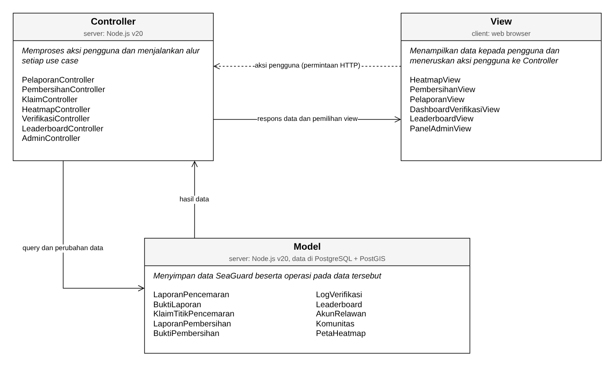

<i>Gambar 1. Arsitektur MVC pada SeaGuard</i>

## 2.3 Identifikasi Komponen / Modul / Subsistem

Komponen SeaGuard dikelompokkan berdasarkan lapisan MVC, ditambah komponen *Pendukung*, *Integrasi Eksternal*, dan *Penyimpanan Data*.

Tabel 2.3. Identifikasi Komponen/Modul/Subsistem

| Nama Komponen/Modul/Subsistem | Jenis                 | Penjelasan                                                                                                           |
| :---------------------------- | :-------------------- | :------------------------------------------------------------------------------------------------------------------- |
| *HeatmapView* | *View* | *Menampilkan peta heatmap persebaran pencemaran beserta kategori (sehat, waspada, berbahaya), filter, pencarian lokasi, dan detail titik pencemaran (UC02). Halaman ini juga menyediakan tombol klaim titik pencemaran (UC04).* |
| *PembersihanView* | *View* | *Menampilkan form laporan pembersihan berisi foto sebelum, foto sesudah, dan deskripsi kegiatan (UC05).* |
| *PelaporanView* | *View* | *Menampilkan form laporan pencemaran berisi unggah foto, indikator tingkat pencemaran, dan koordinat lokasi, beserta dialog persetujuan akses lokasi dan kamera (UC01).* |
| *DashboardVerifikasiView* | *View* | *Menampilkan antrean laporan pencemaran dan daftar pengajuan pembersihan, detail laporan, perbandingan foto before-after, serta tombol setujui/tolak bagi Verifikator (UC03, UC06).* |
| *LeaderboardView* | *View* | *Menampilkan papan peringkat beserta total poin kontribusi Relawan (UC07).* |
| *PanelAdminView* | *View* | *Menampilkan daftar akun, komunitas, dan hak akses beserta form perubahan data bagi Admin (UC08).* |
| *HeatmapController* | *Controller* | *Mengambil laporan terverifikasi, menghitung heat intensity tiap klaster titik, serta memproses filter kategori dan pencarian lokasi.* |
| *KlaimController* | *Controller* | *Memproses klaim titik pencemaran dengan mekanisme locking agar satu titik hanya dapat diklaim oleh satu Relawan.* |
| *PembersihanController* | *Controller* | *Memproses laporan pembersihan, yaitu memvalidasi geofencing foto terhadap titik klaim, mengunggah foto melalui StorageAdapter, lalu mengubah status klaim menjadi "Menunggu Verifikasi".* |
| *PelaporanController* | *Controller* | *Memproses laporan pencemaran baru, yaitu memvalidasi format dan ukuran foto, mengekstrak metadata EXIF, mengunggah foto melalui StorageAdapter, lalu menyimpan laporan.* |
| *VerifikasiController* | *Controller* | *Memproses keputusan Verifikator atas laporan pencemaran dan laporan pembersihan, mencatat log audit, menambah poin Relawan dan memperbarui leaderboard ketika pembersihan disetujui, serta meminta Notifikasi mengirim pemberitahuan ke Relawan.* |
| *LeaderboardController* | *Controller* | *Mengambil daftar peringkat dan posisi Relawan untuk ditampilkan pada LeaderboardView.* |
| *AdminController* | *Controller* | *Memproses perubahan peran, penangguhan akun, dan pembaruan data komunitas.* |
| *PetaHeatmap* | *Model* | *Merepresentasikan klaster titik pencemaran beserta heat intensity dan kategori kualitas perairannya (C10).* |
| *KlaimTitikPencemaran* | *Model* | *Merepresentasikan data klaim titik pencemaran oleh Relawan serta metode untuk mengunci dan membatalkan klaim (C03).* |
| *BuktiLaporan* | *Model* | *Merepresentasikan foto bukti laporan pencemaran beserta metadata EXIF serta metode untuk memvalidasi format dan ukuran berkas (C02).* |
| *LaporanPencemaran* | *Model* | *Merepresentasikan data laporan pencemaran (koordinat, indikator tingkat, dan status) serta metode untuk membuat, mengambil, dan mengubah status laporan (C01).* |
| *BuktiPembersihan* | *Model* | *Merepresentasikan foto before-after beserta koordinat GPS-nya serta metode untuk memvalidasi radius geofencing (C05).* |
| *LaporanPembersihan* | *Model* | *Merepresentasikan data laporan hasil pembersihan beserta status verifikasinya (C04).* |
| *LogVerifikasi* | *Model* | *Merepresentasikan catatan audit setiap tindakan verifikasi, yaitu ID Verifikator, keputusan, dan stempel waktu (C06).* |
| *AkunRelawan* | *Model* | *Merepresentasikan data akun pengguna (profil, peran, status akun, dan total poin) serta metode untuk mengakses dan mengubahnya (C08).* |
| *Leaderboard* | *Model* | *Merepresentasikan urutan peringkat Relawan serta metode untuk menghitung ulang peringkat (C07).* |
| *Komunitas* | *Model* | *Merepresentasikan data komunitas yang dikelola oleh Admin (C09).* |
| *Notifikasi* | *Pendukung* | *Mengirim notifikasi in-app secara real-time kepada Relawan ketika status laporan atau pembersihannya diperbarui oleh Verifikator.* |
| *Autentikasi* | *Pendukung* | *Memeriksa sesi login dan peran pengguna (Relawan atau Verifikator/Admin) sebelum controller memproses permintaan, termasuk mengunci akun sementara setelah 5 kali gagal login (KNF09).* |
| *StorageAdapter* | *Integrasi Eksternal* | *Mengunggah berkas foto bukti ke layanan Cloud Object Storage dan mengembalikan URL foto untuk disimpan pada Model.* |
| *Database* | *Penyimpanan Data* | *Menyimpan seluruh data Model secara persisten pada PostgreSQL dengan ekstensi PostGIS.* |

Keterangan:
1. Seluruh kelas pada diagram kelas SKPL (C01 sampai C10) tercakup sebagai komponen *Model* dengan nama yang sama.
2. Seluruh use case dapat dijalankan oleh pasangan *View* dan *Controller* berikut: UC01 oleh *PelaporanView* dan *PelaporanController*, UC02 oleh *HeatmapView* dan *HeatmapController*, UC03 dan UC06 oleh *DashboardVerifikasiView* dan *VerifikasiController*, UC04 oleh *HeatmapView* dan *KlaimController*, UC05 oleh *PembersihanView* dan *PembersihanController*, UC07 oleh *LeaderboardView* dan *LeaderboardController*, serta UC08 oleh *PanelAdminView* dan *AdminController*.
3. Sistem di luar P/L yang disebutkan pada subbab 2.2 SKPL, yaitu Geolocation API pada browser, layanan peta pihak ketiga, dan Cloud Object Storage, tidak dimasukkan ke tabel ini. Geolocation API dan layanan peta dipakai langsung oleh *View* di browser, sedangkan Cloud Object Storage diakses dari server melalui *StorageAdapter*.

## 2.4 Model Arsitektur Perangkat Lunak

### 2.4.1 Logical View

*Logical View* dipilih karena *view* ini dapat memperlihatkan seluruh komponen pada Tabel 2.3 beserta hubungan antarkomponennya dalam pembagian *View*, *Controller*, dan *Model*. Dengan *view* ini, alur setiap use case dapat ditelusuri mulai dari halaman yang dibuka pengguna sampai data yang disimpan. Lingkungan fisik SeaGuard (server, browser, basis data, dan penyimpanan berkas) sudah dijelaskan pada subbab 2.1, sehingga kelompok cukup membuat satu *view*.

<i>Gambar 2. Logical View SeaGuard</i>

Gambar 2 menggambarkan seluruh komponen pada Tabel 2.3 yang dikelompokkan sesuai pola MVC, ditambah komponen *Pendukung*, *Integrasi Eksternal*, dan *Database*. Sistem di luar P/L, yaitu Layanan Peta Pihak Ketiga, Geolocation API (browser), dan Cloud Object Storage, digambarkan dengan garis putus-putus. Arti setiap label garis adalah sebagai berikut.

1. **Memanggil**: *View* memanggil *Controller* ketika pengguna melakukan aksi pada halaman.
2. **akses**: *Controller* mengakses *Model* yang dibutuhkan use case. *BuktiLaporan* dan *BuktiPembersihan* diakses melalui *Model* induknya, yaitu *LaporanPencemaran* dan *LaporanPembersihan*.
3. **komposisi** dan **agregasi**: hubungan antar-*Model* yang mengikuti diagram kelas keseluruhan pada SKPL (Gambar 11 SKPL).
4. **menyimpan data**: seluruh *Model* menyimpan data ke *Database*.
5. **cek sesi dan peran** dan **akses data akun**: setiap *Controller* memeriksa sesi dan peran pengguna melalui *Autentikasi*, yang membaca data dari *AkunRelawan*.
6. **kirim notifikasi** dan **notifikasi in-app ke Relawan**: *VerifikasiController* meminta *Notifikasi* mengirim pemberitahuan ke halaman Relawan setelah verifikasi.
7. **unggah foto bukti** dan **simpan berkas foto**: *PelaporanController* dan *PembersihanController* mengunggah foto melalui *StorageAdapter* ke Cloud Object Storage.
8. **memuat peta dasar** dan **ambil koordinat GPS**: *HeatmapView* memuat peta dasar dari layanan peta pihak ketiga, sedangkan *PelaporanView* dan *PembersihanView* mengambil koordinat GPS dari Geolocation API pada browser.

 

---

# BAB 3: Realisasi Use Case

## 3.1 Use Case Melaporkan Titik Pencemaran

**ID Use Case:** *UC01*  
**Nama Use Case:** *Melaporkan Titik Pencemaran*

### 3.1.1 Identifikasi Kelas

Tabel 3.1. Identifikasi Kelas Use Case UC01

| No | Nama Kelas Perancangan | Nama Kelas Analisis Terkait |
|:--- | :--- | :--- |
| 1 | *PelaporanView (C11)* | *-* |
| 2 | *PelaporanController (C17)* | *-* |
| 3 | *LaporanPencemaran (C01)* | *LaporanPencemaran (C01)* |
| 4 | *BuktiLaporan (C02)* | *BuktiLaporan (C02)* |
| 5 | *AkunRelawan (C08)* | *AkunRelawan (C08)* |
| 6 | *Autentikasi (C25)* | *-* |
| 7 | *StorageAdapter (C26)* | *-* |

### 3.1.2 Sequence Diagram

- **Skenario Normal**

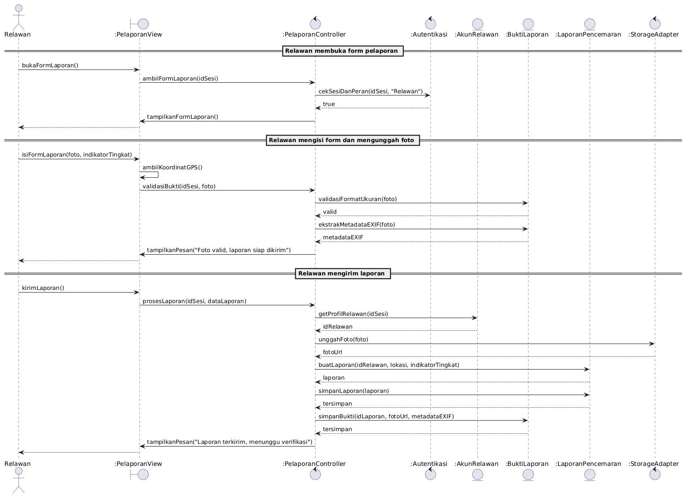

<i>Gambar 3. Sequence Diagram UC01</i>

- **Skenario Alternatif 1: Format Atau Ukuran Foto Tidak Valid**

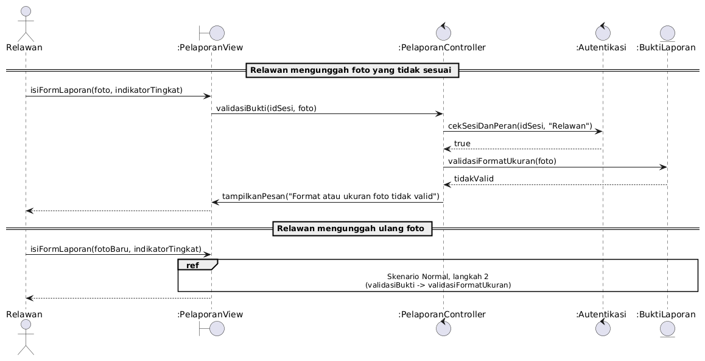

<i>Gambar 4. Sequence Diagram UC01 - Format Atau Ukuran Foto Tidak Valid</i>

### 3.1.3 Diagram Kelas

<i>Gambar 5. Diagram Kelas UC01</i>

## 3.2 Use Case Melihat Data dan Heatmap Pencemaran

**ID Use Case:** *UC02*  
**Nama Use Case:** *Melihat Data dan Heatmap Pencemaran*

### 3.2.1 Identifikasi Kelas

Tabel 3.2. Identifikasi Kelas Use Case UC02

| No | Nama Kelas Perancangan | Nama Kelas Analisis Terkait |
|:--- | :--- | :--- |
| 1 | *HeatmapView (C12)* | *-* |
| 2 | *HeatmapController (C18)* | *-* |
| 3 | *LaporanPencemaran (C01)* | *LaporanPencemaran (C01)* |
| 4 | *PetaHeatmap (C10)* | *PetaHeatmap (C10)* |
| 5 | *Autentikasi (C25)* | *-* |

### 3.2.2 Sequence Diagram

- **Skenario Normal**

<i>Gambar 6. Sequence Diagram UC02</i>

- **Skenario Alternatif 1: Lokasi Tidak Ditemukan**

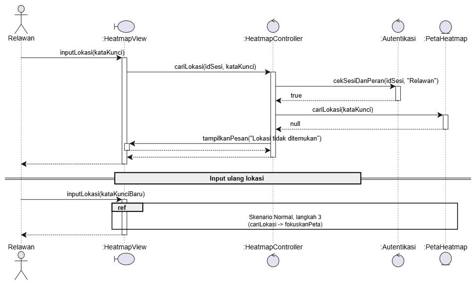

<i>Gambar 7. Sequence Diagram UC02 - Lokasi Tidak Ditemukan</i>

- **Skenario Alternatif 2: Hasil Filter Kosong**

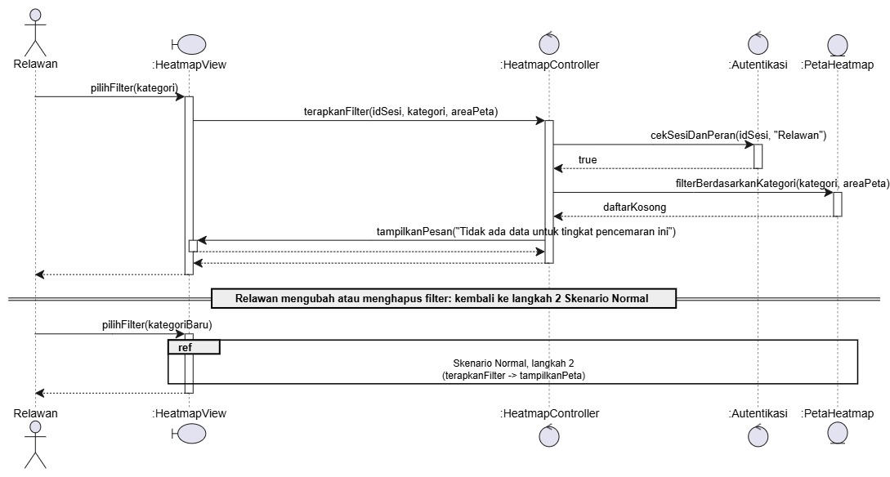

<i>Gambar 8. Sequence Diagram UC02 - Hasil Filter Kosong</i>

### 3.2.3 Diagram Kelas

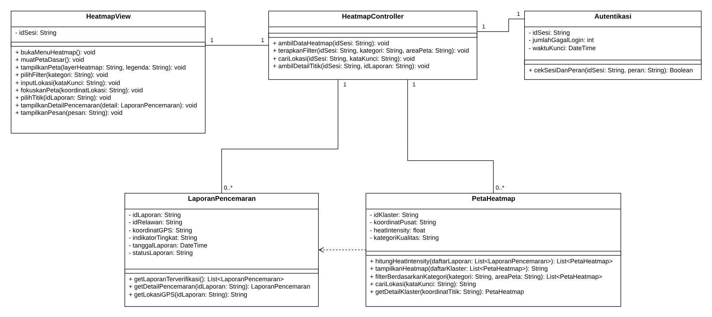

<i>Gambar 9. Diagram Kelas UC02</i>

## 3.3 Use Case Memverifikasi Laporan Pencemaran

**ID Use Case:** *UC03*  
**Nama Use Case:** *Memverifikasi Laporan Pencemaran*

### 3.3.1 Identifikasi Kelas

Tabel 3.3. Identifikasi Kelas Use Case UC03

| No | Nama Kelas Perancangan | Nama Kelas Analisis Terkait |
|:--- | :--- | :--- |
| 1 | *DashboardVerifikasiView (C13)* | *-* |
| 2 | *VerifikasiController (C19)* | *-* |
| 3 | *LaporanPencemaran (C01)* | *LaporanPencemaran (C01)* |
| 4 | *BuktiLaporan (C02)* | *BuktiLaporan (C02)* |
| 5 | *LogVerifikasi (C06)* | *LogVerifikasi (C06)* |
| 6 | *AkunRelawan (C08)* | *AkunRelawan (C08)* |
| 7 | *Notifikasi (C24)* | *-* |
| 8 | *Autentikasi (C25)* | *-* |

### 3.3.2 Sequence Diagram

- **Skenario Normal**

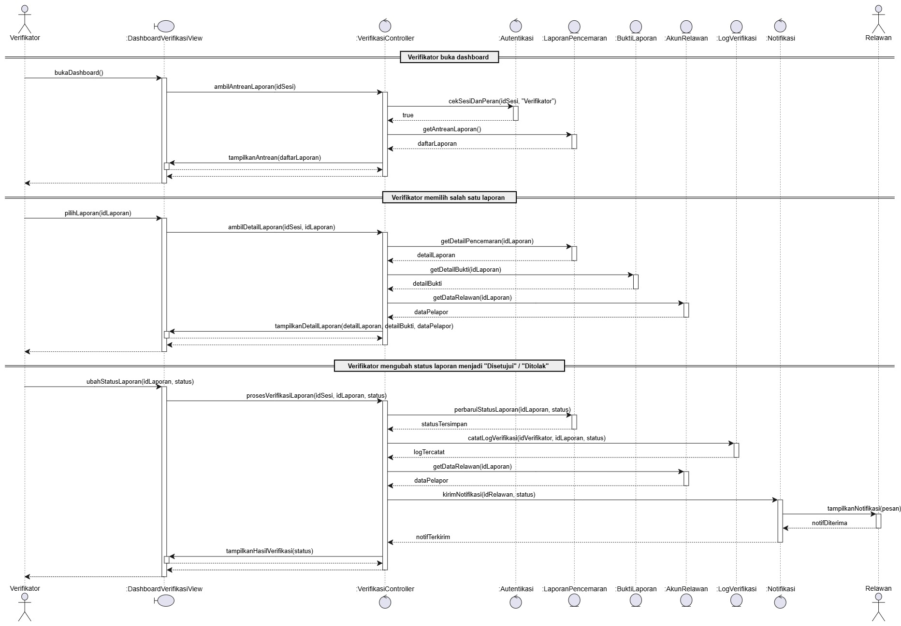

<i>Gambar 10. Sequence Diagram UC03</i>

### 3.3.3 Diagram Kelas

<i>Gambar 11. Diagram Kelas UC03</i>

## 3.4 Use Case Mengklaim Titik Pencemaran

**ID Use Case:** *UC04*  
**Nama Use Case:** *Mengklaim Titik Pencemaran*

### 3.4.1 Identifikasi Kelas

Tabel 3.4. Identifikasi Kelas Use Case UC04

| No | Nama Kelas Perancangan | Nama Kelas Analisis Terkait |
|:--- | :--- | :--- |
| 1 | *HeatmapView (C12)* | *-* |
| 2 | *KlaimController (C20)* | *-* |
| 3 | *LaporanPencemaran (C01)* | *LaporanPencemaran (C01)* |
| 4 | *KlaimTitikPencemaran (C03)* | *KlaimTitikPencemaran (C03)* |
| 5 | *AkunRelawan (C08)* | *AkunRelawan (C08)* |
| 6 | *Autentikasi (C25)* | *-* |

### 3.4.2 Sequence Diagram

- **Skenario Normal**

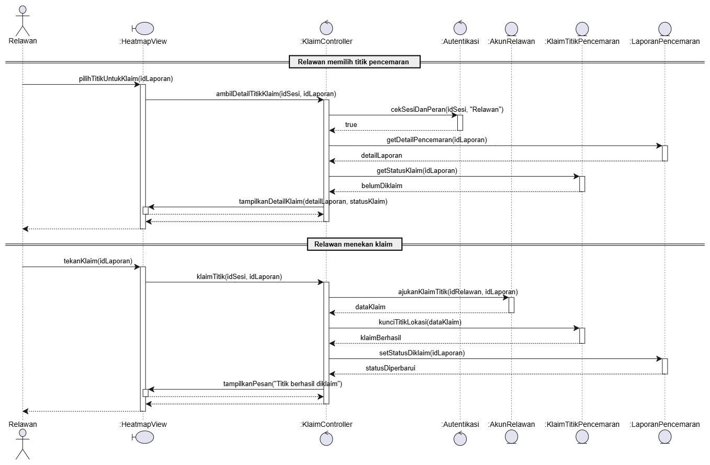

<i>Gambar 12. Sequence Diagram UC04</i>

- **Skenario Alternatif 1: Titik Sudah Diklaim**

<i>Gambar 13. Sequence Diagram UC04 - Titik Sudah Diklaim</i>

- **Skenario Alternatif 2: Klaim Bersamaan pada Titik yang Sama**

<i>Gambar 14. Sequence Diagram UC04 - Klaim Bersamaan pada Titik yang Sama</i>

### 3.4.3 Diagram Kelas

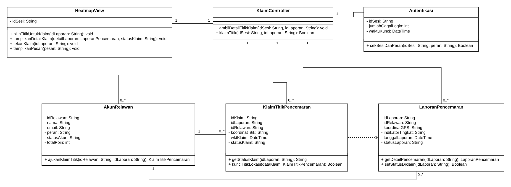

<i>Gambar 15. Diagram Kelas UC04</i>

## 3.5 Use Case Melaporkan Hasil Pembersihan

**ID Use Case:** *UC05*  
**Nama Use Case:** *Melaporkan Hasil Pembersihan*

### 3.5.1 Identifikasi Kelas

Tabel 3.5. Identifikasi Kelas Use Case UC05

| No | Nama Kelas Perancangan | Nama Kelas Analisis Terkait |
|:--- | :--- | :--- |
| 1 | *PembersihanView (C14)* | *-* |
| 2 | *PembersihanController (C21)* | *-* |
| 3 | *KlaimTitikPencemaran (C03)* | *KlaimTitikPencemaran (C03)* |
| 4 | *LaporanPembersihan (C04)* | *LaporanPembersihan (C04)* |
| 5 | *BuktiPembersihan (C05)* | *BuktiPembersihan (C05)* |
| 6 | *AkunRelawan (C08)* | *AkunRelawan (C08)* |
| 7 | *Autentikasi (C25)* | *-* |
| 8 | *StorageAdapter (C26)* | *-* |

### 3.5.2 Sequence Diagram

- **Skenario Normal**

<i>Gambar 16. Sequence Diagram UC05</i>

- **Skenario Alternatif 1: Lokasi Foto di Luar Radius Geofencing**

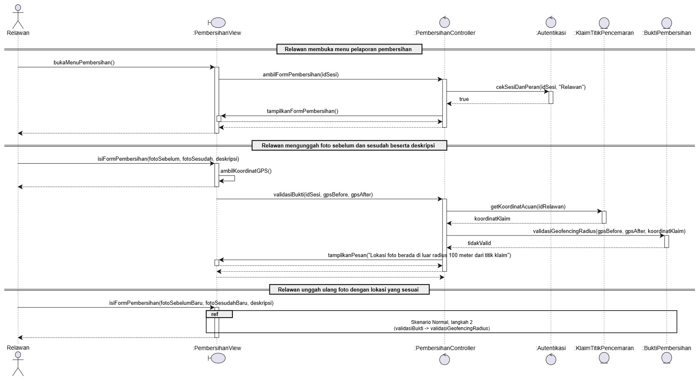

<i>Gambar 17. Sequence Diagram UC05 - Lokasi Foto di Luar Radius Geofencing</i>

### 3.5.3 Diagram Kelas

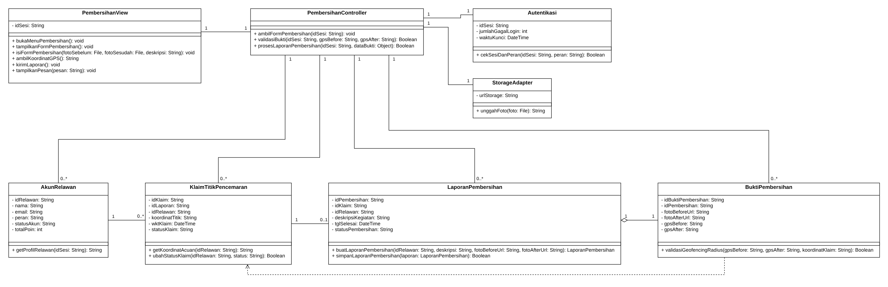

<i>Gambar 18. Diagram Kelas UC05</i>

## 3.6 Use Case Memverifikasi Hasil Pembersihan

**ID Use Case:** *UC06*  
**Nama Use Case:** *Memverifikasi Hasil Pembersihan*

### 3.6.1 Identifikasi Kelas

Tabel 3.6. Identifikasi Kelas Use Case UC06

| No | Nama Kelas Perancangan | Nama Kelas Analisis Terkait |
|:--- | :--- | :--- |
| 1 | *DashboardVerifikasiView (C13)* | *-* |
| 2 | *VerifikasiController (C19)* | *-* |
| 3 | *LaporanPembersihan (C04)* | *LaporanPembersihan (C04)* |
| 4 | *BuktiPembersihan (C05)* | *BuktiPembersihan (C05)* |
| 5 | *LogVerifikasi (C06)* | *LogVerifikasi (C06)* |
| 6 | *Leaderboard (C07)* | *Leaderboard (C07)* |
| 7 | *AkunRelawan (C08)* | *AkunRelawan (C08)* |
| 8 | *Notifikasi (C24)* | *-* |
| 9 | *Autentikasi (C25)* | *-* |

### 3.6.2 Sequence Diagram

- **Skenario Normal**

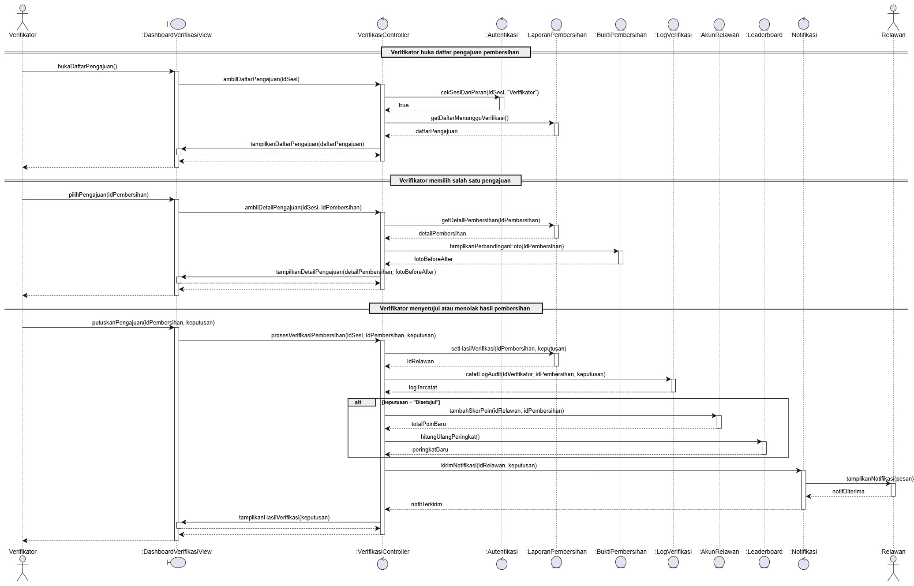

<i>Gambar 19. Sequence Diagram UC06</i>

### 3.6.3 Diagram Kelas

<i>Gambar 20. Diagram Kelas UC06</i>

## 3.7 Use Case Melihat Leaderboard

**ID Use Case:** *UC07*  
**Nama Use Case:** *Melihat Leaderboard*

### 3.7.1 Identifikasi Kelas

Tabel 3.7. Identifikasi Kelas Use Case UC07

| No | Nama Kelas Perancangan | Nama Kelas Analisis Terkait |
|:--- | :--- | :--- |
| 1 | *LeaderboardView (C15)* | *-* |
| 2 | *LeaderboardController (C22)* | *-* |
| 3 | *Leaderboard (C07)* | *Leaderboard (C07)* |
| 4 | *AkunRelawan (C08)* | *AkunRelawan (C08)* |
| 5 | *Autentikasi (C25)* | *-* |

### 3.7.2 Sequence Diagram

- **Skenario Normal**

<i>Gambar 21. Sequence Diagram UC07</i>

- **Skenario Alternatif 1: Gagal Memuat Leaderboard**

<i>Gambar 22. Sequence Diagram UC07 - Gagal Memuat Leaderboard</i>

### 3.7.3 Diagram Kelas

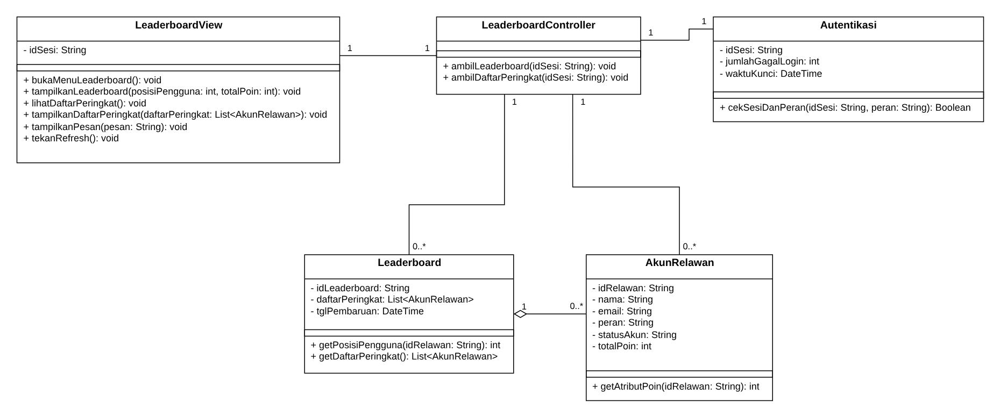

<i>Gambar 23. Diagram Kelas UC07</i>

## 3.8 Use Case Mengelola Akun Relawan dan Data Komunitas

**ID Use Case:** *UC08*  
**Nama Use Case:** *Mengelola Akun Relawan dan Data Komunitas*

### 3.8.1 Identifikasi Kelas

Tabel 3.8. Identifikasi Kelas Use Case UC08

| No | Nama Kelas Perancangan | Nama Kelas Analisis Terkait |
|:--- | :--- | :--- |
| 1 | *PanelAdminView (C16)* | *-* |
| 2 | *AdminController (C23)* | *-* |
| 3 | *AkunRelawan (C08)* | *AkunRelawan (C08)* |
| 4 | *Komunitas (C09)* | *Komunitas (C09)* |
| 5 | *Autentikasi (C25)* | *-* |

### 3.8.2 Sequence Diagram

- **Skenario Normal**

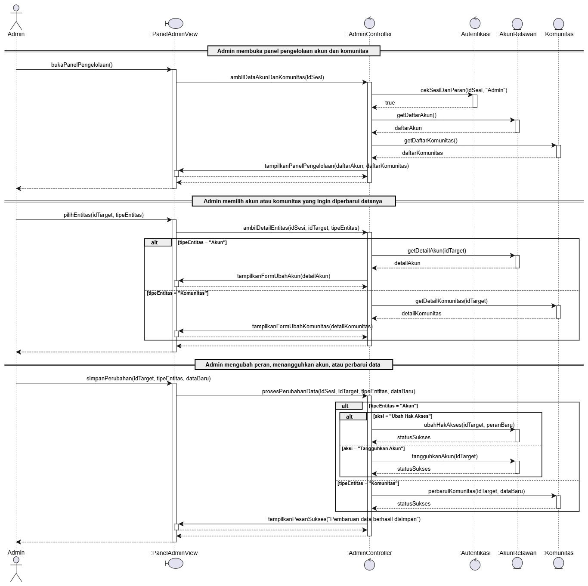

<i>Gambar 24. Sequence Diagram UC08</i>

- **Skenario Alternatif 1: Pembaruan Data Gagal**

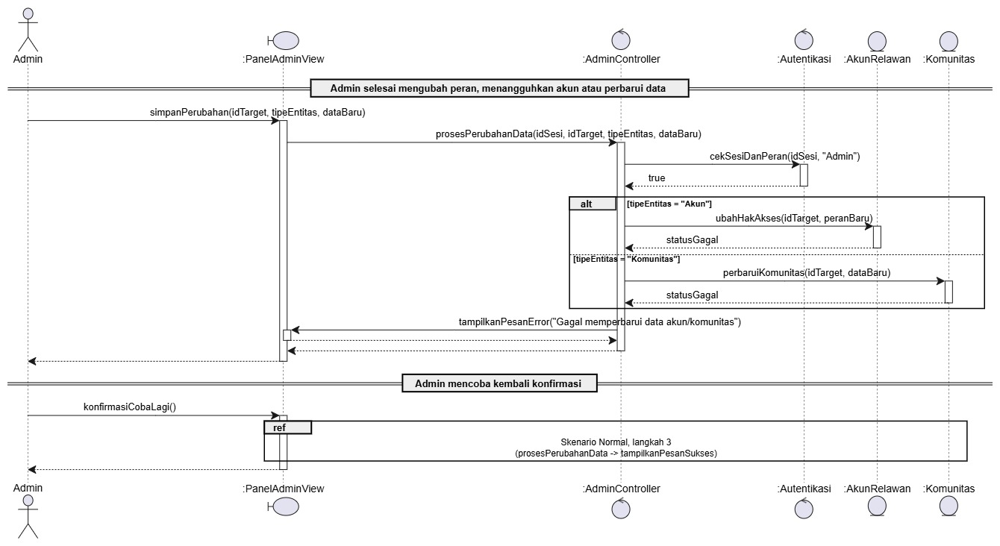

<i>Gambar 25. Sequence Diagram UC08 - Pembaruan Data Gagal</i>

### 3.8.3 Diagram Kelas

<i>Gambar 26. Diagram Kelas UC08</i>

 

---

# BAB 4: Diagram Kelas Keseluruhan

## 4.1 Diagram Kelas

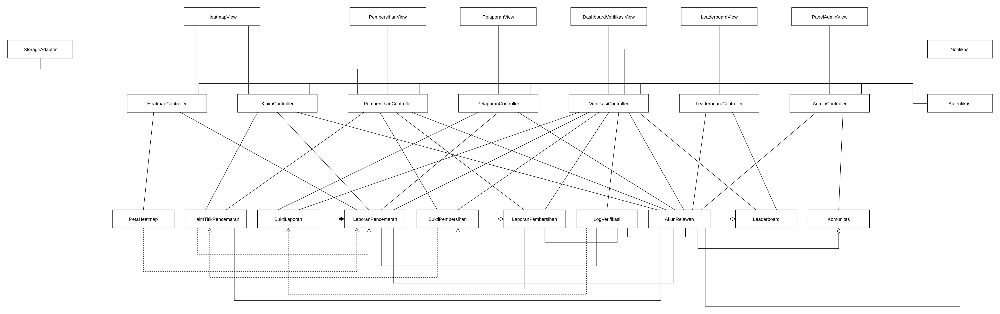

<i>Gambar 27. Diagram Kelas Perancangan Keseluruhan SeaGuard</i>

Tabel 4.1. Daftar Kelas Perancangan Keseluruhan

| ID Kelas | Nama Kelas | Atribut | Metode/Operasi |
| :--- | :--- | :--- | :--- |
| *C01* | *LaporanPencemaran* | *idLaporan, idRelawan, koordinatGPS, indikatorTingkat, tanggalLaporan, statusLaporan* | *buatLaporan(), simpanLaporan(), getLaporanTerverifikasi(), getDetailPencemaran(), getLokasiGPS(), getAntreanLaporan(), perbaruiStatusLaporan(), setStatusDiklaim()* |
| *C02* | *BuktiLaporan* | *idBukti, idLaporan, fotoUrl, ukuranFile, formatFile, metadataEXIF* | *validasiFormatUkuran(), ekstrakMetadataEXIF(), simpanBukti(), getDetailBukti()* |
| *C03* | *KlaimTitikPencemaran* | *idKlaim, idLaporan, idRelawan, koordinatTitik, wktKlaim, statusKlaim* | *getStatusKlaim(), kunciTitikLokasi(), getKoordinatAcuan(), ubahStatusKlaim()* |
| *C04* | *LaporanPembersihan* | *idPembersihan, idKlaim, idRelawan, deskripsiKegiatan, tglSelesai, statusPembersihan* | *buatLaporanPembersihan(), simpanLaporanPembersihan(), getDaftarMenungguVerifikasi(), getDetailPembersihan(), setHasilVerifikasi()* |
| *C05* | *BuktiPembersihan* | *idBuktiPembersihan, idPembersihan, fotoBeforeUrl, fotoAfterUrl, gpsBefore, gpsAfter* | *validasiGeofencingRadius(), tampilkanPerbandinganFoto()* |
| *C06* | *LogVerifikasi* | *idLog, idVerifikator, idObjek, statusKeputusan, timestamp* | *catatLogVerifikasi(), catatLogAudit()* |
| *C07* | *Leaderboard* | *idLeaderboard, daftarPeringkat, tglPembaruan* | *hitungUlangPeringkat(), getPosisiPengguna(), getDaftarPeringkat()* |
| *C08* | *AkunRelawan* | *idRelawan, nama, email, peran, statusAkun, totalPoin* | *getProfilRelawan(), getDataRelawan(), ajukanKlaimTitik(), tambahSkorPoin(), getAtributPoin(), getDaftarAkun(), getDetailAkun(), ubahHakAkses(), tangguhkanAkun()* |
| *C09* | *Komunitas* | *idKomunitas, namaKomunitas, deskripsiKomunitas* | *getDaftarKomunitas(), getDetailKomunitas(), perbaruiKomunitas()* |
| *C10* | *PetaHeatmap* | *idKlaster, koordinatPusat, heatIntensity, kategoriKualitas* | *hitungHeatIntensity(), tampilkanHeatmap(), filterBerdasarkanKategori(), cariLokasi(), getDetailKlaster()* |
| *C11* | *PelaporanView* | *idSesi* | *bukaFormLaporan(), tampilkanFormLaporan(), isiFormLaporan(), ambilKoordinatGPS(), kirimLaporan(), tampilkanPesan()* |
| *C12* | *HeatmapView* | *idSesi* | *bukaMenuHeatmap(), muatPetaDasar(), tampilkanPeta(), pilihFilter(), inputLokasi(), fokuskanPeta(), pilihTitik(), tampilkanDetailPencemaran(), pilihTitikUntukKlaim(), tampilkanDetailKlaim(), tekanKlaim(), tampilkanPesan()* |
| *C13* | *DashboardVerifikasiView* | *idSesi* | *bukaDashboard(), tampilkanAntrean(), pilihLaporan(), tampilkanDetailLaporan(), ubahStatusLaporan(), bukaDaftarPengajuan(), tampilkanDaftarPengajuan(), pilihPengajuan(), tampilkanDetailPengajuan(), putuskanPengajuan(), tampilkanHasilVerifikasi()* |
| *C14* | *PembersihanView* | *idSesi* | *bukaMenuPembersihan(), tampilkanFormPembersihan(), isiFormPembersihan(), ambilKoordinatGPS(), kirimLaporan(), tampilkanPesan()* |
| *C15* | *LeaderboardView* | *idSesi* | *bukaMenuLeaderboard(), tampilkanLeaderboard(), lihatDaftarPeringkat(), tampilkanDaftarPeringkat(), tampilkanPesan(), tekanRefresh()* |
| *C16* | *PanelAdminView* | *idSesi* | *bukaPanelPengelolaan(), tampilkanPanelPengelolaan(), pilihEntitas(), tampilkanFormUbahAkun(), tampilkanFormUbahKomunitas(), simpanPerubahan(), tampilkanPesanSukses(), tampilkanPesanError(), konfirmasiCobaLagi()* |
| *C17* | *PelaporanController* | *-* | *ambilFormLaporan(), validasiBukti(), prosesLaporan()* |
| *C18* | *HeatmapController* | *-* | *ambilDataHeatmap(), terapkanFilter(), cariLokasi(), ambilDetailTitik()* |
| *C19* | *VerifikasiController* | *-* | *ambilAntreanLaporan(), ambilDetailLaporan(), prosesVerifikasiLaporan(), ambilDaftarPengajuan(), ambilDetailPengajuan(), prosesVerifikasiPembersihan()* |
| *C20* | *KlaimController* | *-* | *ambilDetailTitikKlaim(), klaimTitik()* |
| *C21* | *PembersihanController* | *-* | *ambilFormPembersihan(), validasiBukti(), prosesLaporanPembersihan()* |
| *C22* | *LeaderboardController* | *-* | *ambilLeaderboard(), ambilDaftarPeringkat()* |
| *C23* | *AdminController* | *-* | *ambilDataAkunDanKomunitas(), ambilDetailEntitas(), prosesPerubahanData()* |
| *C24* | *Notifikasi* | *idNotifikasi, idRelawan, pesan* | *kirimNotifikasi()* |
| *C25* | *Autentikasi* | *idSesi, jumlahGagalLogin, waktuKunci* | *cekSesiDanPeran()* |
| *C26* | *StorageAdapter* | *urlStorage* | *unggahFoto()* |

 

---

# BAB 5: Matriks Kerunutan

Tabel 5.1. Matriks Kerunutan Kelas terhadap Use Case

| Kelas | Use Case Terkait |
| :--- | :--- |
| *C01 - LaporanPencemaran* | *UC01 - Melaporkan Titik Pencemaran* *UC02 - Melihat Data dan Heatmap Pencemaran* *UC03 - Memverifikasi Laporan Pencemaran* *UC04 - Mengklaim Titik Pencemaran* |
| *C02 - BuktiLaporan* | *UC01 - Melaporkan Titik Pencemaran* *UC03 - Memverifikasi Laporan Pencemaran* |
| *C03 - KlaimTitikPencemaran* | *UC04 - Mengklaim Titik Pencemaran* *UC05 - Melaporkan Hasil Pembersihan* |
| *C04 - LaporanPembersihan* | *UC05 - Melaporkan Hasil Pembersihan* *UC06 - Memverifikasi Hasil Pembersihan* |
| *C05 - BuktiPembersihan* | *UC05 - Melaporkan Hasil Pembersihan* *UC06 - Memverifikasi Hasil Pembersihan* |
| *C06 - LogVerifikasi* | *UC03 - Memverifikasi Laporan Pencemaran* *UC06 - Memverifikasi Hasil Pembersihan* |
| *C07 - Leaderboard* | *UC06 - Memverifikasi Hasil Pembersihan* *UC07 - Melihat Leaderboard* |
| *C08 - AkunRelawan* | *UC01 - Melaporkan Titik Pencemaran* *UC03 - Memverifikasi Laporan Pencemaran* *UC04 - Mengklaim Titik Pencemaran* *UC05 - Melaporkan Hasil Pembersihan* *UC06 - Memverifikasi Hasil Pembersihan* *UC07 - Melihat Leaderboard* *UC08 - Mengelola Akun Relawan dan Data Komunitas* |
| *C09 - Komunitas* | *UC08 - Mengelola Akun Relawan dan Data Komunitas* |
| *C10 - PetaHeatmap* | *UC02 - Melihat Data dan Heatmap Pencemaran* |
| *C11 - PelaporanView* | *UC01 - Melaporkan Titik Pencemaran* |
| *C12 - HeatmapView* | *UC02 - Melihat Data dan Heatmap Pencemaran* *UC04 - Mengklaim Titik Pencemaran* |
| *C13 - DashboardVerifikasiView* | *UC03 - Memverifikasi Laporan Pencemaran* *UC06 - Memverifikasi Hasil Pembersihan* |
| *C14 - PembersihanView* | *UC05 - Melaporkan Hasil Pembersihan* |
| *C15 - LeaderboardView* | *UC07 - Melihat Leaderboard* |
| *C16 - PanelAdminView* | *UC08 - Mengelola Akun Relawan dan Data Komunitas* |
| *C17 - PelaporanController* | *UC01 - Melaporkan Titik Pencemaran* |
| *C18 - HeatmapController* | *UC02 - Melihat Data dan Heatmap Pencemaran* |
| *C19 - VerifikasiController* | *UC03 - Memverifikasi Laporan Pencemaran* *UC06 - Memverifikasi Hasil Pembersihan* |
| *C20 - KlaimController* | *UC04 - Mengklaim Titik Pencemaran* |
| *C21 - PembersihanController* | *UC05 - Melaporkan Hasil Pembersihan* |
| *C22 - LeaderboardController* | *UC07 - Melihat Leaderboard* |
| *C23 - AdminController* | *UC08 - Mengelola Akun Relawan dan Data Komunitas* |
| *C24 - Notifikasi* | *UC03 - Memverifikasi Laporan Pencemaran* *UC06 - Memverifikasi Hasil Pembersihan* |
| *C25 - Autentikasi* | *UC01 - Melaporkan Titik Pencemaran* *UC02 - Melihat Data dan Heatmap Pencemaran* *UC03 - Memverifikasi Laporan Pencemaran* *UC04 - Mengklaim Titik Pencemaran* *UC05 - Melaporkan Hasil Pembersihan* *UC06 - Memverifikasi Hasil Pembersihan* *UC07 - Melihat Leaderboard* *UC08 - Mengelola Akun Relawan dan Data Komunitas* |
| *C26 - StorageAdapter* | *UC01 - Melaporkan Titik Pencemaran* *UC05 - Melaporkan Hasil Pembersihan* |

---
Referensi
- Diagram: https://drive.google.com/file/d/1fiAcloAlCprb9VkNXHB0XuNEx4XPLoKW/view?usp=sharing
