<h1>
IF2150 REKAYASA PERANGKAT LUNAK
<br>
TUGAS 8
<br>
DESKRIPSI PERANCANGAN PERANGKAT LUNAK (DPPL)
</h1>
<br>

## *SeaGuard*
<p align="center">

</p>

### Untuk: *Aurelia Jennifer Gunawan*

Dipersiapkan oleh:
| Informasi | Keterangan |
| --- | --- |
| Kelas | *K02* |
| Kelompok | *G01*  |

| NIM | Nama |
|---|---|
| *13525104* | *Jeremy Gerald Sutanto* |
| *13525116* | *Christian Immanuel* |
| *13525014* | *Denzel Santoso* |
| *13525011* | *Raihan* |
| *13525125* | *Peter Emmanuel Suwardy* |
---

## Daftar Perubahan

| Revisi | Deskripsi |
| :--- | :--- |
|  |  |

---

# BAB 1: Pendahuluan

## 1.1 Tujuan Penulisan Dokumen
Dokumen Deskripsi Perancangan Perangkat Lunak (DPPL) ini bertujuan menjelaskan rancangan perangkat lunak SeaGuard berdasarkan kebutuhan pada dokumen SKPL dan arsitektur pada dokumen APL. Dokumen ini berisi rancangan lingkungan implementasi, arsitektur, realisasi setiap use case dalam bentuk sequence diagram dan diagram kelas, serta matriks kerunutan kelas terhadap use case. Dokumen ini digunakan oleh tim pengembang sebagai acuan saat implementasi dan pengujian, serta oleh asisten sebagai bahan evaluasi rancangan.

## 1.2 Lingkup Masalah
SeaGuard merupakan aplikasi berbasis web bagi Relawan untuk memantau, melaporkan, dan membersihkan titik pencemaran sampah di wilayah perairan Indonesia. Relawan melaporkan titik pencemaran beserta foto bukti, melihat persebaran pencemaran melalui heatmap, mengklaim titik untuk dibersihkan, lalu melaporkan hasil pembersihan. Laporan dan hasil pembersihan diverifikasi oleh Verifikator/Admin, dan setiap kontribusi yang disetujui menambah skor Relawan pada leaderboard.

## 1.3 Definisi, Istilah, dan Singkatan

Tabel 1.3. Definisi Istilah dan Singkatan

| Singkatan, Akronim, atau Istilah | Penjelasan |
| :--- | :--- |
| *P/L* | *Singkatan dari Perangkat Lunak, yaitu aplikasi yang memberikan perintah kepada komputer untuk menjalankan tugas tertentu.* |
| *DPPL* | *Singkatan dari Deskripsi Perancangan Perangkat Lunak, yaitu dokumen yang menjelaskan rancangan perangkat lunak yang akan diimplementasikan.* |
| *SKPL* | *Singkatan dari Spesifikasi Kebutuhan Perangkat Lunak, yaitu dokumen yang merangkum kebutuhan perangkat lunak.* |
| *APL* | *Singkatan dari Arsitektur Perangkat Lunak, yaitu dokumen yang menjelaskan style/pattern, komponen, dan model arsitektur perangkat lunak.* |
| *MVC* | *Model-View-Controller, yaitu pola arsitektur yang memisahkan data (Model), tampilan (View), dan pengendali alur proses (Controller).* |
| *UC* | *Singkatan dari Use Case.* |
| *Sequence Diagram* | *Diagram UML yang menggambarkan urutan pesan antarobjek untuk menjalankan satu skenario use case.* |

## 1.4 Aturan Penomoran

Tabel 1.4. Aturan Penomoran

| Hal/Bagian | Penomoran | Keterangan |
| :--- | :--- | :--- |
| *Kebutuhan Fungsional* | *KFXX* | Diawali "KF" diikuti dengan dua digit yang terurut dari KF01 hingga KF21, sesuai SKPL. |
| *Kebutuhan Non-Fungsional* | *KNFXX* | Diawali "KNF" diikuti dengan dua digit yang terurut dari KNF01 hingga KNF12, sesuai SKPL. |
| *Use Case* | *UCXX* | Diawali "UC" diikuti dengan dua digit yang terurut dari UC01 hingga UC08, sesuai SKPL. |
| *Kelas* | *CXX* | Diawali "C" diikuti dengan dua digit. C01 hingga C10 adalah kelas analisis pada SKPL, sedangkan C11 hingga C26 adalah kelas perancangan tambahan (View, Controller, dan komponen pendukung dari APL). |

## 1.5 Referensi
Dokumentasi yang dirujuk dalam penyusunan dokumen DPPL ini meliputi:
1. Kelompok G01 K02. (2026). *Spesifikasi Kebutuhan Perangkat Lunak (SKPL) SeaGuard*. IF2150 Rekayasa Perangkat Lunak.
2. Kelompok G01 K02. (2026). *Arsitektur Perangkat Lunak (APL) SeaGuard*. IF2150 Rekayasa Perangkat Lunak.
3. Sommerville, I. (2016). *Software Engineering* (10th ed.). Pearson.

## 1.6 Deskripsi Umum Dokumen (Ikhtisar)
Dokumen ini terdiri atas tujuh bab. BAB 1 berisi pendahuluan, BAB 2 berisi perancangan arsitektur yang mencakup lingkungan implementasi, pola MVC, komponen, dan logical view, BAB 3 berisi realisasi setiap use case melalui identifikasi kelas, sequence diagram, dan diagram kelas, BAB 4 berisi diagram kelas perancangan keseluruhan beserta daftar atribut dan metodenya, BAB 5 berisi perancangan rinci setiap kelas beserta algoritma dan query operasi penting, BAB 6 berisi rancangan antarmuka setiap layar, dan BAB 7 berisi matriks kerunutan kelas terhadap use case.

<br>

---

# BAB 2: Perancangan Arsitektur

## 2.1 Rancangan Lingkungan Implementasi

| Aspek | Rancangan |
| :--- | :--- |
| *Arsitektur Sistem* | *Client-Server terdistribusi secara daring (Web-based Application).* |
| *Server (Backend)* | *Node.js v20 LTS (atau ekivalen) yang dapat menangani koneksi secara real-time untuk notifikasi.* |
| *Sistem Operasi Server* | *Linux (contoh: Ubuntu 22.04 LTS) atau lingkungan berbasis container (Docker) pada layanan komputasi Cloud.* |
| *Client (Frontend)* | *Web Browser modern yang memiliki dukungan penuh terhadap HTML5, Geolocation API, dan WebGL (contoh: Google Chrome v100+, Mozilla Firefox v100+, Safari v15+, atau Microsoft Edge terbaru).* |
| *Sistem Operasi Client* | *Cross-platform (Windows, macOS, Linux, Android, iOS) selama sistem operasi tersebut mendukung web browser modern yang disyaratkan.* |
| *Bahasa Pemrograman* | *JavaScript (Node.js v20) di sisi server serta HTML, CSS, dan JavaScript di sisi client.* |
| *DBMS (Database)* | *PostgreSQL v15 (atau terbaru) dilengkapi dengan ekstensi **PostGIS** yang krusial untuk menyimpan koordinat, menghitung tingkat kepanasan heatmap, dan melakukan validasi foto.* |
| *Filing System* | *Layanan Cloud Object Storage (contoh: AWS S3, Google Cloud Storage) untuk penyimpanan dan distribusi berkas foto bukti berukuran hingga 5 MB secara terenkripsi.* |
| *Jaringan Client* | *Koneksi internet yang stabil (minimal 3G/4G/LTE untuk perangkat seluler) untuk pengiriman data formulir, unduh/unggah foto bukti, dan pemuatan layer heatmap peta.* |
| *Development Tools* | *Visual Studio Code, Git dan GitHub, draw.io dan StarUML untuk pemodelan.* |

## 2.2 Style/Pattern Arsitektur Acuan

### Style/Pattern yang Dipilih

SeaGuard menggunakan pola MVC (Model-View-Controller) yang diterapkan di atas arsitektur client-server berbasis web. Peran setiap bagiannya adalah sebagai berikut.

1. **Model** merepresentasikan data SeaGuard beserta operasi yang melekat pada data tersebut. Setiap model berasal dari kelas pada diagram kelas SKPL (C01 sampai C10), misalnya *LaporanPencemaran*, *KlaimTitikPencemaran*, dan *AkunRelawan*. *Model* bertugas menyimpan dan mengambil data dari basis data serta menjalankan operasi milik kelasnya, misalnya validasiFormatUkuran() pada *BuktiLaporan* dan validasiGeofencingRadius() pada *BuktiPembersihan*.
2. **View** adalah halaman antarmuka yang dilihat pengguna melalui web browser, seperti form pelaporan, peta heatmap, dashboard verifikasi, dan leaderboard. *View* hanya menampilkan data dan meneruskan aksi pengguna ke *Controller*. *View* tidak mengakses *Model* secara langsung.
3. **Controller** menerima permintaan dari *View*, menjalankan alur proses setiap use case (misalnya klaim titik pencemaran atau verifikasi laporan), memanggil *Model* yang dibutuhkan, lalu mengembalikan hasilnya ke *View*.

### Alasan Pemilihan

Pola MVC dipilih berdasarkan karakteristik SeaGuard berikut.

1. **Jenis pengguna.** SeaGuard memiliki dua aktor, yaitu Relawan dan Verifikator/Admin, yang memakai data yang sama tetapi dengan tampilan berbeda. Dengan MVC, satu *Model* dapat dipakai oleh beberapa *View*. Contohnya, data *LaporanPencemaran* ditampilkan pada *HeatmapView* untuk Relawan dan pada *DashboardVerifikasiView* untuk Verifikator.
2. **Alur proses bisnis.** Alur SeaGuard berupa rangkaian perubahan status, yaitu laporan masuk, laporan diverifikasi, titik diklaim, hasil pembersihan dilaporkan, hasil pembersihan diverifikasi, lalu skor diberikan, sebagaimana digambarkan pada activity diagram SKPL (Gambar 1 SKPL). Aturan perubahan status ini ditempatkan pada *Controller* dan *Model* sehingga tidak tersebar di halaman antarmuka.
3. **Kebutuhan fungsional.** KF pada SKPL terbagi menjadi kebutuhan tampilan (misalnya KF01, KF06, KF09, KF15, dan KF18), kebutuhan pemrosesan (misalnya KF03, KF08, KF12, KF14, dan KF19), dan kebutuhan penyimpanan data (misalnya KF17 dan KF21). Pembagian ini sesuai dengan pemisahan *View*, *Controller*, dan *Model*.
4. **Kebutuhan non-fungsional.** Beberapa KNF lebih mudah dijamin apabila logika dipisahkan dari tampilan. Mekanisme *locking* klaim (KNF05), validasi *geofencing* (KNF06), dan log audit yang *immutable* (KNF07) dijalankan oleh *Controller* dan *Model* di sisi server sehingga tidak bergantung pada *View* di browser pengguna.

<p align="center">

</p>
<p align="center">
<i>Gambar 1. Arsitektur MVC pada SeaGuard</i>
</p>

## 2.3 Identifikasi Komponen / Modul / Subsistem

Komponen SeaGuard dikelompokkan berdasarkan lapisan MVC, ditambah komponen *Pendukung*, *Integrasi Eksternal*, dan *Penyimpanan Data*.

Tabel 2.3. Identifikasi Komponen/Modul/Subsistem

| Nama Komponen/Modul/Subsistem | Jenis                 | Penjelasan                                                                                                           |
| :---------------------------- | :-------------------- | :------------------------------------------------------------------------------------------------------------------- |
| *HeatmapView* | *View* | *Menampilkan peta heatmap persebaran pencemaran beserta kategori (sehat, waspada, berbahaya), filter, pencarian lokasi, dan detail titik pencemaran (UC02). Halaman ini juga menyediakan tombol klaim titik pencemaran (UC04).* |
| *PembersihanView* | *View* | *Menampilkan form laporan pembersihan berisi foto sebelum, foto sesudah, dan deskripsi kegiatan (UC05).* |
| *PelaporanView* | *View* | *Menampilkan form laporan pencemaran berisi unggah foto, indikator tingkat pencemaran, dan koordinat lokasi, beserta dialog persetujuan akses lokasi dan kamera (UC01).* |
| *DashboardVerifikasiView* | *View* | *Menampilkan antrean laporan pencemaran dan daftar pengajuan pembersihan, detail laporan, perbandingan foto before-after, serta tombol setujui/tolak bagi Verifikator (UC03, UC06).* |
| *LeaderboardView* | *View* | *Menampilkan papan peringkat beserta total poin kontribusi Relawan (UC07).* |
| *PanelAdminView* | *View* | *Menampilkan daftar akun, komunitas, dan hak akses beserta form perubahan data bagi Admin (UC08).* |
| *HeatmapController* | *Controller* | *Mengambil laporan terverifikasi, menghitung heat intensity tiap klaster titik, serta memproses filter kategori dan pencarian lokasi.* |
| *KlaimController* | *Controller* | *Memproses klaim titik pencemaran dengan mekanisme locking agar satu titik hanya dapat diklaim oleh satu Relawan.* |
| *PembersihanController* | *Controller* | *Memproses laporan pembersihan, yaitu memvalidasi geofencing foto terhadap titik klaim, mengunggah foto melalui StorageAdapter, lalu mengubah status klaim menjadi "Menunggu Verifikasi".* |
| *PelaporanController* | *Controller* | *Memproses laporan pencemaran baru, yaitu memvalidasi format dan ukuran foto, mengekstrak metadata EXIF, mengunggah foto melalui StorageAdapter, lalu menyimpan laporan.* |
| *VerifikasiController* | *Controller* | *Memproses keputusan Verifikator atas laporan pencemaran dan laporan pembersihan, mencatat log audit, menambah poin Relawan dan memperbarui leaderboard ketika pembersihan disetujui, serta meminta Notifikasi mengirim pemberitahuan ke Relawan.* |
| *LeaderboardController* | *Controller* | *Mengambil daftar peringkat dan posisi Relawan untuk ditampilkan pada LeaderboardView.* |
| *AdminController* | *Controller* | *Memproses perubahan peran, penangguhan akun, dan pembaruan data komunitas.* |
| *PetaHeatmap* | *Model* | *Merepresentasikan klaster titik pencemaran beserta heat intensity dan kategori kualitas perairannya (C10).* |
| *KlaimTitikPencemaran* | *Model* | *Merepresentasikan data klaim titik pencemaran oleh Relawan serta metode untuk mengunci dan membatalkan klaim (C03).* |
| *BuktiLaporan* | *Model* | *Merepresentasikan foto bukti laporan pencemaran beserta metadata EXIF serta metode untuk memvalidasi format dan ukuran berkas (C02).* |
| *LaporanPencemaran* | *Model* | *Merepresentasikan data laporan pencemaran (koordinat, indikator tingkat, dan status) serta metode untuk membuat, mengambil, dan mengubah status laporan (C01).* |
| *BuktiPembersihan* | *Model* | *Merepresentasikan foto before-after beserta koordinat GPS-nya serta metode untuk memvalidasi radius geofencing (C05).* |
| *LaporanPembersihan* | *Model* | *Merepresentasikan data laporan hasil pembersihan beserta status verifikasinya (C04).* |
| *LogVerifikasi* | *Model* | *Merepresentasikan catatan audit setiap tindakan verifikasi, yaitu ID Verifikator, keputusan, dan stempel waktu (C06).* |
| *AkunRelawan* | *Model* | *Merepresentasikan data akun pengguna (profil, peran, status akun, dan total poin) serta metode untuk mengakses dan mengubahnya (C08).* |
| *Leaderboard* | *Model* | *Merepresentasikan urutan peringkat Relawan serta metode untuk menghitung ulang peringkat (C07).* |
| *Komunitas* | *Model* | *Merepresentasikan data komunitas yang dikelola oleh Admin (C09).* |
| *Notifikasi* | *Pendukung* | *Mengirim notifikasi in-app secara real-time kepada Relawan ketika status laporan atau pembersihannya diperbarui oleh Verifikator.* |
| *Autentikasi* | *Pendukung* | *Memeriksa sesi login dan peran pengguna (Relawan atau Verifikator/Admin) sebelum controller memproses permintaan, termasuk mengunci akun sementara setelah 5 kali gagal login (KNF09).* |
| *StorageAdapter* | *Integrasi Eksternal* | *Mengunggah berkas foto bukti ke layanan Cloud Object Storage dan mengembalikan URL foto untuk disimpan pada Model.* |
| *Database* | *Penyimpanan Data* | *Menyimpan seluruh data Model secara persisten pada PostgreSQL dengan ekstensi PostGIS.* |

Keterangan:
1. Seluruh kelas pada diagram kelas SKPL (C01 sampai C10) tercakup sebagai komponen *Model* dengan nama yang sama.
2. Seluruh use case dapat dijalankan oleh pasangan *View* dan *Controller* berikut: UC01 oleh *PelaporanView* dan *PelaporanController*, UC02 oleh *HeatmapView* dan *HeatmapController*, UC03 dan UC06 oleh *DashboardVerifikasiView* dan *VerifikasiController*, UC04 oleh *HeatmapView* dan *KlaimController*, UC05 oleh *PembersihanView* dan *PembersihanController*, UC07 oleh *LeaderboardView* dan *LeaderboardController*, serta UC08 oleh *PanelAdminView* dan *AdminController*.
3. Sistem di luar P/L yang disebutkan pada subbab 2.2 SKPL, yaitu Geolocation API pada browser, layanan peta pihak ketiga, dan Cloud Object Storage, tidak dimasukkan ke tabel ini. Geolocation API dan layanan peta dipakai langsung oleh *View* di browser, sedangkan Cloud Object Storage diakses dari server melalui *StorageAdapter*.

## 2.4 Model Arsitektur Perangkat Lunak

### 2.4.1 Logical View

*Logical View* dipilih karena *view* ini dapat memperlihatkan seluruh komponen pada Tabel 2.3 beserta hubungan antarkomponennya dalam pembagian *View*, *Controller*, dan *Model*. Dengan *view* ini, alur setiap use case dapat ditelusuri mulai dari halaman yang dibuka pengguna sampai data yang disimpan. Lingkungan fisik SeaGuard (server, browser, basis data, dan penyimpanan berkas) sudah dijelaskan pada subbab 2.1, sehingga kelompok cukup membuat satu *view*.

<p align="center">
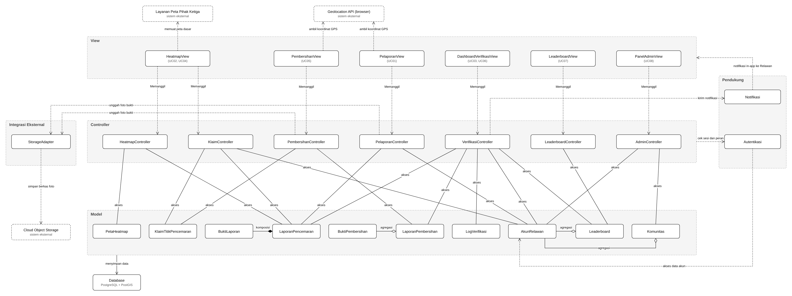
</p>
<p align="center">
<i>Gambar 2. Logical View SeaGuard</i>
</p>

Gambar 2 menggambarkan seluruh komponen pada Tabel 2.3 yang dikelompokkan sesuai pola MVC, ditambah komponen *Pendukung*, *Integrasi Eksternal*, dan *Database*. Sistem di luar P/L, yaitu Layanan Peta Pihak Ketiga, Geolocation API (browser), dan Cloud Object Storage, digambarkan dengan garis putus-putus. Arti setiap label garis adalah sebagai berikut.

1. **Memanggil**: *View* memanggil *Controller* ketika pengguna melakukan aksi pada halaman.
2. **akses**: *Controller* mengakses *Model* yang dibutuhkan use case. *BuktiLaporan* dan *BuktiPembersihan* diakses melalui *Model* induknya, yaitu *LaporanPencemaran* dan *LaporanPembersihan*.
3. **komposisi** dan **agregasi**: hubungan antar-*Model* yang mengikuti diagram kelas keseluruhan pada SKPL (Gambar 11 SKPL).
4. **menyimpan data**: seluruh *Model* menyimpan data ke *Database*.
5. **cek sesi dan peran** dan **akses data akun**: setiap *Controller* memeriksa sesi dan peran pengguna melalui *Autentikasi*, yang membaca data dari *AkunRelawan*.
6. **kirim notifikasi** dan **notifikasi in-app ke Relawan**: *VerifikasiController* meminta *Notifikasi* mengirim pemberitahuan ke halaman Relawan setelah verifikasi.
7. **unggah foto bukti** dan **simpan berkas foto**: *PelaporanController* dan *PembersihanController* mengunggah foto melalui *StorageAdapter* ke Cloud Object Storage.
8. **memuat peta dasar** dan **ambil koordinat GPS**: *HeatmapView* memuat peta dasar dari layanan peta pihak ketiga, sedangkan *PelaporanView* dan *PembersihanView* mengambil koordinat GPS dari Geolocation API pada browser.

<br>

---

# BAB 3: Realisasi Use Case

## 3.1 Use Case Melaporkan Titik Pencemaran

**ID Use Case:** *UC01*  
**Nama Use Case:** *Melaporkan Titik Pencemaran*

### 3.1.1 Identifikasi Kelas

Tabel 3.1. Identifikasi Kelas Use Case UC01

| No | Nama Kelas Perancangan | Nama Kelas Analisis Terkait |
|:--- | :--- | :--- |
| 1 | *PelaporanView (C11)* | *-* |
| 2 | *PelaporanController (C17)* | *-* |
| 3 | *LaporanPencemaran (C01)* | *LaporanPencemaran (C01)* |
| 4 | *BuktiLaporan (C02)* | *BuktiLaporan (C02)* |
| 5 | *AkunRelawan (C08)* | *AkunRelawan (C08)* |
| 6 | *Autentikasi (C25)* | *-* |
| 7 | *StorageAdapter (C26)* | *-* |

### 3.1.2 Sequence Diagram

- **Skenario Normal**

<p align="center">

</p>
<p align="center">
<i>Gambar 3. Sequence Diagram UC01</i>
</p>

- **Skenario Alternatif 1: Format Atau Ukuran Foto Tidak Valid**

<p align="center">

</p>
<p align="center">
<i>Gambar 4. Sequence Diagram UC01 - Format Atau Ukuran Foto Tidak Valid</i>
</p>

### 3.1.3 Diagram Kelas

<p align="center">
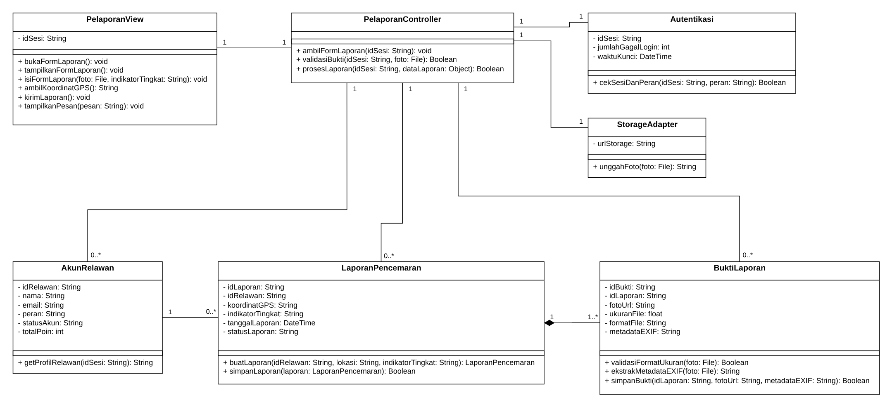
</p>
<p align="center">
<i>Gambar 5. Diagram Kelas UC01</i>
</p>

## 3.2 Use Case Melihat Data dan Heatmap Pencemaran

**ID Use Case:** *UC02*  
**Nama Use Case:** *Melihat Data dan Heatmap Pencemaran*

### 3.2.1 Identifikasi Kelas

Tabel 3.2. Identifikasi Kelas Use Case UC02

| No | Nama Kelas Perancangan | Nama Kelas Analisis Terkait |
|:--- | :--- | :--- |
| 1 | *HeatmapView (C12)* | *-* |
| 2 | *HeatmapController (C18)* | *-* |
| 3 | *LaporanPencemaran (C01)* | *LaporanPencemaran (C01)* |
| 4 | *PetaHeatmap (C10)* | *PetaHeatmap (C10)* |
| 5 | *Autentikasi (C25)* | *-* |

### 3.2.2 Sequence Diagram

- **Skenario Normal**

<p align="center">
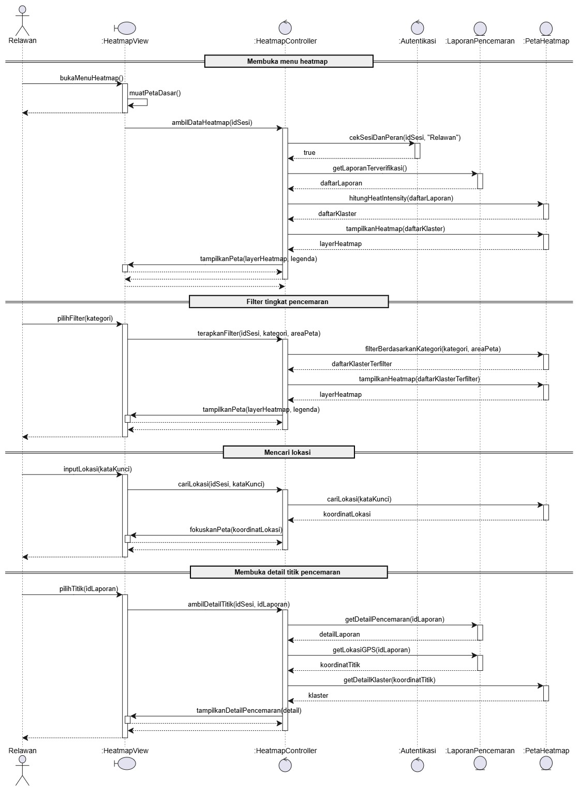
</p>
<p align="center">
<i>Gambar 6. Sequence Diagram UC02</i>
</p>

- **Skenario Alternatif 1: Lokasi Tidak Ditemukan**

<p align="center">

</p>
<p align="center">
<i>Gambar 7. Sequence Diagram UC02 - Lokasi Tidak Ditemukan</i>
</p>

- **Skenario Alternatif 2: Hasil Filter Kosong**

<p align="center">

</p>
<p align="center">
<i>Gambar 8. Sequence Diagram UC02 - Hasil Filter Kosong</i>
</p>

### 3.2.3 Diagram Kelas

<p align="center">

</p>
<p align="center">
<i>Gambar 9. Diagram Kelas UC02</i>
</p>

## 3.3 Use Case Memverifikasi Laporan Pencemaran

**ID Use Case:** *UC03*  
**Nama Use Case:** *Memverifikasi Laporan Pencemaran*

### 3.3.1 Identifikasi Kelas

Tabel 3.3. Identifikasi Kelas Use Case UC03

| No | Nama Kelas Perancangan | Nama Kelas Analisis Terkait |
|:--- | :--- | :--- |
| 1 | *DashboardVerifikasiView (C13)* | *-* |
| 2 | *VerifikasiController (C19)* | *-* |
| 3 | *LaporanPencemaran (C01)* | *LaporanPencemaran (C01)* |
| 4 | *BuktiLaporan (C02)* | *BuktiLaporan (C02)* |
| 5 | *LogVerifikasi (C06)* | *LogVerifikasi (C06)* |
| 6 | *AkunRelawan (C08)* | *AkunRelawan (C08)* |
| 7 | *Notifikasi (C24)* | *-* |
| 8 | *Autentikasi (C25)* | *-* |

### 3.3.2 Sequence Diagram

- **Skenario Normal**

<p align="center">

</p>
<p align="center">
<i>Gambar 10. Sequence Diagram UC03</i>
</p>

### 3.3.3 Diagram Kelas

<p align="center">
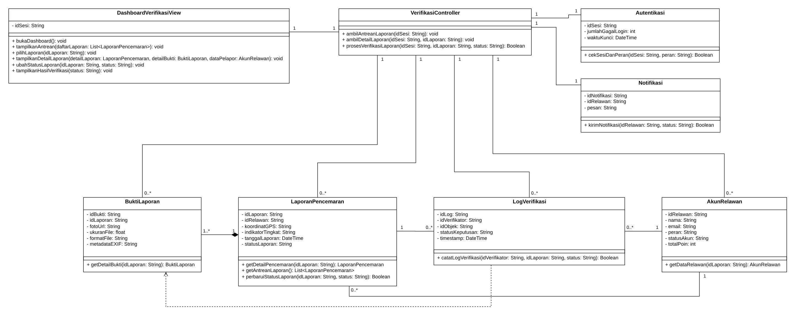
</p>
<p align="center">
<i>Gambar 11. Diagram Kelas UC03</i>
</p>

## 3.4 Use Case Mengklaim Titik Pencemaran

**ID Use Case:** *UC04*  
**Nama Use Case:** *Mengklaim Titik Pencemaran*

### 3.4.1 Identifikasi Kelas

Tabel 3.4. Identifikasi Kelas Use Case UC04

| No | Nama Kelas Perancangan | Nama Kelas Analisis Terkait |
|:--- | :--- | :--- |
| 1 | *HeatmapView (C12)* | *-* |
| 2 | *KlaimController (C20)* | *-* |
| 3 | *LaporanPencemaran (C01)* | *LaporanPencemaran (C01)* |
| 4 | *KlaimTitikPencemaran (C03)* | *KlaimTitikPencemaran (C03)* |
| 5 | *AkunRelawan (C08)* | *AkunRelawan (C08)* |
| 6 | *Autentikasi (C25)* | *-* |

### 3.4.2 Sequence Diagram

- **Skenario Normal**

<p align="center">

</p>
<p align="center">
<i>Gambar 12. Sequence Diagram UC04</i>
</p>

- **Skenario Alternatif 1: Titik Sudah Diklaim**

<p align="center">
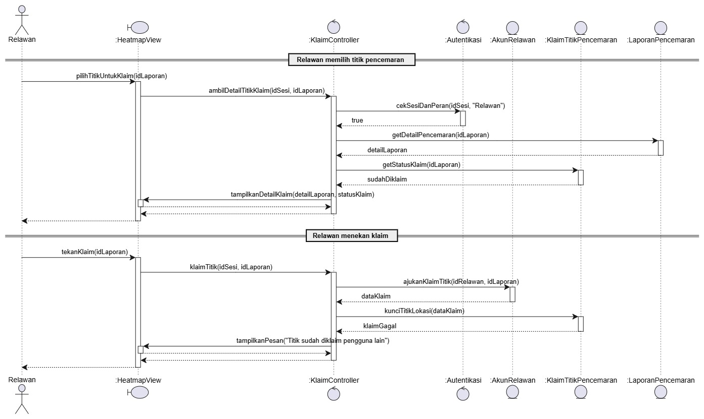
</p>
<p align="center">
<i>Gambar 13. Sequence Diagram UC04 - Titik Sudah Diklaim</i>
</p>

- **Skenario Alternatif 2: Klaim Bersamaan pada Titik yang Sama**

<p align="center">
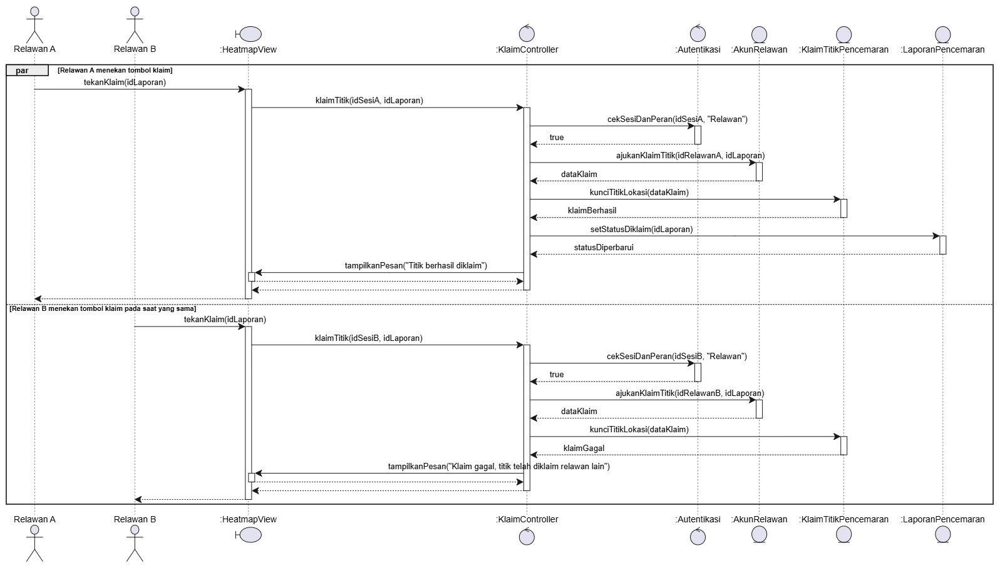
</p>
<p align="center">
<i>Gambar 14. Sequence Diagram UC04 - Klaim Bersamaan pada Titik yang Sama</i>
</p>

### 3.4.3 Diagram Kelas

<p align="center">

</p>
<p align="center">
<i>Gambar 15. Diagram Kelas UC04</i>
</p>

## 3.5 Use Case Melaporkan Hasil Pembersihan

**ID Use Case:** *UC05*  
**Nama Use Case:** *Melaporkan Hasil Pembersihan*

### 3.5.1 Identifikasi Kelas

Tabel 3.5. Identifikasi Kelas Use Case UC05

| No | Nama Kelas Perancangan | Nama Kelas Analisis Terkait |
|:--- | :--- | :--- |
| 1 | *PembersihanView (C14)* | *-* |
| 2 | *PembersihanController (C21)* | *-* |
| 3 | *KlaimTitikPencemaran (C03)* | *KlaimTitikPencemaran (C03)* |
| 4 | *LaporanPembersihan (C04)* | *LaporanPembersihan (C04)* |
| 5 | *BuktiPembersihan (C05)* | *BuktiPembersihan (C05)* |
| 6 | *AkunRelawan (C08)* | *AkunRelawan (C08)* |
| 7 | *Autentikasi (C25)* | *-* |
| 8 | *StorageAdapter (C26)* | *-* |

### 3.5.2 Sequence Diagram

- **Skenario Normal**

<p align="center">
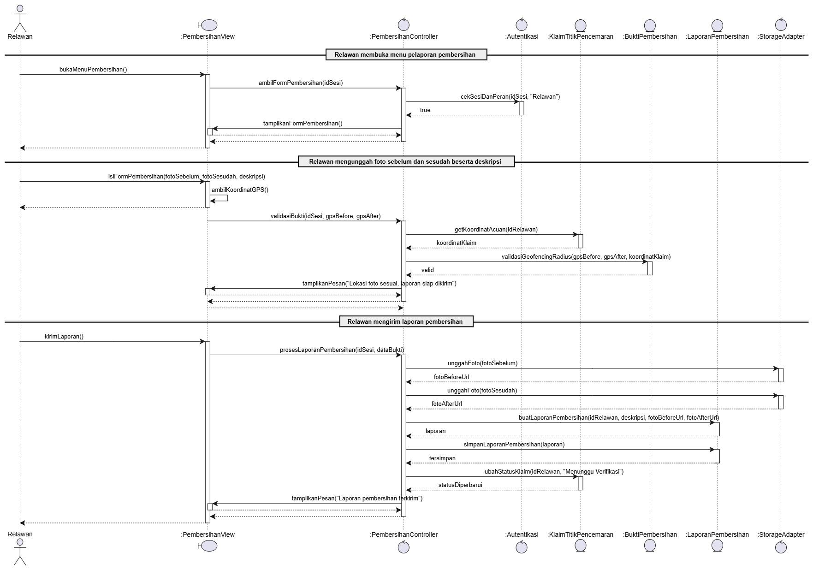
</p>
<p align="center">
<i>Gambar 16. Sequence Diagram UC05</i>
</p>

- **Skenario Alternatif 1: Lokasi Foto di Luar Radius Geofencing**

<p align="center">

</p>
<p align="center">
<i>Gambar 17. Sequence Diagram UC05 - Lokasi Foto di Luar Radius Geofencing</i>
</p>

### 3.5.3 Diagram Kelas

<p align="center">

</p>
<p align="center">
<i>Gambar 18. Diagram Kelas UC05</i>
</p>

## 3.6 Use Case Memverifikasi Hasil Pembersihan

**ID Use Case:** *UC06*  
**Nama Use Case:** *Memverifikasi Hasil Pembersihan*

### 3.6.1 Identifikasi Kelas

Tabel 3.6. Identifikasi Kelas Use Case UC06

| No | Nama Kelas Perancangan | Nama Kelas Analisis Terkait |
|:--- | :--- | :--- |
| 1 | *DashboardVerifikasiView (C13)* | *-* |
| 2 | *VerifikasiController (C19)* | *-* |
| 3 | *LaporanPembersihan (C04)* | *LaporanPembersihan (C04)* |
| 4 | *BuktiPembersihan (C05)* | *BuktiPembersihan (C05)* |
| 5 | *LogVerifikasi (C06)* | *LogVerifikasi (C06)* |
| 6 | *Leaderboard (C07)* | *Leaderboard (C07)* |
| 7 | *AkunRelawan (C08)* | *AkunRelawan (C08)* |
| 8 | *Notifikasi (C24)* | *-* |
| 9 | *Autentikasi (C25)* | *-* |

### 3.6.2 Sequence Diagram

- **Skenario Normal**

<p align="center">

</p>
<p align="center">
<i>Gambar 19. Sequence Diagram UC06</i>
</p>

### 3.6.3 Diagram Kelas

<p align="center">
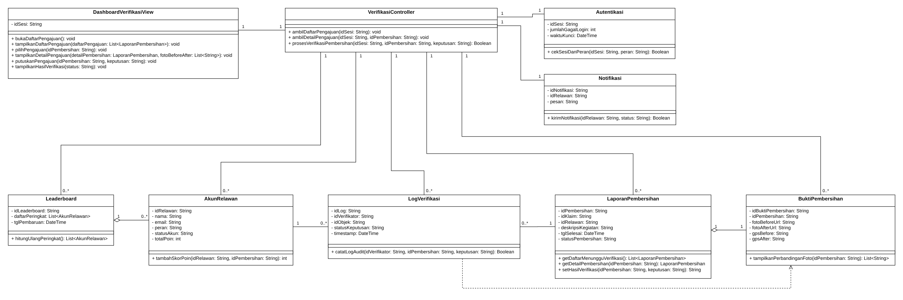
</p>
<p align="center">
<i>Gambar 20. Diagram Kelas UC06</i>
</p>

## 3.7 Use Case Melihat Leaderboard

**ID Use Case:** *UC07*  
**Nama Use Case:** *Melihat Leaderboard*

### 3.7.1 Identifikasi Kelas

Tabel 3.7. Identifikasi Kelas Use Case UC07

| No | Nama Kelas Perancangan | Nama Kelas Analisis Terkait |
|:--- | :--- | :--- |
| 1 | *LeaderboardView (C15)* | *-* |
| 2 | *LeaderboardController (C22)* | *-* |
| 3 | *Leaderboard (C07)* | *Leaderboard (C07)* |
| 4 | *AkunRelawan (C08)* | *AkunRelawan (C08)* |
| 5 | *Autentikasi (C25)* | *-* |

### 3.7.2 Sequence Diagram

- **Skenario Normal**

<p align="center">
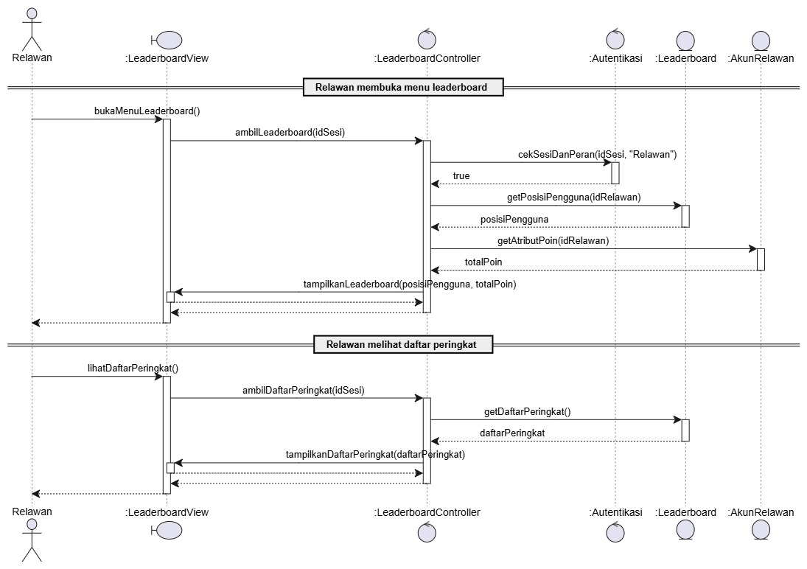
</p>
<p align="center">
<i>Gambar 21. Sequence Diagram UC07</i>
</p>

- **Skenario Alternatif 1: Gagal Memuat Leaderboard**

<p align="center">
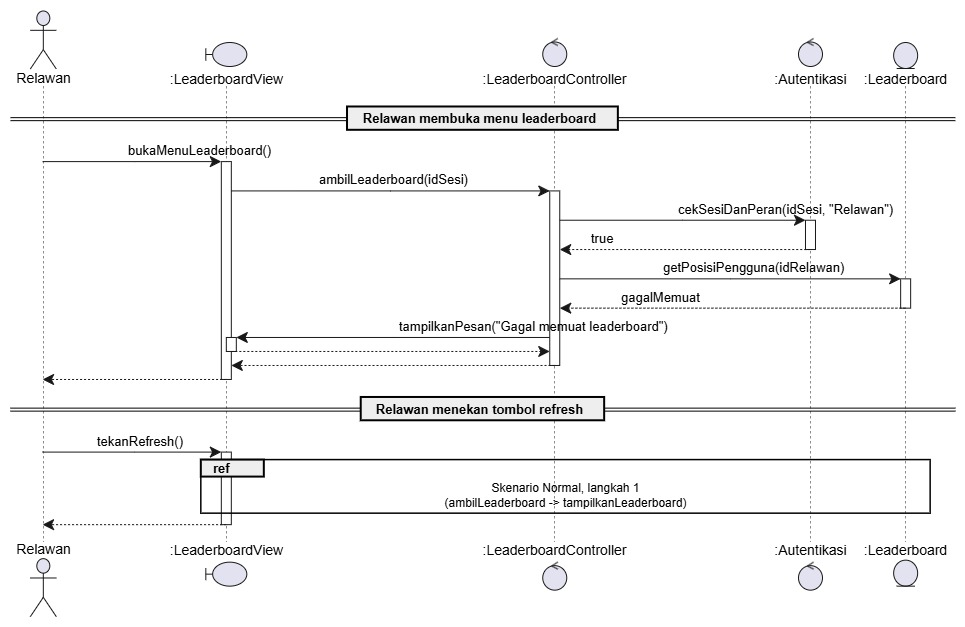
</p>
<p align="center">
<i>Gambar 22. Sequence Diagram UC07 - Gagal Memuat Leaderboard</i>
</p>

### 3.7.3 Diagram Kelas

<p align="center">

</p>
<p align="center">
<i>Gambar 23. Diagram Kelas UC07</i>
</p>

## 3.8 Use Case Mengelola Akun Relawan dan Data Komunitas

**ID Use Case:** *UC08*  
**Nama Use Case:** *Mengelola Akun Relawan dan Data Komunitas*

### 3.8.1 Identifikasi Kelas

Tabel 3.8. Identifikasi Kelas Use Case UC08

| No | Nama Kelas Perancangan | Nama Kelas Analisis Terkait |
|:--- | :--- | :--- |
| 1 | *PanelAdminView (C16)* | *-* |
| 2 | *AdminController (C23)* | *-* |
| 3 | *AkunRelawan (C08)* | *AkunRelawan (C08)* |
| 4 | *Komunitas (C09)* | *Komunitas (C09)* |
| 5 | *Autentikasi (C25)* | *-* |

### 3.8.2 Sequence Diagram

- **Skenario Normal**

<p align="center">

</p>
<p align="center">
<i>Gambar 24. Sequence Diagram UC08</i>
</p>

- **Skenario Alternatif 1: Pembaruan Data Gagal**

<p align="center">

</p>
<p align="center">
<i>Gambar 25. Sequence Diagram UC08 - Pembaruan Data Gagal</i>
</p>

### 3.8.3 Diagram Kelas

<p align="center">
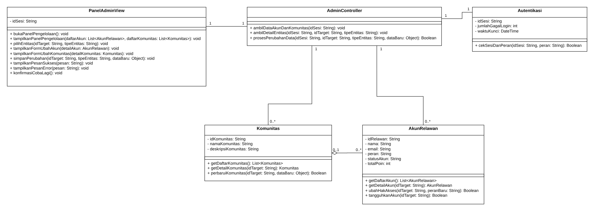
</p>
<p align="center">
<i>Gambar 26. Diagram Kelas UC08</i>
</p>

<br>

---

# BAB 4: Diagram Kelas Keseluruhan

## 4.1 Diagram Kelas

<p align="center">

</p>
<p align="center">
<i>Gambar 27. Diagram Kelas Perancangan Keseluruhan SeaGuard</i>
</p>

Tabel 4.1. Daftar Kelas Perancangan Keseluruhan

| ID Kelas | Nama Kelas | Atribut | Metode/Operasi |
| :--- | :--- | :--- | :--- |
| *C01* | *LaporanPencemaran* | *idLaporan, idRelawan, koordinatGPS, indikatorTingkat, tanggalLaporan, statusLaporan* | *buatLaporan(), simpanLaporan(), getLaporanTerverifikasi(), getDetailPencemaran(), getLokasiGPS(), getAntreanLaporan(), perbaruiStatusLaporan(), setStatusDiklaim()* |
| *C02* | *BuktiLaporan* | *idBukti, idLaporan, fotoUrl, ukuranFile, formatFile, metadataEXIF* | *validasiFormatUkuran(), ekstrakMetadataEXIF(), simpanBukti(), getDetailBukti()* |
| *C03* | *KlaimTitikPencemaran* | *idKlaim, idLaporan, idRelawan, koordinatTitik, wktKlaim, statusKlaim* | *getStatusKlaim(), kunciTitikLokasi(), getKoordinatAcuan(), ubahStatusKlaim()* |
| *C04* | *LaporanPembersihan* | *idPembersihan, idKlaim, idRelawan, deskripsiKegiatan, tglSelesai, statusPembersihan* | *buatLaporanPembersihan(), simpanLaporanPembersihan(), getDaftarMenungguVerifikasi(), getDetailPembersihan(), setHasilVerifikasi()* |
| *C05* | *BuktiPembersihan* | *idBuktiPembersihan, idPembersihan, fotoBeforeUrl, fotoAfterUrl, gpsBefore, gpsAfter* | *validasiGeofencingRadius(), tampilkanPerbandinganFoto()* |
| *C06* | *LogVerifikasi* | *idLog, idVerifikator, idObjek, statusKeputusan, timestamp* | *catatLogVerifikasi(), catatLogAudit()* |
| *C07* | *Leaderboard* | *idLeaderboard, daftarPeringkat, tglPembaruan* | *hitungUlangPeringkat(), getPosisiPengguna(), getDaftarPeringkat()* |
| *C08* | *AkunRelawan* | *idRelawan, nama, email, peran, statusAkun, totalPoin* | *getProfilRelawan(), getDataRelawan(), ajukanKlaimTitik(), tambahSkorPoin(), getAtributPoin(), getDaftarAkun(), getDetailAkun(), ubahHakAkses(), tangguhkanAkun()* |
| *C09* | *Komunitas* | *idKomunitas, namaKomunitas, deskripsiKomunitas* | *getDaftarKomunitas(), getDetailKomunitas(), perbaruiKomunitas()* |
| *C10* | *PetaHeatmap* | *idKlaster, koordinatPusat, heatIntensity, kategoriKualitas* | *hitungHeatIntensity(), tampilkanHeatmap(), filterBerdasarkanKategori(), cariLokasi(), getDetailKlaster()* |
| *C11* | *PelaporanView* | *idSesi* | *bukaFormLaporan(), tampilkanFormLaporan(), isiFormLaporan(), ambilKoordinatGPS(), kirimLaporan(), tampilkanPesan()* |
| *C12* | *HeatmapView* | *idSesi* | *bukaMenuHeatmap(), muatPetaDasar(), tampilkanPeta(), pilihFilter(), inputLokasi(), fokuskanPeta(), pilihTitik(), tampilkanDetailPencemaran(), pilihTitikUntukKlaim(), tampilkanDetailKlaim(), tekanKlaim(), tampilkanPesan()* |
| *C13* | *DashboardVerifikasiView* | *idSesi* | *bukaDashboard(), tampilkanAntrean(), pilihLaporan(), tampilkanDetailLaporan(), ubahStatusLaporan(), bukaDaftarPengajuan(), tampilkanDaftarPengajuan(), pilihPengajuan(), tampilkanDetailPengajuan(), putuskanPengajuan(), tampilkanHasilVerifikasi()* |
| *C14* | *PembersihanView* | *idSesi* | *bukaMenuPembersihan(), tampilkanFormPembersihan(), isiFormPembersihan(), ambilKoordinatGPS(), kirimLaporan(), tampilkanPesan()* |
| *C15* | *LeaderboardView* | *idSesi* | *bukaMenuLeaderboard(), tampilkanLeaderboard(), lihatDaftarPeringkat(), tampilkanDaftarPeringkat(), tampilkanPesan(), tekanRefresh()* |
| *C16* | *PanelAdminView* | *idSesi* | *bukaPanelPengelolaan(), tampilkanPanelPengelolaan(), pilihEntitas(), tampilkanFormUbahAkun(), tampilkanFormUbahKomunitas(), simpanPerubahan(), tampilkanPesanSukses(), tampilkanPesanError(), konfirmasiCobaLagi()* |
| *C17* | *PelaporanController* | *-* | *ambilFormLaporan(), validasiBukti(), prosesLaporan()* |
| *C18* | *HeatmapController* | *-* | *ambilDataHeatmap(), terapkanFilter(), cariLokasi(), ambilDetailTitik()* |
| *C19* | *VerifikasiController* | *-* | *ambilAntreanLaporan(), ambilDetailLaporan(), prosesVerifikasiLaporan(), ambilDaftarPengajuan(), ambilDetailPengajuan(), prosesVerifikasiPembersihan()* |
| *C20* | *KlaimController* | *-* | *ambilDetailTitikKlaim(), klaimTitik()* |
| *C21* | *PembersihanController* | *-* | *ambilFormPembersihan(), validasiBukti(), prosesLaporanPembersihan()* |
| *C22* | *LeaderboardController* | *-* | *ambilLeaderboard(), ambilDaftarPeringkat()* |
| *C23* | *AdminController* | *-* | *ambilDataAkunDanKomunitas(), ambilDetailEntitas(), prosesPerubahanData()* |
| *C24* | *Notifikasi* | *idNotifikasi, idRelawan, pesan* | *kirimNotifikasi()* |
| *C25* | *Autentikasi* | *idSesi, jumlahGagalLogin, waktuKunci* | *cekSesiDanPeran()* |
| *C26* | *StorageAdapter* | *urlStorage* | *unggahFoto()* |

<br>

---

# BAB 5: Perancangan Rinci Kelas

Tabel 5.1. Daftar Kelas Perancangan dan Kelas Analisis Terkait

| No | Nama Kelas Perancangan | Nama Kelas Analisis Terkait |
| :--- | :--- | :--- |
| 1 | *LaporanPencemaran (C01)* | *LaporanPencemaran (C01)* |
| 2 | *BuktiLaporan (C02)* | *BuktiLaporan (C02)* |
| 3 | *KlaimTitikPencemaran (C03)* | *KlaimTitikPencemaran (C03)* |
| 4 | *LaporanPembersihan (C04)* | *LaporanPembersihan (C04)* |
| 5 | *BuktiPembersihan (C05)* | *BuktiPembersihan (C05)* |
| 6 | *LogVerifikasi (C06)* | *LogVerifikasi (C06)* |
| 7 | *Leaderboard (C07)* | *Leaderboard (C07)* |
| 8 | *AkunRelawan (C08)* | *AkunRelawan (C08)* |
| 9 | *Komunitas (C09)* | *Komunitas (C09)* |
| 10 | *PetaHeatmap (C10)* | *PetaHeatmap (C10)* |
| 11 | *PelaporanView (C11)* | *-* |
| 12 | *HeatmapView (C12)* | *-* |
| 13 | *DashboardVerifikasiView (C13)* | *-* |
| 14 | *PembersihanView (C14)* | *-* |
| 15 | *LeaderboardView (C15)* | *-* |
| 16 | *PanelAdminView (C16)* | *-* |
| 17 | *PelaporanController (C17)* | *-* |
| 18 | *HeatmapController (C18)* | *-* |
| 19 | *VerifikasiController (C19)* | *-* |
| 20 | *KlaimController (C20)* | *-* |
| 21 | *PembersihanController (C21)* | *-* |
| 22 | *LeaderboardController (C22)* | *-* |
| 23 | *AdminController (C23)* | *-* |
| 24 | *Notifikasi (C24)* | *-* |
| 25 | *Autentikasi (C25)* | *-* |
| 26 | *StorageAdapter (C26)* | *-* |

Tipe atribut dan parameter mengikuti tipe pada diagram kelas BAB 3 dan BAB 4. Koordinat disimpan sebagai teks WKT, misalnya `POINT(107.6107 -6.8915)`, sehingga dapat dibaca oleh fungsi PostGIS. Nama tabel dan kolom pada query memakai bentuk *snake_case* dari nama kelas dan atribut, misalnya kelas *LaporanPencemaran* menjadi tabel `laporan_pencemaran` dan atribut *idLaporan* menjadi kolom `id_laporan`.

## 5.1 Kelas LaporanPencemaran

**Nama Kelas:** *LaporanPencemaran*  
**ID Kelas:** *C01*

Tabel 5.1.1. Operasi Kelas LaporanPencemaran

| Nama Operasi | Visibility (private, public) | Keterangan |
| :--- | :--- | :--- |
| `buatLaporan(idRelawan: String, lokasi: String, indikatorTingkat: String): LaporanPencemaran` | *public* | *Membuat objek laporan pencemaran baru dari idRelawan, lokasi, dan indikator tingkat pencemaran dengan status awal menunggu verifikasi.* |
| `simpanLaporan(laporan: LaporanPencemaran): Boolean` | *public* | *Menyimpan laporan pencemaran ke basis data.* |
| `getLaporanTerverifikasi(): List<LaporanPencemaran>` | *public* | *Mengambil seluruh laporan pencemaran yang sudah disetujui Verifikator untuk ditampilkan pada heatmap.* |
| `getDetailPencemaran(idLaporan: String): LaporanPencemaran` | *public* | *Mengambil detail satu laporan pencemaran berdasarkan idLaporan.* |
| `getLokasiGPS(idLaporan: String): String` | *public* | *Mengambil koordinat GPS dari satu laporan pencemaran.* |
| `getAntreanLaporan(): List<LaporanPencemaran>` | *public* | *Mengambil daftar laporan pencemaran yang masih menunggu verifikasi.* |
| `perbaruiStatusLaporan(idLaporan: String, status: String): Boolean` | *public* | *Mengubah status laporan menjadi "Disetujui" atau "Ditolak".* |
| `setStatusDiklaim(idLaporan: String): Boolean` | *public* | *Mengubah status laporan menjadi "Diklaim" setelah titik berhasil dikunci oleh Relawan.* |

Tabel 5.1.2. Atribut Kelas LaporanPencemaran

| Nama Atribut | Visibility (private, public) | Tipe |
| :--- | :--- | :--- |
| *idLaporan* | *private* | *String* |
| *idRelawan* | *private* | *String* |
| *koordinatGPS* | *private* | *String* |
| *indikatorTingkat* | *private* | *String* |
| *tanggalLaporan* | *private* | *DateTime* |
| *statusLaporan* | *private* | *String* |

## 5.2 Kelas BuktiLaporan

**Nama Kelas:** *BuktiLaporan*  
**ID Kelas:** *C02*

Tabel 5.2.1. Operasi Kelas BuktiLaporan

| Nama Operasi | Visibility (private, public) | Keterangan |
| :--- | :--- | :--- |
| `validasiFormatUkuran(foto: File): Boolean` | *public* | *Memeriksa format berkas foto (JPG/PNG) dan ukuran berkas (maksimal 5 MB).* |
| `ekstrakMetadataEXIF(foto: File): String` | *public* | *Mengekstrak metadata EXIF dari foto bukti, jika tersedia, untuk verifikasi lokasi laporan.* |
| `simpanBukti(idLaporan: String, fotoUrl: String, metadataEXIF: String): Boolean` | *public* | *Menyimpan URL foto dan metadata EXIF bukti yang terhubung ke laporan pencemaran.* |
| `getDetailBukti(idLaporan: String): BuktiLaporan` | *public* | *Mengambil foto dan metadata bukti dari satu laporan pencemaran.* |

Tabel 5.2.2. Atribut Kelas BuktiLaporan

| Nama Atribut | Visibility (private, public) | Tipe |
| :--- | :--- | :--- |
| *idBukti* | *private* | *String* |
| *idLaporan* | *private* | *String* |
| *fotoUrl* | *private* | *String* |
| *ukuranFile* | *private* | *float* |
| *formatFile* | *private* | *String* |
| *metadataEXIF* | *private* | *String* |

### 5.2.1 Algoritma/Query

**Nama Kelas:** *BuktiLaporan*  
**Nama Operasi:** `validasiFormatUkuran(foto: File): Boolean`  
**ID Algoritma:** *Algo-001*

```text
function validasiFormatUkuran(foto: File): Boolean
    FORMAT_DIIZINKAN <- ["image/jpeg", "image/png"]
    UKURAN_MAKS <- 5 * 1024 * 1024            { 5 MB, sesuai KF03 }
    if foto = null then
        return false
    if foto.tipe tidak ada di FORMAT_DIIZINKAN then
        return false
    if foto.ukuran > UKURAN_MAKS then
        return false
    return true
```

## 5.3 Kelas KlaimTitikPencemaran

**Nama Kelas:** *KlaimTitikPencemaran*  
**ID Kelas:** *C03*

Tabel 5.3.1. Operasi Kelas KlaimTitikPencemaran

| Nama Operasi | Visibility (private, public) | Keterangan |
| :--- | :--- | :--- |
| `getStatusKlaim(idLaporan: String): String` | *public* | *Mengambil status klaim titik pencemaran (belum diklaim atau sudah diklaim).* |
| `kunciTitikLokasi(dataKlaim: KlaimTitikPencemaran): Boolean` | *public* | *Mengunci titik pencemaran untuk satu Relawan dengan mekanisme locking agar tidak terjadi klaim ganda.* |
| `getKoordinatAcuan(idRelawan: String): String` | *public* | *Mengambil koordinat titik klaim aktif milik Relawan sebagai acuan validasi geofencing.* |
| `ubahStatusKlaim(idRelawan: String, status: String): Boolean` | *public* | *Mengubah status klaim milik Relawan, misalnya menjadi "Menunggu Verifikasi".* |

Tabel 5.3.2. Atribut Kelas KlaimTitikPencemaran

| Nama Atribut | Visibility (private, public) | Tipe |
| :--- | :--- | :--- |
| *idKlaim* | *private* | *String* |
| *idLaporan* | *private* | *String* |
| *idRelawan* | *private* | *String* |
| *koordinatTitik* | *private* | *String* |
| *wktKlaim* | *private* | *DateTime* |
| *statusKlaim* | *private* | *String* |

### 5.3.1 Algoritma/Query

**Nama Kelas:** *KlaimTitikPencemaran*  
**Nama Operasi:** `kunciTitikLokasi(dataKlaim: KlaimTitikPencemaran): Boolean`  
**ID Algoritma:** *Algo-003*

```text
function kunciTitikLokasi(dataKlaim: KlaimTitikPencemaran): Boolean
    { KNF05: mencegah klaim ganda pada titik dan waktu yang sama }
    BEGIN TRANSACTION
        laporan <- jalankan Q-002 (mengunci baris laporan dengan FOR UPDATE)
        if laporan.statusLaporan = "Diklaim" then
            ROLLBACK
            return false                       { klaimGagal }
        jalankan Q-003 (simpan data klaim dengan statusKlaim "Aktif")
    COMMIT
    return true                                { klaimBerhasil }
```

Tabel 5.3.3. Query Operasi kunciTitikLokasi

| No Query | Query | Keterangan |
| :--- | :--- | :--- |
| *Q-002* | `SELECT id_laporan, status_laporan FROM laporan_pencemaran WHERE id_laporan = :id_laporan FOR UPDATE` | *Mengunci baris laporan selama transaksi sehingga permintaan klaim lain pada titik yang sama harus menunggu.* |
| *Q-003* | `INSERT INTO klaim_titik_pencemaran (id_klaim, id_laporan, id_relawan, koordinat_titik, wkt_klaim, status_klaim) VALUES (:id_klaim, :id_laporan, :id_relawan, :koordinat_titik, NOW(), 'Aktif')` | *Menyimpan data klaim titik pencemaran.* |

## 5.4 Kelas LaporanPembersihan

**Nama Kelas:** *LaporanPembersihan*  
**ID Kelas:** *C04*

Tabel 5.4.1. Operasi Kelas LaporanPembersihan

| Nama Operasi | Visibility (private, public) | Keterangan |
| :--- | :--- | :--- |
| `buatLaporanPembersihan(idRelawan: String, deskripsi: String, fotoBeforeUrl: String, fotoAfterUrl: String): LaporanPembersihan` | *public* | *Membuat objek laporan pembersihan dari idRelawan, deskripsi kegiatan, dan URL foto sebelum dan sesudah.* |
| `simpanLaporanPembersihan(laporan: LaporanPembersihan): Boolean` | *public* | *Menyimpan laporan pembersihan ke basis data.* |
| `getDaftarMenungguVerifikasi(): List<LaporanPembersihan>` | *public* | *Mengambil daftar laporan pembersihan yang menunggu verifikasi.* |
| `getDetailPembersihan(idPembersihan: String): LaporanPembersihan` | *public* | *Mengambil detail satu laporan pembersihan berdasarkan idPembersihan.* |
| `setHasilVerifikasi(idPembersihan: String, keputusan: String): String` | *public* | *Menyimpan keputusan verifikasi pembersihan dan mengembalikan idRelawan pemilik laporan.* |

Tabel 5.4.2. Atribut Kelas LaporanPembersihan

| Nama Atribut | Visibility (private, public) | Tipe |
| :--- | :--- | :--- |
| *idPembersihan* | *private* | *String* |
| *idKlaim* | *private* | *String* |
| *idRelawan* | *private* | *String* |
| *deskripsiKegiatan* | *private* | *String* |
| *tglSelesai* | *private* | *DateTime* |
| *statusPembersihan* | *private* | *String* |

## 5.5 Kelas BuktiPembersihan

**Nama Kelas:** *BuktiPembersihan*  
**ID Kelas:** *C05*

Tabel 5.5.1. Operasi Kelas BuktiPembersihan

| Nama Operasi | Visibility (private, public) | Keterangan |
| :--- | :--- | :--- |
| `validasiGeofencingRadius(gpsBefore: String, gpsAfter: String, koordinatKlaim: String): Boolean` | *public* | *Memeriksa apakah koordinat foto sebelum dan sesudah berada dalam radius 100 meter dari titik klaim.* |
| `tampilkanPerbandinganFoto(idPembersihan: String): List<String>` | *public* | *Mengambil URL foto before dan after dari satu laporan pembersihan untuk ditampilkan berdampingan.* |

Tabel 5.5.2. Atribut Kelas BuktiPembersihan

| Nama Atribut | Visibility (private, public) | Tipe |
| :--- | :--- | :--- |
| *idBuktiPembersihan* | *private* | *String* |
| *idPembersihan* | *private* | *String* |
| *fotoBeforeUrl* | *private* | *String* |
| *fotoAfterUrl* | *private* | *String* |
| *gpsBefore* | *private* | *String* |
| *gpsAfter* | *private* | *String* |

### 5.5.1 Algoritma/Query

**Nama Kelas:** *BuktiPembersihan*  
**Nama Operasi:** `validasiGeofencingRadius(gpsBefore: String, gpsAfter: String, koordinatKlaim: String): Boolean`  
**ID Algoritma:** *Algo-004*

```text
function validasiGeofencingRadius(gpsBefore: String, gpsAfter: String, koordinatKlaim: String): Boolean
    { KF14: foto bukti harus berada dalam radius maksimal 100 meter dari titik klaim }
    RADIUS_MAKS <- 100                          { meter }
    if gpsBefore = null or gpsAfter = null then
        return false
    jarakBefore, jarakAfter <- hasil query Q-004
    return (jarakBefore <= RADIUS_MAKS) and (jarakAfter <= RADIUS_MAKS)
```

Tabel 5.5.3. Query Operasi validasiGeofencingRadius

| No Query | Query | Keterangan |
| :--- | :--- | :--- |
| *Q-004* | `SELECT ST_Distance(ST_GeogFromText(:gps_before), ST_GeogFromText(:koordinat_klaim)) AS jarak_before, ST_Distance(ST_GeogFromText(:gps_after), ST_GeogFromText(:koordinat_klaim)) AS jarak_after` | *Menghitung jarak (meter) koordinat foto sebelum dan sesudah terhadap titik klaim menggunakan PostGIS.* |

## 5.6 Kelas LogVerifikasi

**Nama Kelas:** *LogVerifikasi*  
**ID Kelas:** *C06*

Tabel 5.6.1. Operasi Kelas LogVerifikasi

| Nama Operasi | Visibility (private, public) | Keterangan |
| :--- | :--- | :--- |
| `catatLogVerifikasi(idVerifikator: String, idLaporan: String, status: String): Boolean` | *public* | *Mencatat log audit verifikasi laporan pencemaran (ID Verifikator, idLaporan, status, stempel waktu).* |
| `catatLogAudit(idVerifikator: String, idPembersihan: String, keputusan: String): Boolean` | *public* | *Mencatat log audit verifikasi hasil pembersihan (ID Verifikator, idPembersihan, keputusan, stempel waktu).* |

Tabel 5.6.2. Atribut Kelas LogVerifikasi

| Nama Atribut | Visibility (private, public) | Tipe |
| :--- | :--- | :--- |
| *idLog* | *private* | *String* |
| *idVerifikator* | *private* | *String* |
| *idObjek* | *private* | *String* |
| *statusKeputusan* | *private* | *String* |
| *timestamp* | *private* | *DateTime* |

### 5.6.1 Algoritma/Query

**Nama Kelas:** *LogVerifikasi*  
**Nama Operasi:** `catatLogAudit(idVerifikator: String, idPembersihan: String, keputusan: String): Boolean`  
**ID Algoritma:** *Algo-009*

```text
function catatLogAudit(idVerifikator: String, idPembersihan: String, keputusan: String): Boolean
    { KNF07: log bersifat immutable, sehingga operasi ini hanya menambah data (INSERT) }
    jalankan Q-009
    return true
```

Tabel 5.6.3. Query Operasi catatLogAudit

| No Query | Query | Keterangan |
| :--- | :--- | :--- |
| *Q-009* | `INSERT INTO log_verifikasi (id_log, id_verifikator, id_objek, status_keputusan, timestamp) VALUES (:id_log, :id_verifikator, :id_pembersihan, :keputusan, NOW())` | *Menambah catatan audit tanpa mengubah atau menghapus catatan sebelumnya.* |

## 5.7 Kelas Leaderboard

**Nama Kelas:** *Leaderboard*  
**ID Kelas:** *C07*

Tabel 5.7.1. Operasi Kelas Leaderboard

| Nama Operasi | Visibility (private, public) | Keterangan |
| :--- | :--- | :--- |
| `hitungUlangPeringkat(): List<AkunRelawan>` | *public* | *Mengurutkan ulang seluruh Relawan berdasarkan total poin setelah ada pembersihan yang disetujui.* |
| `getPosisiPengguna(idRelawan: String): int` | *public* | *Mengambil posisi peringkat seorang Relawan pada leaderboard.* |
| `getDaftarPeringkat(): List<AkunRelawan>` | *public* | *Mengambil daftar peringkat Relawan yang sudah terurut.* |

Tabel 5.7.2. Atribut Kelas Leaderboard

| Nama Atribut | Visibility (private, public) | Tipe |
| :--- | :--- | :--- |
| *idLeaderboard* | *private* | *String* |
| *daftarPeringkat* | *private* | *List<AkunRelawan>* |
| *tglPembaruan* | *private* | *DateTime* |

### 5.7.1 Algoritma/Query

**Nama Kelas:** *Leaderboard*  
**Nama Operasi:** `hitungUlangPeringkat(): List<AkunRelawan>`  
**ID Algoritma:** *Algo-008*

```text
function hitungUlangPeringkat(): List<AkunRelawan>
    daftarPeringkat <- hasil query Q-008
    tglPembaruan <- NOW()
    return daftarPeringkat
```

Tabel 5.7.3. Query Operasi hitungUlangPeringkat

| No Query | Query | Keterangan |
| :--- | :--- | :--- |
| *Q-008* | `SELECT id_relawan, nama, total_poin, RANK() OVER (ORDER BY total_poin DESC) AS peringkat FROM akun_relawan WHERE peran = 'Relawan' AND status_akun = 'Aktif' ORDER BY peringkat` | *Mengurutkan Relawan aktif berdasarkan total poin.* |

## 5.8 Kelas AkunRelawan

**Nama Kelas:** *AkunRelawan*  
**ID Kelas:** *C08*

Tabel 5.8.1. Operasi Kelas AkunRelawan

| Nama Operasi | Visibility (private, public) | Keterangan |
| :--- | :--- | :--- |
| `getProfilRelawan(idSesi: String): String` | *public* | *Mengambil idRelawan dari sesi pengguna yang sedang login.* |
| `getDataRelawan(idLaporan: String): AkunRelawan` | *public* | *Mengambil data Relawan pelapor dari suatu laporan.* |
| `ajukanKlaimTitik(idRelawan: String, idLaporan: String): KlaimTitikPencemaran` | *public* | *Membentuk data klaim titik pencemaran atas nama Relawan.* |
| `tambahSkorPoin(idRelawan: String, idPembersihan: String): int` | *public* | *Menambahkan poin kontribusi Relawan setelah hasil pembersihan disetujui dan mengembalikan total poin terbaru.* |
| `getAtributPoin(idRelawan: String): int` | *public* | *Mengambil total poin kontribusi seorang Relawan.* |
| `getDaftarAkun(): List<AkunRelawan>` | *public* | *Mengambil daftar seluruh akun pengguna.* |
| `getDetailAkun(idTarget: String): AkunRelawan` | *public* | *Mengambil detail satu akun pengguna.* |
| `ubahHakAkses(idTarget: String, peranBaru: String): Boolean` | *public* | *Mengubah peran akun (Relawan atau Verifikator).* |
| `tangguhkanAkun(idTarget: String): Boolean` | *public* | *Mengubah status akun menjadi ditangguhkan.* |

Tabel 5.8.2. Atribut Kelas AkunRelawan

| Nama Atribut | Visibility (private, public) | Tipe |
| :--- | :--- | :--- |
| *idRelawan* | *private* | *String* |
| *nama* | *private* | *String* |
| *email* | *private* | *String* |
| *peran* | *private* | *String* |
| *statusAkun* | *private* | *String* |
| *totalPoin* | *private* | *int* |

### 5.8.1 Algoritma/Query

**Nama Kelas:** *AkunRelawan*  
**Nama Operasi:** `tambahSkorPoin(idRelawan: String, idPembersihan: String): int`  
**ID Algoritma:** *Algo-007*

```text
function tambahSkorPoin(idRelawan: String, idPembersihan: String): int
    { R21: poin ditentukan dari tingkat kepanasan titik yang berhasil dibersihkan }
    heatIntensity <- hasil query Q-006
    poin <- ROUND(heatIntensity)
    totalPoinBaru <- hasil query Q-007
    return totalPoinBaru
```

Tabel 5.8.3. Query Operasi tambahSkorPoin

| No Query | Query | Keterangan |
| :--- | :--- | :--- |
| *Q-006* | `SELECT p.heat_intensity FROM laporan_pembersihan lp JOIN klaim_titik_pencemaran k ON k.id_klaim = lp.id_klaim JOIN peta_heatmap p ON ST_DWithin(ST_GeogFromText(p.koordinat_pusat), ST_GeogFromText(k.koordinat_titik), :radius_klaster) WHERE lp.id_pembersihan = :id_pembersihan LIMIT 1` | *Mengambil heat intensity klaster tempat titik klaim berada.* |
| *Q-007* | `UPDATE akun_relawan SET total_poin = total_poin + :poin WHERE id_relawan = :id_relawan RETURNING total_poin` | *Menambahkan poin ke akun Relawan dan mengembalikan total poin terbaru.* |

## 5.9 Kelas Komunitas

**Nama Kelas:** *Komunitas*  
**ID Kelas:** *C09*

Tabel 5.9.1. Operasi Kelas Komunitas

| Nama Operasi | Visibility (private, public) | Keterangan |
| :--- | :--- | :--- |
| `getDaftarKomunitas(): List<Komunitas>` | *public* | *Mengambil daftar seluruh komunitas.* |
| `getDetailKomunitas(idTarget: String): Komunitas` | *public* | *Mengambil detail satu komunitas.* |
| `perbaruiKomunitas(idTarget: String, dataBaru: Object): Boolean` | *public* | *Menyimpan perubahan data komunitas.* |

Tabel 5.9.2. Atribut Kelas Komunitas

| Nama Atribut | Visibility (private, public) | Tipe |
| :--- | :--- | :--- |
| *idKomunitas* | *private* | *String* |
| *namaKomunitas* | *private* | *String* |
| *deskripsiKomunitas* | *private* | *String* |

## 5.10 Kelas PetaHeatmap

**Nama Kelas:** *PetaHeatmap*  
**ID Kelas:** *C10*

Tabel 5.10.1. Operasi Kelas PetaHeatmap

| Nama Operasi | Visibility (private, public) | Keterangan |
| :--- | :--- | :--- |
| `hitungHeatIntensity(daftarLaporan: List<LaporanPencemaran>): List<PetaHeatmap>` | *public* | *Mengelompokkan laporan terverifikasi menjadi klaster titik dan menghitung heat intensity setiap klaster.* |
| `tampilkanHeatmap(daftarKlaster: List<PetaHeatmap>): String` | *public* | *Membentuk layer heatmap dari daftar klaster untuk dirender pada peta.* |
| `filterBerdasarkanKategori(kategori: String, areaPeta: String): List<PetaHeatmap>` | *public* | *Mengambil klaster dengan kategori kualitas tertentu pada area peta yang sedang ditampilkan.* |
| `cariLokasi(kataKunci: String): String` | *public* | *Mencari koordinat lokasi berdasarkan kata kunci; mengembalikan null jika lokasi tidak ditemukan.* |
| `getDetailKlaster(koordinatTitik: String): PetaHeatmap` | *public* | *Mengambil data klaster tempat suatu titik pencemaran berada.* |

Tabel 5.10.2. Atribut Kelas PetaHeatmap

| Nama Atribut | Visibility (private, public) | Tipe |
| :--- | :--- | :--- |
| *idKlaster* | *private* | *String* |
| *koordinatPusat* | *private* | *String* |
| *heatIntensity* | *private* | *float* |
| *kategoriKualitas* | *private* | *String* |

### 5.10.1 Algoritma/Query

**Nama Kelas:** *PetaHeatmap*  
**Nama Operasi:** `hitungHeatIntensity(daftarLaporan: List<LaporanPencemaran>): List<PetaHeatmap>`  
**ID Algoritma:** *Algo-002*

```text
function hitungHeatIntensity(daftarLaporan: List<LaporanPencemaran>): List<PetaHeatmap>
    { R06: bobot dihitung dari jumlah laporan berdekatan, tingkat keparahan, dan durasi belum ditangani }
    { RADIUS_KLASTER, w1, w2, w3 adalah konstanta yang ditetapkan saat implementasi }
    daftarKlaster <- hasil query Q-001 (laporan terverifikasi dikelompokkan per klaster)
    for setiap klaster k in daftarKlaster do
        k.heatIntensity <- w1 * k.jumlahLaporan
                         + w2 * k.rataRataKeparahan      { Sehat = 1, Waspada = 2, Berbahaya = 3 }
                         + w3 * k.rataRataHariBelumDitangani
        k.kategoriKualitas <- indikatorTingkat dengan keparahan tertinggi di klaster k
    return daftarKlaster
```

Tabel 5.10.3. Query Operasi hitungHeatIntensity

| No Query | Query | Keterangan |
| :--- | :--- | :--- |
| *Q-001* | `WITH k AS (SELECT *, ST_ClusterDBSCAN(ST_GeogFromText(koordinat_gps)::geometry, eps := :radius_klaster, minpoints := 1) OVER () AS id_klaster FROM laporan_pencemaran WHERE status_laporan = 'Disetujui') SELECT id_klaster, COUNT(*) AS jumlah_laporan, AVG(CASE indikator_tingkat WHEN 'Sehat' THEN 1 WHEN 'Waspada' THEN 2 ELSE 3 END) AS rata_rata_keparahan, AVG(EXTRACT(DAY FROM NOW() - tanggal_laporan)) AS rata_rata_hari, ST_AsText(ST_Centroid(ST_Collect(ST_GeogFromText(koordinat_gps)::geometry))) AS koordinat_pusat FROM k GROUP BY id_klaster` | *Mengelompokkan laporan terverifikasi berdasarkan kedekatan koordinat (PostGIS) serta menghitung jumlah laporan, rata-rata keparahan, dan rata-rata lama belum ditangani per klaster.* |

## 5.11 Kelas PelaporanView

**Nama Kelas:** *PelaporanView*  
**ID Kelas:** *C11*

Tabel 5.11.1. Operasi Kelas PelaporanView

| Nama Operasi | Visibility (private, public) | Keterangan |
| :--- | :--- | :--- |
| `bukaFormLaporan(): void` | *public* | *Menangani aksi Relawan membuka menu pelaporan.* |
| `tampilkanFormLaporan(): void` | *public* | *Menampilkan form laporan pencemaran.* |
| `isiFormLaporan(foto: File, indikatorTingkat: String): void` | *public* | *Menerima foto dan indikator tingkat pencemaran yang diisi Relawan.* |
| `ambilKoordinatGPS(): String` | *public* | *Mengambil koordinat GPS perangkat melalui Geolocation API browser.* |
| `kirimLaporan(): void` | *public* | *Menangani aksi Relawan menekan tombol kirim laporan.* |
| `tampilkanPesan(pesan: String): void` | *public* | *Menampilkan pesan informasi atau pesan kesalahan kepada pengguna.* |

Tabel 5.11.2. Atribut Kelas PelaporanView

| Nama Atribut | Visibility (private, public) | Tipe |
| :--- | :--- | :--- |
| *idSesi* | *private* | *String* |

## 5.12 Kelas HeatmapView

**Nama Kelas:** *HeatmapView*  
**ID Kelas:** *C12*

Tabel 5.12.1. Operasi Kelas HeatmapView

| Nama Operasi | Visibility (private, public) | Keterangan |
| :--- | :--- | :--- |
| `bukaMenuHeatmap(): void` | *public* | *Menangani aksi Relawan membuka menu heatmap.* |
| `muatPetaDasar(): void` | *public* | *Memuat peta dasar dari layanan peta pihak ketiga.* |
| `tampilkanPeta(layerHeatmap: String, legenda: String): void` | *public* | *Menampilkan layer heatmap beserta legenda kategori pada peta.* |
| `pilihFilter(kategori: String): void` | *public* | *Menerima kategori tingkat pencemaran yang dipilih Relawan sebagai filter.* |
| `inputLokasi(kataKunci: String): void` | *public* | *Menerima kata kunci lokasi yang ingin dicari.* |
| `fokuskanPeta(koordinatLokasi: String): void` | *public* | *Memindahkan tampilan peta ke koordinat lokasi hasil pencarian.* |
| `pilihTitik(idLaporan: String): void` | *public* | *Menerima titik pencemaran yang dipilih pada peta.* |
| `tampilkanDetailPencemaran(detail: LaporanPencemaran): void` | *public* | *Menampilkan detail data pencemaran pada titik yang dipilih.* |
| `pilihTitikUntukKlaim(idLaporan: String): void` | *public* | *Menerima titik pencemaran yang akan diklaim.* |
| `tampilkanDetailKlaim(detailLaporan: LaporanPencemaran, statusKlaim: String): void` | *public* | *Menampilkan detail titik beserta status klaim dan tombol klaim.* |
| `tekanKlaim(idLaporan: String): void` | *public* | *Menangani aksi Relawan menekan tombol klaim.* |
| `tampilkanPesan(pesan: String): void` | *public* | *Menampilkan pesan informasi atau pesan kesalahan kepada pengguna.* |

Tabel 5.12.2. Atribut Kelas HeatmapView

| Nama Atribut | Visibility (private, public) | Tipe |
| :--- | :--- | :--- |
| *idSesi* | *private* | *String* |

## 5.13 Kelas DashboardVerifikasiView

**Nama Kelas:** *DashboardVerifikasiView*  
**ID Kelas:** *C13*

Tabel 5.13.1. Operasi Kelas DashboardVerifikasiView

| Nama Operasi | Visibility (private, public) | Keterangan |
| :--- | :--- | :--- |
| `bukaDashboard(): void` | *public* | *Menangani aksi Verifikator membuka dashboard verifikasi laporan.* |
| `tampilkanAntrean(daftarLaporan: List<LaporanPencemaran>): void` | *public* | *Menampilkan antrean laporan pencemaran beserta foto, lokasi, dan status.* |
| `pilihLaporan(idLaporan: String): void` | *public* | *Menerima laporan yang dipilih Verifikator untuk diperiksa.* |
| `tampilkanDetailLaporan(detailLaporan: LaporanPencemaran, detailBukti: BuktiLaporan, dataPelapor: AkunRelawan): void` | *public* | *Menampilkan detail laporan, bukti foto, dan data pelapor.* |
| `ubahStatusLaporan(idLaporan: String, status: String): void` | *public* | *Menerima keputusan Verifikator ("Disetujui"/"Ditolak") atas laporan.* |
| `bukaDaftarPengajuan(): void` | *public* | *Menangani aksi Verifikator membuka daftar pengajuan pembersihan.* |
| `tampilkanDaftarPengajuan(daftarPengajuan: List<LaporanPembersihan>): void` | *public* | *Menampilkan daftar pengajuan pembersihan yang menunggu verifikasi.* |
| `pilihPengajuan(idPembersihan: String): void` | *public* | *Menerima pengajuan pembersihan yang dipilih Verifikator.* |
| `tampilkanDetailPengajuan(detailPembersihan: LaporanPembersihan, fotoBeforeAfter: List<String>): void` | *public* | *Menampilkan detail pengajuan dan perbandingan foto before-after secara berdampingan.* |
| `putuskanPengajuan(idPembersihan: String, keputusan: String): void` | *public* | *Menerima keputusan Verifikator ("Disetujui"/"Ditolak") atas pengajuan pembersihan.* |
| `tampilkanHasilVerifikasi(status: String): void` | *public* | *Menampilkan hasil keputusan verifikasi.* |

Tabel 5.13.2. Atribut Kelas DashboardVerifikasiView

| Nama Atribut | Visibility (private, public) | Tipe |
| :--- | :--- | :--- |
| *idSesi* | *private* | *String* |

## 5.14 Kelas PembersihanView

**Nama Kelas:** *PembersihanView*  
**ID Kelas:** *C14*

Tabel 5.14.1. Operasi Kelas PembersihanView

| Nama Operasi | Visibility (private, public) | Keterangan |
| :--- | :--- | :--- |
| `bukaMenuPembersihan(): void` | *public* | *Menangani aksi Relawan membuka menu pelaporan pembersihan.* |
| `tampilkanFormPembersihan(): void` | *public* | *Menampilkan form laporan pembersihan.* |
| `isiFormPembersihan(fotoSebelum: File, fotoSesudah: File, deskripsi: String): void` | *public* | *Menerima foto sebelum, foto sesudah, dan deskripsi kegiatan.* |
| `ambilKoordinatGPS(): String` | *public* | *Mengambil koordinat GPS foto sebelum dan sesudah melalui Geolocation API browser.* |
| `kirimLaporan(): void` | *public* | *Menangani aksi Relawan menekan tombol kirim laporan pembersihan.* |
| `tampilkanPesan(pesan: String): void` | *public* | *Menampilkan pesan informasi atau pesan kesalahan kepada pengguna.* |

Tabel 5.14.2. Atribut Kelas PembersihanView

| Nama Atribut | Visibility (private, public) | Tipe |
| :--- | :--- | :--- |
| *idSesi* | *private* | *String* |

## 5.15 Kelas LeaderboardView

**Nama Kelas:** *LeaderboardView*  
**ID Kelas:** *C15*

Tabel 5.15.1. Operasi Kelas LeaderboardView

| Nama Operasi | Visibility (private, public) | Keterangan |
| :--- | :--- | :--- |
| `bukaMenuLeaderboard(): void` | *public* | *Menangani aksi Relawan membuka menu leaderboard.* |
| `tampilkanLeaderboard(posisiPengguna: int, totalPoin: int): void` | *public* | *Menampilkan posisi dan total poin Relawan.* |
| `lihatDaftarPeringkat(): void` | *public* | *Menangani aksi Relawan melihat daftar peringkat.* |
| `tampilkanDaftarPeringkat(daftarPeringkat: List<AkunRelawan>): void` | *public* | *Menampilkan daftar peringkat Relawan.* |
| `tampilkanPesan(pesan: String): void` | *public* | *Menampilkan pesan informasi atau pesan kesalahan kepada pengguna.* |
| `tekanRefresh(): void` | *public* | *Menangani aksi Relawan menekan tombol muat ulang setelah leaderboard gagal dimuat.* |

Tabel 5.15.2. Atribut Kelas LeaderboardView

| Nama Atribut | Visibility (private, public) | Tipe |
| :--- | :--- | :--- |
| *idSesi* | *private* | *String* |

## 5.16 Kelas PanelAdminView

**Nama Kelas:** *PanelAdminView*  
**ID Kelas:** *C16*

Tabel 5.16.1. Operasi Kelas PanelAdminView

| Nama Operasi | Visibility (private, public) | Keterangan |
| :--- | :--- | :--- |
| `bukaPanelPengelolaan(): void` | *public* | *Menangani aksi Admin membuka panel pengelolaan akun dan komunitas.* |
| `tampilkanPanelPengelolaan(daftarAkun: List<AkunRelawan>, daftarKomunitas: List<Komunitas>): void` | *public* | *Menampilkan daftar akun dan daftar komunitas.* |
| `pilihEntitas(idTarget: String, tipeEntitas: String): void` | *public* | *Menerima akun atau komunitas yang dipilih Admin.* |
| `tampilkanFormUbahAkun(detailAkun: AkunRelawan): void` | *public* | *Menampilkan form perubahan data akun.* |
| `tampilkanFormUbahKomunitas(detailKomunitas: Komunitas): void` | *public* | *Menampilkan form perubahan data komunitas.* |
| `simpanPerubahan(idTarget: String, tipeEntitas: String, dataBaru: Object): void` | *public* | *Menangani aksi Admin menyimpan perubahan data.* |
| `tampilkanPesanSukses(pesan: String): void` | *public* | *Menampilkan pesan bahwa perubahan berhasil disimpan.* |
| `tampilkanPesanError(pesan: String): void` | *public* | *Menampilkan pesan bahwa perubahan gagal disimpan.* |
| `konfirmasiCobaLagi(): void` | *public* | *Menangani aksi Admin mencoba kembali konfirmasi perubahan.* |

Tabel 5.16.2. Atribut Kelas PanelAdminView

| Nama Atribut | Visibility (private, public) | Tipe |
| :--- | :--- | :--- |
| *idSesi* | *private* | *String* |

## 5.17 Kelas PelaporanController

**Nama Kelas:** *PelaporanController*  
**ID Kelas:** *C17*

Tabel 5.17.1. Operasi Kelas PelaporanController

| Nama Operasi | Visibility (private, public) | Keterangan |
| :--- | :--- | :--- |
| `ambilFormLaporan(idSesi: String): void` | *public* | *Memeriksa sesi Relawan lalu meminta View menampilkan form laporan.* |
| `validasiBukti(idSesi: String, foto: File): Boolean` | *public* | *Memvalidasi format dan ukuran foto lalu mengekstrak metadata EXIF.* |
| `prosesLaporan(idSesi: String, dataLaporan: Object): Boolean` | *public* | *Mengunggah foto, membuat dan menyimpan laporan beserta buktinya, lalu menampilkan pesan hasil.* |

Tabel 5.17.2. Atribut Kelas PelaporanController

| Nama Atribut | Visibility (private, public) | Tipe |
| :--- | :--- | :--- |
| *-* | *-* | *-* |

## 5.18 Kelas HeatmapController

**Nama Kelas:** *HeatmapController*  
**ID Kelas:** *C18*

Tabel 5.18.1. Operasi Kelas HeatmapController

| Nama Operasi | Visibility (private, public) | Keterangan |
| :--- | :--- | :--- |
| `ambilDataHeatmap(idSesi: String): void` | *public* | *Memeriksa sesi, mengambil laporan terverifikasi, menghitung heat intensity, lalu mengirim layer heatmap ke View.* |
| `terapkanFilter(idSesi: String, kategori: String, areaPeta: String): void` | *public* | *Memfilter klaster berdasarkan kategori dan memperbarui heatmap, atau menampilkan pesan jika hasil kosong.* |
| `cariLokasi(idSesi: String, kataKunci: String): void` | *public* | *Mencari lokasi melalui PetaHeatmap lalu memfokuskan peta, atau menampilkan pesan jika lokasi tidak ditemukan.* |
| `ambilDetailTitik(idSesi: String, idLaporan: String): void` | *public* | *Mengambil detail laporan, koordinat, dan klaster dari titik yang dipilih.* |

Tabel 5.18.2. Atribut Kelas HeatmapController

| Nama Atribut | Visibility (private, public) | Tipe |
| :--- | :--- | :--- |
| *-* | *-* | *-* |

## 5.19 Kelas VerifikasiController

**Nama Kelas:** *VerifikasiController*  
**ID Kelas:** *C19*

Tabel 5.19.1. Operasi Kelas VerifikasiController

| Nama Operasi | Visibility (private, public) | Keterangan |
| :--- | :--- | :--- |
| `ambilAntreanLaporan(idSesi: String): void` | *public* | *Memeriksa sesi Verifikator lalu mengambil antrean laporan pencemaran.* |
| `ambilDetailLaporan(idSesi: String, idLaporan: String): void` | *public* | *Mengambil detail laporan, bukti, dan data pelapor.* |
| `prosesVerifikasiLaporan(idSesi: String, idLaporan: String, status: String): Boolean` | *public* | *Menyimpan status laporan, mencatat log verifikasi, dan mengirim notifikasi ke Relawan.* |
| `ambilDaftarPengajuan(idSesi: String): void` | *public* | *Memeriksa sesi Verifikator lalu mengambil daftar pengajuan pembersihan.* |
| `ambilDetailPengajuan(idSesi: String, idPembersihan: String): void` | *public* | *Mengambil detail pengajuan beserta foto before-after.* |
| `prosesVerifikasiPembersihan(idSesi: String, idPembersihan: String, keputusan: String): Boolean` | *public* | *Menyimpan keputusan, mencatat log audit, menambah poin dan menghitung ulang peringkat jika disetujui, lalu mengirim notifikasi.* |

Tabel 5.19.2. Atribut Kelas VerifikasiController

| Nama Atribut | Visibility (private, public) | Tipe |
| :--- | :--- | :--- |
| *-* | *-* | *-* |

### 5.19.1 Algoritma/Query

**Nama Kelas:** *VerifikasiController*  
**Nama Operasi:** `prosesVerifikasiPembersihan(idSesi: String, idPembersihan: String, keputusan: String): Boolean`  
**ID Algoritma:** *Algo-006*

```text
function prosesVerifikasiPembersihan(idSesi: String, idPembersihan: String, keputusan: String): Boolean
    if not autentikasi.cekSesiDanPeran(idSesi, "Verifikator") then
        return false
    idVerifikator <- akunRelawan.getProfilRelawan(idSesi)
    idRelawan <- laporanPembersihan.setHasilVerifikasi(idPembersihan, keputusan)
    logVerifikasi.catatLogAudit(idVerifikator, idPembersihan, keputusan)
    if keputusan = "Disetujui" then
        akunRelawan.tambahSkorPoin(idRelawan, idPembersihan)
        leaderboard.hitungUlangPeringkat()
    notifikasi.kirimNotifikasi(idRelawan, keputusan)
    view.tampilkanHasilVerifikasi(keputusan)
    return true
```

## 5.20 Kelas KlaimController

**Nama Kelas:** *KlaimController*  
**ID Kelas:** *C20*

Tabel 5.20.1. Operasi Kelas KlaimController

| Nama Operasi | Visibility (private, public) | Keterangan |
| :--- | :--- | :--- |
| `ambilDetailTitikKlaim(idSesi: String, idLaporan: String): void` | *public* | *Memeriksa sesi Relawan lalu mengambil detail titik dan status klaimnya.* |
| `klaimTitik(idSesi: String, idLaporan: String): Boolean` | *public* | *Memproses klaim titik dengan locking dan mengubah status laporan menjadi diklaim jika berhasil.* |

Tabel 5.20.2. Atribut Kelas KlaimController

| Nama Atribut | Visibility (private, public) | Tipe |
| :--- | :--- | :--- |
| *-* | *-* | *-* |

## 5.21 Kelas PembersihanController

**Nama Kelas:** *PembersihanController*  
**ID Kelas:** *C21*

Tabel 5.21.1. Operasi Kelas PembersihanController

| Nama Operasi | Visibility (private, public) | Keterangan |
| :--- | :--- | :--- |
| `ambilFormPembersihan(idSesi: String): void` | *public* | *Memeriksa sesi Relawan lalu meminta View menampilkan form pembersihan.* |
| `validasiBukti(idSesi: String, gpsBefore: String, gpsAfter: String): Boolean` | *public* | *Mengambil koordinat titik klaim lalu memvalidasi geofencing foto sebelum dan sesudah.* |
| `prosesLaporanPembersihan(idSesi: String, dataBukti: Object): Boolean` | *public* | *Mengunggah foto, membuat dan menyimpan laporan pembersihan, lalu mengubah status klaim.* |

Tabel 5.21.2. Atribut Kelas PembersihanController

| Nama Atribut | Visibility (private, public) | Tipe |
| :--- | :--- | :--- |
| *-* | *-* | *-* |

## 5.22 Kelas LeaderboardController

**Nama Kelas:** *LeaderboardController*  
**ID Kelas:** *C22*

Tabel 5.22.1. Operasi Kelas LeaderboardController

| Nama Operasi | Visibility (private, public) | Keterangan |
| :--- | :--- | :--- |
| `ambilLeaderboard(idSesi: String): void` | *public* | *Memeriksa sesi Relawan lalu mengambil posisi dan total poin Relawan.* |
| `ambilDaftarPeringkat(idSesi: String): void` | *public* | *Mengambil daftar peringkat untuk ditampilkan.* |

Tabel 5.22.2. Atribut Kelas LeaderboardController

| Nama Atribut | Visibility (private, public) | Tipe |
| :--- | :--- | :--- |
| *-* | *-* | *-* |

## 5.23 Kelas AdminController

**Nama Kelas:** *AdminController*  
**ID Kelas:** *C23*

Tabel 5.23.1. Operasi Kelas AdminController

| Nama Operasi | Visibility (private, public) | Keterangan |
| :--- | :--- | :--- |
| `ambilDataAkunDanKomunitas(idSesi: String): void` | *public* | *Memeriksa sesi Admin lalu mengambil daftar akun dan komunitas.* |
| `ambilDetailEntitas(idSesi: String, idTarget: String, tipeEntitas: String): void` | *public* | *Mengambil detail akun atau komunitas sesuai tipe entitas yang dipilih.* |
| `prosesPerubahanData(idSesi: String, idTarget: String, tipeEntitas: String, dataBaru: Object): Boolean` | *public* | *Menyimpan perubahan peran, penangguhan akun, atau data komunitas sesuai tipe entitas.* |

Tabel 5.23.2. Atribut Kelas AdminController

| Nama Atribut | Visibility (private, public) | Tipe |
| :--- | :--- | :--- |
| *-* | *-* | *-* |

## 5.24 Kelas Notifikasi

**Nama Kelas:** *Notifikasi*  
**ID Kelas:** *C24*

Tabel 5.24.1. Operasi Kelas Notifikasi

| Nama Operasi | Visibility (private, public) | Keterangan |
| :--- | :--- | :--- |
| `kirimNotifikasi(idRelawan: String, status: String): Boolean` | *public* | *Mengirim notifikasi in-app secara real-time kepada Relawan terkait hasil verifikasi.* |

Tabel 5.24.2. Atribut Kelas Notifikasi

| Nama Atribut | Visibility (private, public) | Tipe |
| :--- | :--- | :--- |
| *idNotifikasi* | *private* | *String* |
| *idRelawan* | *private* | *String* |
| *pesan* | *private* | *String* |

## 5.25 Kelas Autentikasi

**Nama Kelas:** *Autentikasi*  
**ID Kelas:** *C25*

Tabel 5.25.1. Operasi Kelas Autentikasi

| Nama Operasi | Visibility (private, public) | Keterangan |
| :--- | :--- | :--- |
| `cekSesiDanPeran(idSesi: String, peran: String): Boolean` | *public* | *Memeriksa bahwa sesi masih aktif, akun tidak sedang terkunci, dan peran pengguna sesuai.* |

Tabel 5.25.2. Atribut Kelas Autentikasi

| Nama Atribut | Visibility (private, public) | Tipe |
| :--- | :--- | :--- |
| *idSesi* | *private* | *String* |
| *jumlahGagalLogin* | *private* | *int* |
| *waktuKunci* | *private* | *DateTime* |

### 5.25.1 Algoritma/Query

**Nama Kelas:** *Autentikasi*  
**Nama Operasi:** `cekSesiDanPeran(idSesi: String, peran: String): Boolean`  
**ID Algoritma:** *Algo-005*

```text
function cekSesiDanPeran(idSesi: String, peran: String): Boolean
    if idSesi tidak terdaftar sebagai sesi aktif then
        return false
    if waktuKunci != null and NOW() < waktuKunci then
        return false                           { akun terkunci 15 menit setelah 5 kali gagal login, KNF09 }
    idRelawan <- akunRelawan.getProfilRelawan(idSesi)
    akun <- akunRelawan.getDetailAkun(idRelawan)
    if akun.statusAkun = "Ditangguhkan" then
        return false
    if peran = "Admin" then
        return akun.peran = "Verifikator"     { aktor Verifikator/Admin adalah satu peran }
    return akun.peran = peran
```

## 5.26 Kelas StorageAdapter

**Nama Kelas:** *StorageAdapter*  
**ID Kelas:** *C26*

Tabel 5.26.1. Operasi Kelas StorageAdapter

| Nama Operasi | Visibility (private, public) | Keterangan |
| :--- | :--- | :--- |
| `unggahFoto(foto: File): String` | *public* | *Mengunggah berkas foto ke Cloud Object Storage dan mengembalikan URL foto.* |

Tabel 5.26.2. Atribut Kelas StorageAdapter

| Nama Atribut | Visibility (private, public) | Tipe |
| :--- | :--- | :--- |
| *urlStorage* | *private* | *String* |

<br>

---


# BAB 6: Perancangan Antarmuka

Antarmuka SeaGuard terdiri atas delapan layar yang mewakili seluruh *View* pada Tabel 2.3. Layar I-01 sampai I-04 dan I-07 dipakai oleh Relawan, sedangkan layar I-05, I-06, dan I-08 dipakai oleh Verifikator/Admin. Objek navigasi (NAV) muncul pada setiap layar sesuai peran pengguna.

## 6.1 Rancangan Antarmuka I-01

**Antarmuka:** *I-01*  
**Nama Layar:** *Form Laporan Pencemaran*  
**Kelas View:** *PelaporanView* (UC01)

<p align="center">
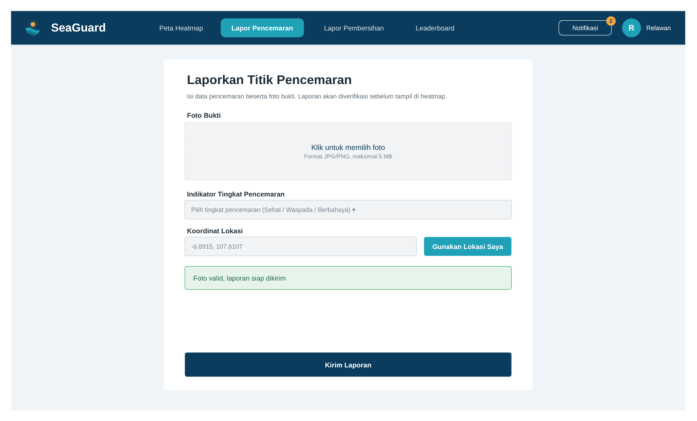
</p>
<p align="center">
<i>Gambar 6.1. Rancangan Antarmuka I-01 - Form Laporan Pencemaran</i>
</p>

Tabel 6.1. Spesifikasi Objek Antarmuka I-01

| Id_Objek | Jenis | Konten | Keterangan |
| :--- | :--- | :--- | :--- |
| *I01-01* | *Upload Box* | *Klik untuk memilih foto (JPG/PNG, maksimal 5 MB)* | Menerima foto bukti melalui `isiFormLaporan()`, lalu memanggil `validasiBukti()` pada *PelaporanController* (Algo-001). |
| *I01-02* | *Dropdown* | *Indikator Tingkat Pencemaran: Sehat / Waspada / Berbahaya* | Menerima indikator kualitatif tingkat pencemaran (KF01). |
| *I01-03* | *Text Box* | *Koordinat Lokasi* | Menampilkan koordinat GPS yang diambil otomatis; dapat diisi oleh pengguna (KF01). |
| *I01-04* | *Button* | *Gunakan Lokasi Saya* | Memanggil `ambilKoordinatGPS()` melalui Geolocation API browser (KF02). Saat pertama kali, menampilkan I-02. |
| *I01-05* | *Label Pesan* | *Foto valid, laporan siap dikirim / Format atau ukuran foto tidak valid* | Ditampilkan melalui `tampilkanPesan()` sesuai hasil validasi foto. |
| *I01-06* | *Button* | *Kirim Laporan* | Memanggil `kirimLaporan()` lalu `prosesLaporan()` pada *PelaporanController*; menampilkan pesan "Laporan terkirim, menunggu verifikasi". |
| *NAV-01* | *Menu* | *Peta Heatmap* | Membuka I-03 melalui `bukaMenuHeatmap()` pada *HeatmapView*. |
| *NAV-02* | *Menu* | *Lapor Pencemaran* | Membuka I-01 melalui `bukaFormLaporan()` pada *PelaporanView*. |
| *NAV-03* | *Menu* | *Lapor Pembersihan* | Membuka I-04 melalui `bukaMenuPembersihan()` pada *PembersihanView*. |
| *NAV-04* | *Menu* | *Leaderboard* | Membuka I-07 melalui `bukaMenuLeaderboard()` pada *LeaderboardView*. |
| *NAV-05* | *Label notifikasi* | *Notifikasi* | Menampilkan jumlah notifikasi in-app hasil verifikasi yang dikirim oleh *Notifikasi* (`kirimNotifikasi()`). |

## 6.2 Rancangan Antarmuka I-02

**Antarmuka:** *I-02*  
**Nama Layar:** *Dialog Persetujuan Akses Lokasi dan Kamera*  
**Kelas View:** *PelaporanView* (UC01)

<p align="center">
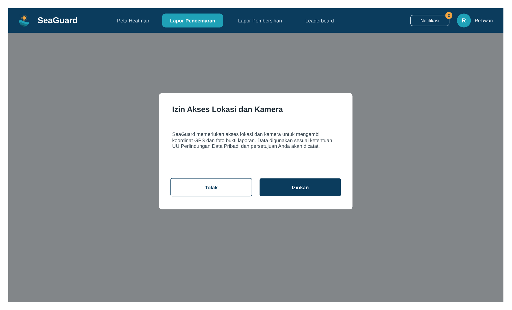
</p>
<p align="center">
<i>Gambar 6.2. Rancangan Antarmuka I-02 - Dialog Persetujuan Akses Lokasi dan Kamera</i>
</p>

Tabel 6.2. Spesifikasi Objek Antarmuka I-02

| Id_Objek | Jenis | Konten | Keterangan |
| :--- | :--- | :--- | :--- |
| *I02-01* | *Dialog* | *Izin Akses Lokasi dan Kamera* | Ditampilkan saat pengguna pertama kali mengakses fitur yang memerlukan kamera atau lokasi (KF05). |
| *I02-02* | *Label* | *Penjelasan penggunaan data sesuai UU PDP* | Menjelaskan alasan akses lokasi dan kamera. |
| *I02-03* | *Button* | *Izinkan* | Mencatat persetujuan pengguna (KNF02), menutup dialog, dan melanjutkan `ambilKoordinatGPS()`. |
| *I02-04* | *Button* | *Tolak* | Menutup dialog tanpa mengakses lokasi dan kamera; pengguna kembali ke I-01. |

## 6.3 Rancangan Antarmuka I-03

**Antarmuka:** *I-03*  
**Nama Layar:** *Peta Heatmap Pencemaran*  
**Kelas View:** *HeatmapView* (UC02, UC04)

<p align="center">
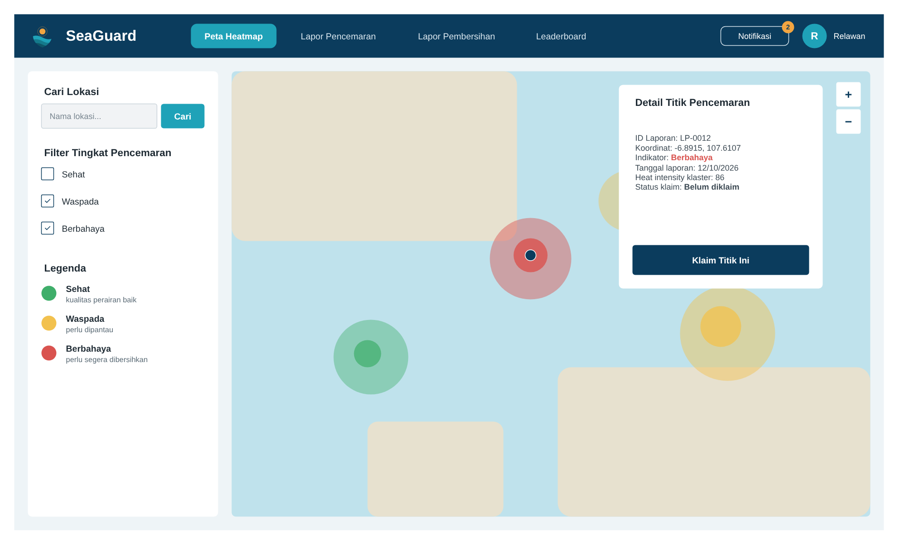
</p>
<p align="center">
<i>Gambar 6.3. Rancangan Antarmuka I-03 - Peta Heatmap Pencemaran</i>
</p>

Tabel 6.3. Spesifikasi Objek Antarmuka I-03

| Id_Objek | Jenis | Konten | Keterangan |
| :--- | :--- | :--- | :--- |
| *I03-01* | *Text Box* | *Nama lokasi...* | Menerima kata kunci lokasi melalui `inputLokasi()`. |
| *I03-02* | *Button* | *Cari* | Memanggil `cariLokasi()` pada *HeatmapController*; peta difokuskan melalui `fokuskanPeta()` atau muncul pesan "Lokasi tidak ditemukan". |
| *I03-03* | *Checkbox* | *Sehat / Waspada / Berbahaya* | Memanggil `pilihFilter()` lalu `terapkanFilter()`; jika kosong muncul pesan "Tidak ada data untuk tingkat pencemaran ini" (KF07). |
| *I03-04* | *Legenda* | *Sehat, Waspada, Berbahaya beserta warnanya* | Menjelaskan arti warna heatmap (KF06, KNF10). |
| *I03-05* | *Map* | *Peta dasar dan layer heatmap* | Dimuat melalui `muatPetaDasar()` dan `ambilDataHeatmap()` (Algo-002). Memilih titik memanggil `pilihTitik()` / `pilihTitikUntukKlaim()`. |
| *I03-06* | *Button* | *+ / −* | Memperbesar atau memperkecil tampilan peta. |
| *I03-07* | *Panel* | *Detail Titik Pencemaran* | Menampilkan detail laporan, klaster, dan status klaim melalui `tampilkanDetailPencemaran()` dan `tampilkanDetailKlaim()`. |
| *I03-08* | *Button* | *Klaim Titik Ini* | Memanggil `tekanKlaim()` lalu `klaimTitik()` pada *KlaimController* (Algo-003); menampilkan pesan "Titik berhasil diklaim" atau "Titik sudah diklaim pengguna lain". |
| *NAV-01* | *Menu* | *Peta Heatmap* | Membuka I-03 melalui `bukaMenuHeatmap()` pada *HeatmapView*. |
| *NAV-02* | *Menu* | *Lapor Pencemaran* | Membuka I-01 melalui `bukaFormLaporan()` pada *PelaporanView*. |
| *NAV-03* | *Menu* | *Lapor Pembersihan* | Membuka I-04 melalui `bukaMenuPembersihan()` pada *PembersihanView*. |
| *NAV-04* | *Menu* | *Leaderboard* | Membuka I-07 melalui `bukaMenuLeaderboard()` pada *LeaderboardView*. |
| *NAV-05* | *Label notifikasi* | *Notifikasi* | Menampilkan jumlah notifikasi in-app hasil verifikasi yang dikirim oleh *Notifikasi* (`kirimNotifikasi()`). |

## 6.4 Rancangan Antarmuka I-04

**Antarmuka:** *I-04*  
**Nama Layar:** *Form Laporan Pembersihan*  
**Kelas View:** *PembersihanView* (UC05)

<p align="center">
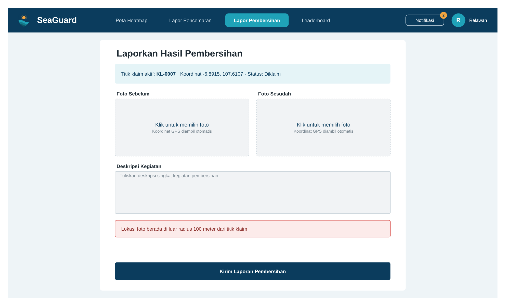
</p>
<p align="center">
<i>Gambar 6.4. Rancangan Antarmuka I-04 - Form Laporan Pembersihan</i>
</p>

Tabel 6.4. Spesifikasi Objek Antarmuka I-04

| Id_Objek | Jenis | Konten | Keterangan |
| :--- | :--- | :--- | :--- |
| *I04-01* | *Label* | *Titik klaim aktif beserta koordinat dan status* | Menampilkan titik klaim milik Relawan yang menjadi acuan geofencing. |
| *I04-02* | *Upload Box* | *Foto Sebelum* | Menerima foto sebelum pembersihan; koordinat GPS diambil melalui `ambilKoordinatGPS()`. |
| *I04-03* | *Upload Box* | *Foto Sesudah* | Menerima foto sesudah pembersihan; koordinat GPS diambil melalui `ambilKoordinatGPS()`. |
| *I04-04* | *Text Area* | *Deskripsi Kegiatan* | Menerima deskripsi singkat kegiatan (KF13). |
| *I04-05* | *Label Pesan* | *Lokasi foto sesuai / Lokasi foto berada di luar radius 100 meter dari titik klaim* | Ditampilkan melalui `tampilkanPesan()` sesuai hasil `validasiBukti()` (Algo-004). |
| *I04-06* | *Button* | *Kirim Laporan Pembersihan* | Memanggil `kirimLaporan()` lalu `prosesLaporanPembersihan()`; status klaim berubah menjadi "Menunggu Verifikasi". |
| *NAV-01* | *Menu* | *Peta Heatmap* | Membuka I-03 melalui `bukaMenuHeatmap()` pada *HeatmapView*. |
| *NAV-02* | *Menu* | *Lapor Pencemaran* | Membuka I-01 melalui `bukaFormLaporan()` pada *PelaporanView*. |
| *NAV-03* | *Menu* | *Lapor Pembersihan* | Membuka I-04 melalui `bukaMenuPembersihan()` pada *PembersihanView*. |
| *NAV-04* | *Menu* | *Leaderboard* | Membuka I-07 melalui `bukaMenuLeaderboard()` pada *LeaderboardView*. |
| *NAV-05* | *Label notifikasi* | *Notifikasi* | Menampilkan jumlah notifikasi in-app hasil verifikasi yang dikirim oleh *Notifikasi* (`kirimNotifikasi()`). |

## 6.5 Rancangan Antarmuka I-05

**Antarmuka:** *I-05*  
**Nama Layar:** *Dashboard Verifikasi Laporan Pencemaran*  
**Kelas View:** *DashboardVerifikasiView* (UC03)

<p align="center">
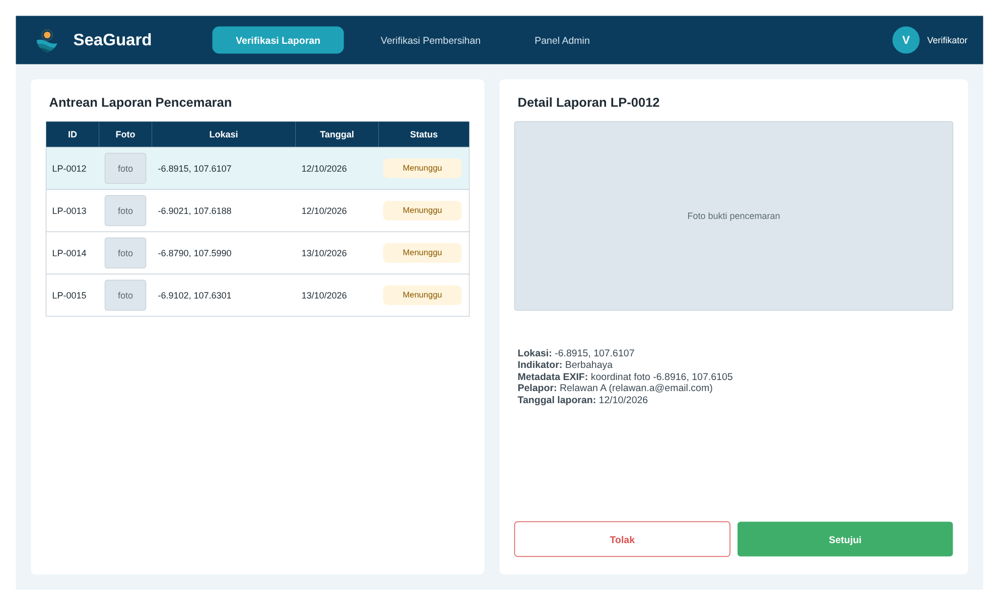
</p>
<p align="center">
<i>Gambar 6.5. Rancangan Antarmuka I-05 - Dashboard Verifikasi Laporan Pencemaran</i>
</p>

Tabel 6.5. Spesifikasi Objek Antarmuka I-05

| Id_Objek | Jenis | Konten | Keterangan |
| :--- | :--- | :--- | :--- |
| *I05-01* | *Table* | *Antrean Laporan Pencemaran (ID, Foto, Lokasi, Tanggal, Status)* | Diisi melalui `ambilAntreanLaporan()` dan `tampilkanAntrean()` (KF09). Memilih baris memanggil `pilihLaporan()`. |
| *I05-02* | *Image* | *Foto bukti pencemaran* | Menampilkan foto bukti dari `getDetailBukti()`. |
| *I05-03* | *Label* | *Lokasi, indikator, metadata EXIF, pelapor, tanggal laporan* | Ditampilkan melalui `tampilkanDetailLaporan()`. |
| *I05-04* | *Button* | *Setujui* | Memanggil `ubahStatusLaporan()` dengan status "Disetujui" lalu `prosesVerifikasiLaporan()`; notifikasi dikirim ke Relawan (KF10, KF11). |
| *I05-05* | *Button* | *Tolak* | Memanggil `ubahStatusLaporan()` dengan status "Ditolak" lalu `prosesVerifikasiLaporan()`. |
| *NAV-06* | *Menu* | *Verifikasi Laporan* | Membuka I-05 melalui `bukaDashboard()` pada *DashboardVerifikasiView*. |
| *NAV-07* | *Menu* | *Verifikasi Pembersihan* | Membuka I-06 melalui `bukaDaftarPengajuan()` pada *DashboardVerifikasiView*. |
| *NAV-08* | *Menu* | *Panel Admin* | Membuka I-08 melalui `bukaPanelPengelolaan()` pada *PanelAdminView*. |

## 6.6 Rancangan Antarmuka I-06

**Antarmuka:** *I-06*  
**Nama Layar:** *Verifikasi Hasil Pembersihan*  
**Kelas View:** *DashboardVerifikasiView* (UC06)

<p align="center">
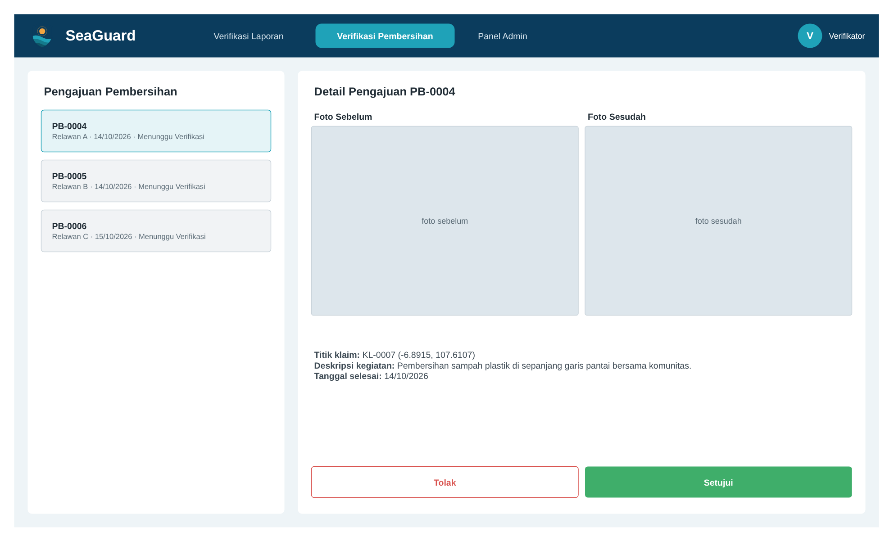
</p>
<p align="center">
<i>Gambar 6.6. Rancangan Antarmuka I-06 - Verifikasi Hasil Pembersihan</i>
</p>

Tabel 6.6. Spesifikasi Objek Antarmuka I-06

| Id_Objek | Jenis | Konten | Keterangan |
| :--- | :--- | :--- | :--- |
| *I06-01* | *List* | *Pengajuan Pembersihan* | Diisi melalui `ambilDaftarPengajuan()` dan `tampilkanDaftarPengajuan()`. Memilih item memanggil `pilihPengajuan()`. |
| *I06-02* | *Image* | *Foto Sebelum* | Ditampilkan berdampingan dengan foto sesudah melalui `tampilkanPerbandinganFoto()` (KF15). |
| *I06-03* | *Image* | *Foto Sesudah* | Ditampilkan berdampingan dengan foto sebelum (KF15). |
| *I06-04* | *Label* | *Titik klaim, deskripsi kegiatan, tanggal selesai* | Ditampilkan melalui `tampilkanDetailPengajuan()`. |
| *I06-05* | *Button* | *Setujui* | Memanggil `putuskanPengajuan()` dengan keputusan "Disetujui" lalu `prosesVerifikasiPembersihan()` (Algo-006). |
| *I06-06* | *Button* | *Tolak* | Memanggil `putuskanPengajuan()` dengan keputusan "Ditolak" lalu `prosesVerifikasiPembersihan()`. |
| *NAV-06* | *Menu* | *Verifikasi Laporan* | Membuka I-05 melalui `bukaDashboard()` pada *DashboardVerifikasiView*. |
| *NAV-07* | *Menu* | *Verifikasi Pembersihan* | Membuka I-06 melalui `bukaDaftarPengajuan()` pada *DashboardVerifikasiView*. |
| *NAV-08* | *Menu* | *Panel Admin* | Membuka I-08 melalui `bukaPanelPengelolaan()` pada *PanelAdminView*. |

## 6.7 Rancangan Antarmuka I-07

**Antarmuka:** *I-07*  
**Nama Layar:** *Leaderboard*  
**Kelas View:** *LeaderboardView* (UC07)

<p align="center">
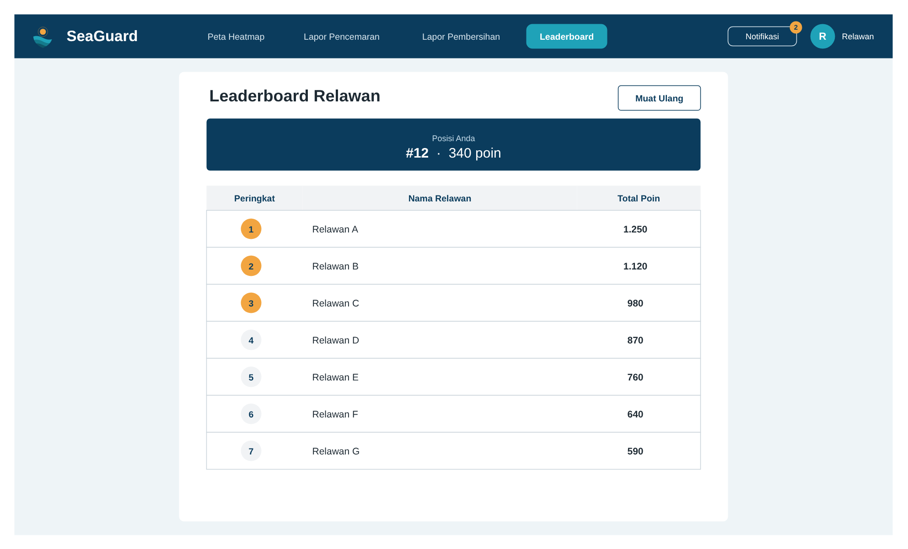
</p>
<p align="center">
<i>Gambar 6.7. Rancangan Antarmuka I-07 - Leaderboard</i>
</p>

Tabel 6.7. Spesifikasi Objek Antarmuka I-07

| Id_Objek | Jenis | Konten | Keterangan |
| :--- | :--- | :--- | :--- |
| *I07-01* | *Label* | *Posisi Anda dan total poin* | Ditampilkan melalui `ambilLeaderboard()` dan `tampilkanLeaderboard()` (KF18). |
| *I07-02* | *Table* | *Peringkat, Nama Relawan, Total Poin* | Diisi melalui `lihatDaftarPeringkat()`, `ambilDaftarPeringkat()`, dan `tampilkanDaftarPeringkat()` (Algo-008). |
| *I07-03* | *Button* | *Muat Ulang* | Memanggil `tekanRefresh()` untuk mengambil ulang data leaderboard; jika gagal muncul pesan "Gagal memuat leaderboard". |
| *NAV-01* | *Menu* | *Peta Heatmap* | Membuka I-03 melalui `bukaMenuHeatmap()` pada *HeatmapView*. |
| *NAV-02* | *Menu* | *Lapor Pencemaran* | Membuka I-01 melalui `bukaFormLaporan()` pada *PelaporanView*. |
| *NAV-03* | *Menu* | *Lapor Pembersihan* | Membuka I-04 melalui `bukaMenuPembersihan()` pada *PembersihanView*. |
| *NAV-04* | *Menu* | *Leaderboard* | Membuka I-07 melalui `bukaMenuLeaderboard()` pada *LeaderboardView*. |
| *NAV-05* | *Label notifikasi* | *Notifikasi* | Menampilkan jumlah notifikasi in-app hasil verifikasi yang dikirim oleh *Notifikasi* (`kirimNotifikasi()`). |

## 6.8 Rancangan Antarmuka I-08

**Antarmuka:** *I-08*  
**Nama Layar:** *Panel Pengelolaan Akun dan Komunitas*  
**Kelas View:** *PanelAdminView* (UC08)

<p align="center">
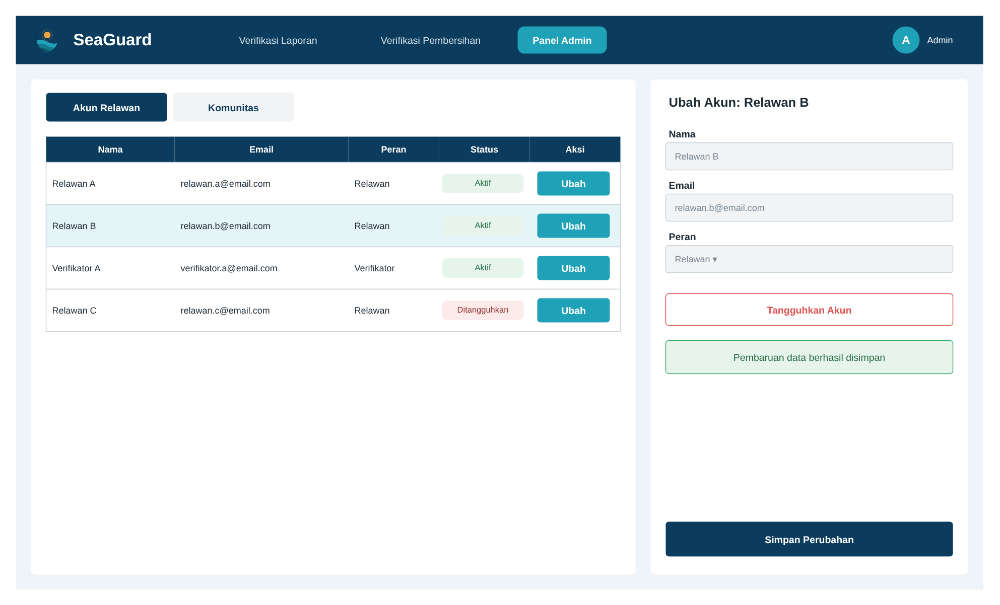
</p>
<p align="center">
<i>Gambar 6.8. Rancangan Antarmuka I-08 - Panel Pengelolaan Akun dan Komunitas</i>
</p>

Tabel 6.8. Spesifikasi Objek Antarmuka I-08

| Id_Objek | Jenis | Konten | Keterangan |
| :--- | :--- | :--- | :--- |
| *I08-01* | *Tab* | *Akun Relawan / Komunitas* | Berpindah antara daftar akun dan daftar komunitas yang diambil melalui `ambilDataAkunDanKomunitas()`. |
| *I08-02* | *Table* | *Nama, Email, Peran, Status, Aksi* | Ditampilkan melalui `tampilkanPanelPengelolaan()`. |
| *I08-03* | *Button* | *Ubah* | Memanggil `pilihEntitas()` lalu `ambilDetailEntitas()`; form ditampilkan melalui `tampilkanFormUbahAkun()` atau `tampilkanFormUbahKomunitas()`. |
| *I08-04* | *Text Box* | *Nama, Email* | Menampilkan data akun yang dipilih. |
| *I08-05* | *Dropdown* | *Peran: Relawan / Verifikator* | Mengubah peran akun melalui `ubahHakAkses()` saat disimpan. |
| *I08-06* | *Button* | *Tangguhkan Akun* | Menangguhkan akun melalui `tangguhkanAkun()` saat disimpan. |
| *I08-07* | *Label Pesan* | *Pembaruan data berhasil disimpan / Gagal memperbarui data akun/komunitas* | Ditampilkan melalui `tampilkanPesanSukses()` atau `tampilkanPesanError()`. |
| *I08-08* | *Button* | *Simpan Perubahan* | Memanggil `simpanPerubahan()` lalu `prosesPerubahanData()` pada *AdminController*. |
| *NAV-06* | *Menu* | *Verifikasi Laporan* | Membuka I-05 melalui `bukaDashboard()` pada *DashboardVerifikasiView*. |
| *NAV-07* | *Menu* | *Verifikasi Pembersihan* | Membuka I-06 melalui `bukaDaftarPengajuan()` pada *DashboardVerifikasiView*. |
| *NAV-08* | *Menu* | *Panel Admin* | Membuka I-08 melalui `bukaPanelPengelolaan()` pada *PanelAdminView*. |

## 6.9 Rancangan Antarmuka Keseluruhan

Tabel 6.9. Rancangan Antarmuka Keseluruhan

| No | Tampilan Antarmuka |
| :--- | :--- |
| *I-01* | <br>*Form Laporan Pencemaran* |
| *I-02* | <br>*Dialog Persetujuan Akses Lokasi dan Kamera* |
| *I-03* | <br>*Peta Heatmap Pencemaran* |
| *I-04* | <br>*Form Laporan Pembersihan* |
| *I-05* | <br>*Dashboard Verifikasi Laporan Pencemaran* |
| *I-06* | <br>*Verifikasi Hasil Pembersihan* |
| *I-07* | <br>*Leaderboard* |
| *I-08* | <br>*Panel Pengelolaan Akun dan Komunitas* |

<br>

---


# BAB 7: Matriks Kerunutan

Tabel 7.1. Matriks Kerunutan Kelas terhadap Use Case

| Kelas | Use Case Terkait |
| :--- | :--- |
| *C01 - LaporanPencemaran* | *UC01 - Melaporkan Titik Pencemaran*<br>*UC02 - Melihat Data dan Heatmap Pencemaran*<br>*UC03 - Memverifikasi Laporan Pencemaran*<br>*UC04 - Mengklaim Titik Pencemaran* |
| *C02 - BuktiLaporan* | *UC01 - Melaporkan Titik Pencemaran*<br>*UC03 - Memverifikasi Laporan Pencemaran* |
| *C03 - KlaimTitikPencemaran* | *UC04 - Mengklaim Titik Pencemaran*<br>*UC05 - Melaporkan Hasil Pembersihan* |
| *C04 - LaporanPembersihan* | *UC05 - Melaporkan Hasil Pembersihan*<br>*UC06 - Memverifikasi Hasil Pembersihan* |
| *C05 - BuktiPembersihan* | *UC05 - Melaporkan Hasil Pembersihan*<br>*UC06 - Memverifikasi Hasil Pembersihan* |
| *C06 - LogVerifikasi* | *UC03 - Memverifikasi Laporan Pencemaran*<br>*UC06 - Memverifikasi Hasil Pembersihan* |
| *C07 - Leaderboard* | *UC06 - Memverifikasi Hasil Pembersihan*<br>*UC07 - Melihat Leaderboard* |
| *C08 - AkunRelawan* | *UC01 - Melaporkan Titik Pencemaran*<br>*UC03 - Memverifikasi Laporan Pencemaran*<br>*UC04 - Mengklaim Titik Pencemaran*<br>*UC05 - Melaporkan Hasil Pembersihan*<br>*UC06 - Memverifikasi Hasil Pembersihan*<br>*UC07 - Melihat Leaderboard*<br>*UC08 - Mengelola Akun Relawan dan Data Komunitas* |
| *C09 - Komunitas* | *UC08 - Mengelola Akun Relawan dan Data Komunitas* |
| *C10 - PetaHeatmap* | *UC02 - Melihat Data dan Heatmap Pencemaran* |
| *C11 - PelaporanView* | *UC01 - Melaporkan Titik Pencemaran* |
| *C12 - HeatmapView* | *UC02 - Melihat Data dan Heatmap Pencemaran*<br>*UC04 - Mengklaim Titik Pencemaran* |
| *C13 - DashboardVerifikasiView* | *UC03 - Memverifikasi Laporan Pencemaran*<br>*UC06 - Memverifikasi Hasil Pembersihan* |
| *C14 - PembersihanView* | *UC05 - Melaporkan Hasil Pembersihan* |
| *C15 - LeaderboardView* | *UC07 - Melihat Leaderboard* |
| *C16 - PanelAdminView* | *UC08 - Mengelola Akun Relawan dan Data Komunitas* |
| *C17 - PelaporanController* | *UC01 - Melaporkan Titik Pencemaran* |
| *C18 - HeatmapController* | *UC02 - Melihat Data dan Heatmap Pencemaran* |
| *C19 - VerifikasiController* | *UC03 - Memverifikasi Laporan Pencemaran*<br>*UC06 - Memverifikasi Hasil Pembersihan* |
| *C20 - KlaimController* | *UC04 - Mengklaim Titik Pencemaran* |
| *C21 - PembersihanController* | *UC05 - Melaporkan Hasil Pembersihan* |
| *C22 - LeaderboardController* | *UC07 - Melihat Leaderboard* |
| *C23 - AdminController* | *UC08 - Mengelola Akun Relawan dan Data Komunitas* |
| *C24 - Notifikasi* | *UC03 - Memverifikasi Laporan Pencemaran*<br>*UC06 - Memverifikasi Hasil Pembersihan* |
| *C25 - Autentikasi* | *UC01 - Melaporkan Titik Pencemaran*<br>*UC02 - Melihat Data dan Heatmap Pencemaran*<br>*UC03 - Memverifikasi Laporan Pencemaran*<br>*UC04 - Mengklaim Titik Pencemaran*<br>*UC05 - Melaporkan Hasil Pembersihan*<br>*UC06 - Memverifikasi Hasil Pembersihan*<br>*UC07 - Melihat Leaderboard*<br>*UC08 - Mengelola Akun Relawan dan Data Komunitas* |
| *C26 - StorageAdapter* | *UC01 - Melaporkan Titik Pencemaran*<br>*UC05 - Melaporkan Hasil Pembersihan* |

---
Referensi
- Diagram: https://drive.google.com/file/d/1fiAcloAlCprb9VkNXHB0XuNEx4XPLoKW/view?usp=sharing
