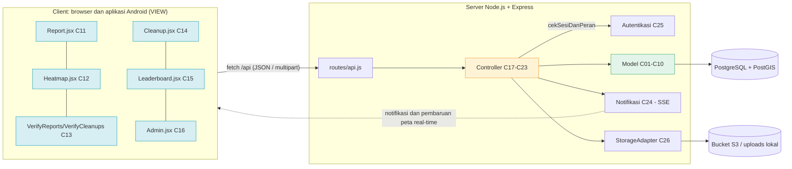

<h1>
IF2150 REKAYASA PERANGKAT LUNAK
 
TUGAS 9
 
IMPLEMENTASI PERANGKAT LUNAK
</h1>
 

## *SeaGuard*

### Untuk: *Aurelia Jennifer Gunawan*

Dipersiapkan oleh:
| Informasi | Keterangan |
| --- | --- |
| Kelas | *K02* |
| Kelompok | *G01 (Swike Karang Anyar)* |

| NIM | Nama |
|---|---|
| *13525104* | *Jeremy Gerald Sutanto* |
| *13525116* | *Christian Immanuel* |
| *13525014* | *Denzel Santoso* |
| *13525011* | *Raihan* |
| *13525125* | *Peter Emmanuel Suwardy* |
---

**Deadline:** Rabu, 11 November 2026, 21.50 WIB  
**Tag pengumpulan:** `v9.0` pada branch `main` repository public kelompok.  
**Kode sumber dan README:** [`src/`](../../src) dan [`src/README.md`](../../src/README.md)  
**Aplikasi web (deploy):** https://seaguard-app-production.up.railway.app  
**Aplikasi Android (APK):** https://seaguard-app-production.up.railway.app/download

---

# Ringkasan Implementasi

SeaGuard diimplementasikan sebagai **aplikasi web client-server dengan pola MVC** sesuai DPPL, ditambah **aplikasi Android** yang dibangun dari kode antarmuka yang sama. Seluruh **8 use case (UC01–UC08)** pada SKPL diimplementasikan, bersama **21 kebutuhan fungsional (KF01–KF21)** dan kebutuhan non-fungsional yang dapat diuji (Tabel R.2). Aplikasi dapat dijalankan lokal tanpa akun layanan apa pun (basis data PostGIS lewat Docker Compose, foto disimpan di folder lokal), dan versi produksinya berjalan di Railway.

| Lapisan | Teknologi |
| :--- | :--- |
| View (C11–C16) | React 19 + Vite 8, peta MapLibre GL 6 (ubin OpenFreeMap), ikon lucide-react, dua bahasa (Inggris/Indonesia) |
| Aplikasi Android | Capacitor 8 (kode React yang sama), pembaruan *over-the-air* dengan `@capgo/capacitor-updater` |
| Controller (C17–C23) dan layanan (C24–C26) | Node.js 20+, Express 5 |
| Model (C01–C10) | PostgreSQL 16 + PostGIS 3.4 (`pg`) |
| Penyimpanan foto | *Bucket* S3-compatible (Railway); folder `server/uploads/` saat dijalankan lokal |
| Hosting | Railway: layanan `seaguard-app` (Docker), `PostGIS`, dan *bucket* `seaguard-media` |

Tabel R.1. Status implementasi use case

| Use Case | Status | Kelas utama | Bukti pengujian otomatis (`src/server/tests/e2e.test.mjs`) |
| :--- | :--- | :--- | :--- |
| UC01 Melaporkan Titik Pencemaran | Selesai | C11, C17, C01, C02, C26 | laporan normal; alternatif: foto tidak valid dan lokasi di luar Indonesia (R02) |
| UC02 Melihat Data dan Heatmap | Selesai | C12, C18, C10, C01 | titik yang disetujui tampil, filter kategori, filter kosong, lokasi tidak ditemukan |
| UC03 Memverifikasi Laporan Pencemaran | Selesai | C13, C19, C06, C24 | setujui laporan, log audit dan notifikasi tercatat |
| UC04 Mengklaim Titik Pencemaran | Selesai | C12, C20, C03 | dua klaim bersamaan pada titik yang sama, tepat satu berhasil (KNF05) |
| UC05 Melaporkan Hasil Pembersihan | Selesai | C14, C21, C04, C05, C26 | foto di luar 100 m ditolak, di dalam radius diterima |
| UC06 Memverifikasi Hasil Pembersihan | Selesai | C13, C19, C04, C05, C07 | poin bertambah sesuai heat klaster, titik hilang dari heatmap |
| UC07 Melihat Leaderboard | Selesai | C15, C22, C07 | posisi pengguna tersedia setelah persetujuan |
| UC08 Mengelola Akun dan Komunitas | Selesai | C16, C23, C08, C09 | perbarui komunitas, peran Verifikator wajib instansi (R24), akun ditangguhkan langsung keluar |

Tabel R.2. Cakupan kebutuhan fungsional dan non-fungsional

| Kebutuhan | Realisasi pada implementasi |
| :--- | :--- |
| KF01–KF05 | Form pelaporan (I-01), GPS perangkat (Geolocation API / plugin Capacitor), validasi JPG/PNG ≤ 5 MB plus pemeriksaan *magic bytes*, ekstraksi EXIF (`exifr`), dialog persetujuan lokasi dan kamera (I-02) |
| KF06–KF08 | Heatmap MapLibre berwarna per kategori dengan legenda, filter kategori dan area, pencarian tempat dengan saran, heat intensity per klaster (Algo-002) |
| KF09–KF11 | Antrean verifikasi, setujui/tolak dengan alasan, teguran opsional, notifikasi in-app real-time (SSE) |
| KF12 | Klaim titik dengan penguncian baris (`SELECT … FOR UPDATE`) |
| KF13–KF16 | Form pembersihan, geofencing 100 m, foto sebelum dan sesudah berdampingan, setujui/tolak |
| KF17 | Log audit `log_verifikasi` |
| KF18–KF19 | Posisi dan total poin pengguna; peringkat dihitung ulang setelah persetujuan |
| KF20–KF21 | Panel admin: peran, penangguhan, data komunitas |
| KNF01 | `StorageAdapter.unggahFoto` mencoba ulang maksimal 3 kali; klien juga mengulang unggahan |
| KNF02 | Tabel `consent_log` mencatat izin dan penolakan |
| KNF03 | Heatmap 10.000 titik dalam batas 3 detik; lihat B.2.1 |
| KNF04 | Notifikasi dikirim lewat Server-Sent Events saat keputusan dibuat; tidak diukur otomatis |
| KNF05 | `SELECT … FOR UPDATE` dan *unique index* parsial; diuji dengan dua klaim bersamaan |
| KNF06 | Geofencing 100 m dengan toleransi 10 m; diuji |
| KNF07 | *Trigger* menolak `UPDATE`/`DELETE` pada `log_verifikasi`; diuji (`tests/nfr-check.mjs`) |
| KNF08 | Setelah persetujuan, peringkat dihitung ulang dan semua klien menerima sinyal SSE untuk memuat ulang leaderboard |
| KNF09 | 5 kali gagal masuk mengunci akun 15 menit; diuji |
| KNF10 | Kategori selalu memakai titik warna dan label, target sentuh minimal 44 px, pesan galat di bawah kolom terkait, dua bahasa |
| KNF11, KNF12 | Belum diukur (lihat B.3) |

---

# BAGIAN B: Laporan Implementasi

## B.1 Perubahan dari DPPL

Tabel B.1. Perubahan dari DPPL

| No | Bagian DPPL | Rancangan Awal | Implementasi Akhir | Alasan |
| :--- | :--- | :--- | :--- | :--- |
| 1 | Subbab 2.1, Client | Web browser (HTML, CSS, JavaScript) | Aplikasi web **React 19 + Vite**, ditambah **aplikasi Android** (Capacitor 8) dari kode yang sama | Satu kode untuk web dan Android. Relawan bekerja di lapangan memakai ponsel, sehingga GPS dan kamera perangkat lebih andal lewat aplikasi. |
| 2 | Subbab 2.1, Client | Tidak ada mekanisme pembaruan | Pembaruan *over-the-air*: aplikasi mengunduh paket web terbaru (`GET /api/app/versi`, checksum SHA-256), lalu meminta pengguna memulai ulang. APK baru hanya ditawarkan bila bagian native berubah. | Pengguna tidak perlu mengunduh ulang APK untuk setiap perbaikan. |
| 3 | Subbab 2.1, DBMS | PostgreSQL v15 + PostGIS | PostgreSQL **16** + PostGIS **3.4** | Versi yang tersedia pada layanan hosting; sesuai "v15 atau terbaru". |
| 4 | Subbab 2.1 Filing System, C26 | Cloud Object Storage (contoh AWS S3) | *Bucket* S3-compatible di Railway; foto disajikan lewat URL bertanda tangan berumur pendek. Bila *bucket* tidak dikonfigurasi, foto disimpan di `server/uploads/`. | Sesuai rancangan untuk produksi; mode lokal agar asisten dapat menjalankan tanpa akun cloud. |
| 5 | C10 `cariLokasi()` (layanan peta pihak ketiga) | Satu hasil dari layanan peta | **Photon** (OSM, untuk saran saat mengetik) dengan cadangan **Nominatim** dan gazeteer lokal. Singkatan umum (BSD, PIK, Jaksel, Tangsel, Jogja, NTT, dan lain-lain) diperluas lebih dulu. Ditambah operasi `saranLokasi()` (`GET /heatmap/saran`). | Hasil pertama Nominatim sering salah tempat (mis. "BSD" mengarah ke kios di Bandung), dan pengguna lebih sering mengetik singkatan daripada nama resmi. |
| 6 | Status `LaporanPencemaran` | Menunggu Verifikasi, Disetujui, Ditolak, Diklaim | Ditambah **Dibersihkan**. Heatmap menampilkan *Disetujui* dan *Diklaim* | Titik yang sedang diklaim tetap terlihat; titik yang sudah dibersihkan hilang dari heatmap. |
| 7 | Status `KlaimTitikPencemaran` | Aktif, Menunggu Verifikasi | Ditambah **Selesai**, **Dibatalkan**, dan **Kedaluwarsa** (pekerjaan berkala tiap 10 menit, `kedaluwarsakan()`) | Melengkapi siklus klaim, termasuk batas 7 hari pada SKPL. |
| 8 | Algo-004 geofencing | `jarak ≤ 100 m` | `jarak ≤ 100 m + 10 m toleransi`, memakai `ST_Distance` pada `geography`; koordinat EXIF foto diutamakan, bila tidak ada dipakai GPS perangkat | Memenuhi KNF06 (toleransi 10 m) dan KF14. |
| 9 | C08 `ajukanKlaimTitik` / C03 `getKoordinatAcuan` | Jumlah klaim tidak dibatasi | Satu Relawan hanya boleh punya **satu klaim aktif** (*unique index* parsial) | `getKoordinatAcuan(idRelawan)` mengembalikan satu titik acuan. |
| 10 | Operasi Controller | Controller memanggil `View.tampilkan…()` | Controller **mengembalikan JSON** lewat REST; View memanggil API lalu menampilkan hasil | View berjalan di klien dan Controller di server. Alur View → Controller → Model tetap sama. |
| 11 | Atribut View `idSesi` (C11–C16) | Disimpan di View | Token sesi disimpan di cookie `HttpOnly` (web) atau token Bearer di penyimpanan aplikasi (Android); View hanya memegang data akun | Mencegah pencurian token lewat JavaScript. |
| 12 | C25 Autentikasi | Atribut `idSesi`, `jumlahGagalLogin`, `waktuKunci`; operasi `cekSesiDanPeran()` | Kolom `jumlah_gagal_login`, `waktu_kunci`, tabel `sesi` (token disimpan sebagai HMAC). Ditambah `daftar`, `login`, `logout`, `gantiPassword`, `catatConsent`, `sudahConsent`. Kata sandi di-*hash* bcrypt; percobaan masuk dibatasi 40 kali per 15 menit per alamat. | KNF09, KF05/KNF02, dan keamanan dasar memerlukan operasi tersebut. |
| 13 | Antarmuka I-01 s.d. I-08 | 8 layar | Ditambah layar **Masuk**, **Daftar** (Relawan dapat mendaftar sendiri), **pilih bahasa** pada peluncuran pertama, **profil**, **notifikasi**, **log audit**, **beranda**, dan **unduh aplikasi** | Autentikasi butuh layar masuk; pendaftaran mandiri memudahkan relawan baru, sedangkan peran Verifikator/Admin tetap hanya diberikan Admin (R24). |
| 14 | C10 `tampilkanHeatmap(): String` | Mengembalikan String | Mengembalikan objek JSON `{titik, klaster}`; `HeatmapController.ambilDataHeatmap` menambahkan daftar hotspot dan ringkasan kondisi (`papan`, `ringkasan`) | Dipakai langsung oleh peta, daftar hotspot, dan ringkasan kondisi. |
| 15 | C10 `hitungHeatIntensity()` | Dihitung saat peta diminta | Dihitung saat laporan disetujui, saat klaim berubah, dan setiap jam; hasil disimpan di `peta_heatmap`. Permintaan peta hanya membaca hasilnya. | Mempercepat pemuatan peta (B.2.1). |
| 16 | C24 Notifikasi | Tidak menyebut teknologi | **Server-Sent Events** (`GET /api/stream`) + tabel `notifikasi` | Satu arah server → klien tanpa pustaka tambahan; notifikasi tetap tersimpan saat aplikasi ditutup. |
| 17 | C08 `tambahSkorPoin` (Algo-007) | `poin = ROUND(heatIntensity)` | `poin = max(1, ROUND(heatIntensity))` | Poin minimal 1. |
| 18 | C02 `validasiFormatUkuran` (Algo-001) | Cek tipe dan ukuran | Ditambah pemeriksaan *magic bytes* JPEG/PNG; foto > 5 MB di klien diperkecil otomatis sebelum diunggah | Menolak berkas yang menyamar sebagai gambar; memudahkan foto kamera ponsel yang besar. |
| 19 | C08 `getProfilRelawan()` | Operasi tersendiri | Diwujudkan oleh `getDataRelawan()` (dipakai `GET /api/auth/saya`) | Data profil dan data relawan sama; tidak perlu dua operasi. |
| 20 | Operasi tambahan | – | Mis. `LaporanPencemaran.getRingkasan`, `setStatusDiklaim`, `setStatusDibersihkan`, `lepasKlaim`; `KlaimTitikPencemaran.getKlaimHidup`, `batalkanKlaim`, `kedaluwarsakan`, `getRiwayatKlaim`; `AkunRelawan.beriTeguran`, `aktifkanAkun`, `perbaruiDataAkun`, `setPassword`, `getStatistik`; `PetaHeatmap.getPapanHotspot` | Kebutuhan alur lengkap (melepas klaim, teguran R18, pemulihan akun, statistik profil, daftar hotspot). |
| 21 | Basis data | Tabel kelas entitas | Ditambah tabel `sesi`, `consent_log`, `teguran`, `riwayat_poin`, `notifikasi`, `rilis_aplikasi` | Mendukung autentikasi, consent log, teguran, riwayat poin, notifikasi, dan pembaruan aplikasi. |

*Seluruh 26 kelas perancangan tetap diimplementasikan; tidak ada kelas yang dihapus, digabung, atau dipecah (lihat B.5).*

## B.2 Bukti Penerapan Best Practices

Tabel B.2. Bukti Best Practices

| Praktik | Bukti | Keterangan |
| :--- | :--- | :--- |
| Branching | [Daftar branch](https://github.com/i-Jer/IF2150-RPL-K02-G01/branches) | Pengembangan dilakukan langsung di `main`, mengikuti aturan bawaan README repository. Tidak ada *feature branch* yang dipakai. |
| Semantic commit | [Riwayat commit](https://github.com/i-Jer/IF2150-RPL-K02-G01/commits/main) | Kode sumber dimasukkan dalam 19 commit per fitur dengan format `<tipe> : <deskripsi>` (`feat`, `test`, `chore`, `docs`), mis. `feat : add hotspot claim and cleanup with geofence`, `test : add end-to-end and non-functional tests`. |
| Track tasks | [Logbook](../K02_G01_Logbook.md) | GitHub Issues tidak diaktifkan pada repository ini; pembagian dan progres pekerjaan dicatat pada Logbook kelompok. |
| Pull request dan review | – | Tidak memakai pull request. |
| Pengujian | [`src/server/tests/`](../../src/server/tests) | `npm test`: **11 pengujian end-to-end, 11 lulus** pada server lokal yang baru dijalankan (pendaftaran dan masuk, penguncian akun KNF09, otorisasi 401/403, UC01 dengan foto tidak valid dan lokasi di luar Indonesia, UC03, UC02 dengan filter dan pencarian, UC04 klaim bersamaan KNF05, UC05 geofencing, UC06/UC07 poin dan peringkat, UC08 dengan aturan R24). `node tests/nfr-check.mjs`: KNF07 dan KNF03. `npm run profile`: profiling heatmap (B.2.1). |

### B.2.1 Profiling dan Optimasi

| Informasi | Keterangan |
| :--- | :--- |
| Fitur / proses yang diprofil | **Heatmap** (`GET /api/heatmap`): pengelompokan laporan menjadi klaster (`PetaHeatmap.hitungHeatIntensity`, Algo-002, `ST_ClusterDBSCAN` dengan eps 500 m) dan pembacaan lapisan peta (`PetaHeatmap.tampilkanHeatmap`). KNF03 mensyaratkan 10.000 titik ≤ 3 detik. |
| Alat | `EXPLAIN (ANALYZE)` PostgreSQL untuk waktu eksekusi di basis data, dan `process.hrtime` untuk waktu total pada skrip `src/server/tests/profile-heatmap.mjs` (`npm run profile`). Data uji: 10.000 laporan disetujui yang dibuat secara deterministik di 6 wilayah pesisir, pada basis data sementara `seaguard_bench` yang dibuat lalu dihapus. Median dari 3 kali percobaan. Diukur 13 November 2026 dari laptop ke server PostGIS di Railway (melalui internet). |
| Temuan (sebelum) | Bila klaster dihitung pada setiap permintaan peta (A), waktunya **2.457 ms**, dengan pengelompokan sendiri **1.446 ms**. `EXPLAIN ANALYZE` menunjukkan `ST_ClusterDBSCAN` atas 10.000 titik hanya **88 ms** di basis data; sisanya penulisan ulang klaster (`DELETE`/`INSERT` `peta_heatmap`, `UPDATE` 10.000 baris `id_klaster`) dan perjalanan jaringan. Pengelompokan juga mengunci tabel klaster, sehingga permintaan peta yang bersamaan akan saling menunggu. Waktu ini mendekati batas 3 detik. |
| Perbaikan | Pengelompokan dipindahkan dari permintaan peta ke saat data berubah: setelah laporan disetujui, setelah klaim dibuat atau dilepas, dan setiap jam (`server.js`, `segarkanPeta()` di `VerifikasiController`). Hasilnya disimpan di `peta_heatmap`, dan `GET /api/heatmap` hanya membaca tabel itu (B) lalu menjalankan dua kueri lapisan secara paralel. |
| Hasil (sesudah) | Membaca lapisan (B): **1.145 ms** untuk 10.000 titik dan 8.636 klaster bila diukur dari laptop, dengan waktu eksekusi pembacaan klaster di basis data **9,7 ms**. Sebagian besar waktu yang tersisa adalah pengiriman sekitar 18.000 baris melalui internet; di produksi, server dan basis data berada di jaringan privat Railway. Waktu muat peta turun sekitar **53%** dan berada di bawah batas 3 detik (KNF03). |

Tabel B.2.1. Waktu heatmap 10.000 titik (median 3 percobaan)

| Cara | Waktu total dari laptop | Waktu eksekusi di basis data |
| :--- | ---: | ---: |
| A. Hitung klaster pada setiap permintaan (sebelum) | 2.457 ms | `ST_ClusterDBSCAN`: 88 ms |
| B. Klaster disimpan, permintaan hanya membaca (sesudah) | 1.145 ms | baca klaster: 9,7 ms |

*Angka bergantung pada mesin dan jaringan. Jalankan ulang dengan `npm run profile` (lihat `src/README.md` bagian 3).*

## B.3 Kendala dan Catatan Penting

**Kendala yang dihadapi**
1. **Klaim bersamaan (KNF05):** dua relawan dapat menekan "Klaim" pada saat yang sama. Diselesaikan dengan `SELECT … FOR UPDATE` dalam transaksi ditambah *unique index* parsial, lalu dibuktikan dengan pengujian klaim bersamaan.
2. **Performa heatmap (KNF03):** pengelompokan pada setiap permintaan mendekati batas 3 detik; diselesaikan dengan menyimpan hasil klaster (B.2.1).
3. **Pencarian tempat:** layanan geocoding hanya mengembalikan satu hasil yang sering keliru untuk singkatan; diganti dengan daftar saran, peringkat jenis tempat, dan perluasan singkatan (B.1 no. 5).
4. **Pembaruan aplikasi Android:** pustaka pembaruan menolak paket tanpa checksum, sehingga APK versi 1.0.0 tidak dapat memperbarui diri. Diperbaiki pada APK 1.0.1; perangkat dengan 1.0.0 mendapat tawaran untuk memasang 1.0.1 satu kali, dan pembaruan berikutnya berjalan otomatis (diuji pada emulator Android 15 dan ponsel Android).
5. **Konsistensi status** laporan, klaim, dan pembersihan pada empat tabel ditangani dalam satu transaksi di `VerifikasiController` dan diuji end-to-end.

**Known issues / batasan**
1. Kompatibilitas browser dan perangkat (KNF12) baru diuji pada Google Chrome desktop, emulator Android 15, dan satu ponsel Samsung; ketersediaan 99% (KNF11) belum diukur.
2. Peta dasar, pencarian tempat, dan penamaan lokasi memerlukan internet (OpenFreeMap, Photon, Nominatim). Tanpa internet, pencarian memakai gazeteer lokal dan peta tampil tanpa latar.
3. Geolokasi di browser memerlukan HTTPS atau `localhost`; bila ditolak, koordinat dapat diisi manual.
4. Foto demo adalah gambar ilustrasi yang dibuat oleh skrip seed (`server/src/db/demoImage.js`), bukan foto asli.
5. Masuk dibatasi 40 percobaan per 15 menit per alamat IP; menjalankan `npm test` berulang kali pada server yang sama akan terkena batas ini.
6. Konfigurasi deploy Railway (`railway.json`) memakai format yang akan dihentikan Railway pada 1 Desember 2026 dan perlu dimigrasikan.

**Catatan untuk asisten**
1. Menjalankan lokal (tanpa akun apa pun), dari folder `src/`: `docker compose up -d`, lalu `cd server && npm install && cp .env.example .env`, `cd ../web && npm install && npx vite build`, `cd ../server && npm start`, dan buka http://localhost:8080. Skema dan data demo fiktif dibuat otomatis pada start pertama. Langkah lengkap ada di `src/README.md` bagian 2.
2. Akun uji (`src/README.md` bagian 4): Relawan `relawan1@seaguard.test` / `Relawan123!`; Relawan dengan pengajuan pembersihan menunggu `relawan2@seaguard.test` / `Relawan123!`; Verifikator `verifikator@seaguard.test` / `Verifikator123!`. Kata sandi Admin diatur lewat `SEED_ADMIN_PASSWORD` di `.env` (bila kosong, kata sandi acak dicetak di konsol saat seed). Relawan baru juga dapat mendaftar sendiri.
3. Antrean verifikasi sudah berisi laporan menunggu dan satu pengajuan pembersihan agar UC03 dan UC06 dapat langsung dicoba.
4. Untuk mencoba geofencing tanpa berada di lokasi, unggah foto berisi GPS EXIF atau izinkan lokasi perangkat; foto yang berjarak lebih dari 110 m dari titik klaim akan ditolak, dan jaraknya ditampilkan pada skala di layar pembersihan.
5. `npm test` menjalankan 11 pengujian end-to-end terhadap server yang sedang berjalan; `npm run profile` mengulang profiling B.2.1.

## B.4 Kontribusi Anggota

Tabel B.4. Kontribusi Anggota

| NIM | Nama | Modul / Fitur yang Dikerjakan | Persentase Kontribusi |
| :--- | :--- | :--- | :--- |
| *13525104* | *Jeremy Gerald Sutanto* | UC02 Heatmap dan UC04 Klaim: `PetaHeatmap`, `KlaimTitikPencemaran`, `HeatmapController`, `KlaimController`, `Geocoder`, `pages/Heatmap.jsx`, `components/MapView.jsx`; profiling heatmap | *20%* |
| *13525116* | *Christian Immanuel* | UC01 Pelaporan: `LaporanPencemaran`, `BuktiLaporan`, `PelaporanController`, `StorageAdapter`, `pages/Report.jsx`, dialog persetujuan | *20%* |
| *13525014* | *Denzel Santoso* | UC03 dan UC06 Verifikasi: `VerifikasiController`, `LogVerifikasi`, `Notifikasi` (SSE), `pages/VerifyReports.jsx`, `pages/VerifyCleanups.jsx`, halaman log audit | *20%* |
| *13525011* | *Raihan* | UC05 Pembersihan dan UC07 Leaderboard: `LaporanPembersihan`, `BuktiPembersihan`, `Leaderboard`, `PembersihanController`, `LeaderboardController`, `pages/Cleanup.jsx`, `pages/Leaderboard.jsx` | *20%* |
| *13525125* | *Peter Emmanuel Suwardy* | UC08 Admin dan akun: `AkunRelawan`, `Komunitas`, `Autentikasi`, `AdminController`, `pages/Admin.jsx`, halaman masuk/daftar; skema basis data, data demo, pengujian end-to-end | *20%* |
| | | **Total** | **100%** |

## B.5 Traceability Kelas Perancangan ke Implementasi

Kode server berada di `src/server/src/`, kode antarmuka di `src/web/src/`. Atribut kelas entitas diwujudkan sebagai kolom tabel (`snake_case`) dan properti objek (`camelCase`); operasi Model dan Controller diwujudkan sebagai metode statis dengan **nama yang sama** dengan DPPL. Operasi View diwujudkan sebagai komponen dan *handler* React.

Tabel B.5. Traceability Kelas Perancangan ke Implementasi

| ID Kelas | Nama Kelas Perancangan | Bentuk Implementasi | Lokasi (File dan Nama) | Keterangan |
| :--- | :--- | :--- | :--- | :--- |
| C01 | LaporanPencemaran | Kelas (Model) + tabel | `server/src/models/LaporanPencemaran.js` — `LaporanPencemaran`; tabel `laporan_pencemaran` | Operasi DPPL bernama sama (`buatLaporan`, `simpanLaporan`, `getLaporanTerverifikasi`, `getDetailPencemaran`, `getLokasiGPS`, `getAntreanLaporan`, `perbaruiStatusLaporan`, …). `koordinatGPS` disimpan sebagai `geography(Point)`. Ditambah `setStatusDiklaim`, `setStatusDibersihkan`, `lepasKlaim`, `getRingkasan`. |
| C02 | BuktiLaporan | Kelas (Model) + tabel | `server/src/models/BuktiLaporan.js` — `BuktiLaporan`; tabel `bukti_laporan` | `validasiFormatUkuran` = Algo-001 (+ *magic bytes*); `ekstrakMetadataEXIF` memakai `exifr`, hasil disimpan sebagai JSON pada `metadata_exif`; `simpanBukti`, `getDetailBukti`. |
| C03 | KlaimTitikPencemaran | Kelas (Model) + tabel | `server/src/models/KlaimTitikPencemaran.js` — `KlaimTitikPencemaran`; tabel `klaim_titik_pencemaran` | `kunciTitikLokasi` = Algo-003 (`SELECT … FOR UPDATE` + *unique index* parsial); `getStatusKlaim`, `getKoordinatAcuan`, `ubahStatusKlaim`. Ditambah `getKlaimHidup`, `batalkanKlaim`, `kedaluwarsakan`, `getRiwayatKlaim`. |
| C04 | LaporanPembersihan | Kelas (Model) + tabel | `server/src/models/LaporanPembersihan.js` — `LaporanPembersihan`; tabel `laporan_pembersihan` | `buatLaporanPembersihan`, `simpanLaporanPembersihan` (laporan dan bukti dalam satu transaksi), `getDaftarMenungguVerifikasi`, `getDetailPembersihan`, `setHasilVerifikasi`. |
| C05 | BuktiPembersihan | Kelas (Model) + tabel | `server/src/models/BuktiPembersihan.js` — `BuktiPembersihan`; tabel `bukti_pembersihan` | `validasiGeofencingRadius` = Algo-004 (`ST_Distance` pada `geography`, Q-004); `tampilkanPerbandinganFoto`. Jarak tiap foto disimpan di `jarak_before_m`/`jarak_after_m`. |
| C06 | LogVerifikasi | Kelas (Model) + tabel | `server/src/models/LogVerifikasi.js` — `LogVerifikasi`; tabel `log_verifikasi` | `catatLogVerifikasi`, `catatLogAudit` hanya `INSERT` (Q-009); *trigger* di `server/src/db/schema.sql` menolak perubahan (KNF07). Ditambah `catatLogAdmin`, `getLog`. |
| C07 | Leaderboard | Kelas (Model) + tabel | `server/src/models/Leaderboard.js` — `Leaderboard`; tabel `leaderboard` | `hitungUlangPeringkat`, `getPosisiPengguna`, `getDaftarPeringkat` memakai `RANK() OVER` (Q-008). Ditambah `getPeringkatKomunitas`, `getTglPembaruan`. |
| C08 | AkunRelawan | Kelas (Model) + tabel | `server/src/models/AkunRelawan.js` — `AkunRelawan`; tabel `akun_relawan` | `getDataRelawan` (juga mewujudkan `getProfilRelawan`, B.1 no. 19), `ajukanKlaimTitik`, `tambahSkorPoin` = Algo-007, `getAtributPoin`, `getDaftarAkun`, `getDetailAkun`, `ubahHakAkses`, `tangguhkanAkun`. Ditambah `buatAkun`, `aktifkanAkun`, `perbaruiDataAkun`, `beriTeguran`, `setPassword`, `getStatistik`. |
| C09 | Komunitas | Kelas (Model) + tabel | `server/src/models/Komunitas.js` — `Komunitas`; tabel `komunitas` | `getDaftarKomunitas`, `getDetailKomunitas`, `perbaruiKomunitas` (validasi nama 1–100 karakter); ditambah `simpanDataKomunitas`. |
| C10 | PetaHeatmap | Kelas (Model) + tabel + layanan | `server/src/models/PetaHeatmap.js` — `PetaHeatmap`; `server/src/services/Geocoder.js`; tabel `peta_heatmap` | `hitungHeatIntensity` = Algo-002 (`ST_ClusterDBSCAN`, Q-001), `tampilkanHeatmap`, `filterBerdasarkanKategori`, `cariLokasi` (lewat `Geocoder`), `getDetailKlaster`. Ditambah `getPapanHotspot`. |
| C11 | PelaporanView | Komponen React (View) | `web/src/pages/Report.jsx` — `Report`; `web/src/components/Consent.jsx`, `PhotoDrop.jsx`; `web/src/lib/device.js` — `ambilKoordinatGPS`; layar I-01/I-02 | `ambilKoordinatGPS` bernama sama; `kirimLaporan` = *handler* `kirim`; `tampilkanPesan` = pesan galat per kolom dan notifikasi. |
| C12 | HeatmapView | Komponen React (View) | `web/src/pages/Heatmap.jsx` — `Heatmap`, `SearchBox`, `Detail`; `web/src/components/MapView.jsx` — `MapView`; layar I-03 | `muatPetaDasar`/`tampilkanPeta` = `MapView` (MapLibre); `pilihFilter` = `Filters`; `inputLokasi`/`fokuskanPeta` = `SearchBox`; `tampilkanDetailPencemaran`/`tekanKlaim` = `Detail` (`claim`). |
| C13 | DashboardVerifikasiView | Komponen React (View) | `web/src/pages/VerifyReports.jsx`, `VerifyCleanups.jsx`; `web/src/components/Decision.jsx`; layar I-05, I-06 | Dua alur DPPL (laporan dan pembersihan) menjadi dua halaman yang memakai komponen keputusan yang sama; foto sebelum dan sesudah berdampingan. |
| C14 | PembersihanView | Komponen React (View) | `web/src/pages/Cleanup.jsx` — `Cleanup`, `GeoTrack`, `ClaimTrack`; layar I-04 | Validasi geofencing langsung (`POST /api/pembersihan/validasi`) dengan skala jarak; sisa waktu klaim 7 hari ditampilkan. |
| C15 | LeaderboardView | Komponen React (View) | `web/src/pages/Leaderboard.jsx` — `Leaderboard`; layar I-07 | `tekanRefresh` = tombol Muat ulang; pembaruan otomatis lewat SSE; gagal → pesan "Gagal memuat leaderboard". |
| C16 | PanelAdminView | Komponen React (View) | `web/src/pages/Admin.jsx` — `Admin`, `AkunForm`, `KomunitasForm`; `web/src/pages/AuditLog.jsx`; layar I-08 | Tab akun/komunitas, form ubah, pesan sukses/galat per kolom, `konfirmasiCobaLagi` = tombol coba lagi. |
| C17 | PelaporanController | Kelas (Controller) + route | `server/src/controllers/PelaporanController.js`; `server/src/routes/api.js` — `GET /pelaporan/form`, `POST /pelaporan/validasi`, `POST /pelaporan` | `ambilFormLaporan`, `validasiBukti`, `prosesLaporan`; ditambah `validasiWilayah` (R02, menolak lokasi di luar Indonesia). |
| C18 | HeatmapController | Kelas (Controller) + route | `server/src/controllers/HeatmapController.js`; `GET /heatmap`, `/heatmap/filter`, `/heatmap/cari`, `/heatmap/saran`, `/heatmap/titik/:id` | `ambilDataHeatmap`, `terapkanFilter`, `cariLokasi`, `ambilDetailTitik`; ditambah `saranLokasi`. |
| C19 | VerifikasiController | Kelas (Controller) + route | `server/src/controllers/VerifikasiController.js`; `/verifikasi/laporan[/:id]`, `/verifikasi/pembersihan[/:id]`, `/verifikasi/log` | `prosesVerifikasiPembersihan` = Algo-006 dalam satu transaksi (status, log audit, poin, peringkat, status klaim/laporan); notifikasi dikirim setelah commit. Ditambah `ambilLog`. |
| C20 | KlaimController | Kelas (Controller) + route | `server/src/controllers/KlaimController.js`; `GET/POST /klaim/:idLaporan`, `GET /klaim/saya`, `POST /klaim/batal` | `ambilDetailTitikKlaim`, `klaimTitik`; ditambah `batalkan`. |
| C21 | PembersihanController | Kelas (Controller) + route | `server/src/controllers/PembersihanController.js`; `/pembersihan/form`, `/pembersihan/validasi`, `POST /pembersihan` | `ambilFormPembersihan`, `validasiBukti` (mengambil koordinat acuan klaim lalu memanggil `validasiGeofencingRadius`), `prosesLaporanPembersihan`. |
| C22 | LeaderboardController | Kelas (Controller) + route | `server/src/controllers/LeaderboardController.js`; `/leaderboard`, `/leaderboard/peringkat` | `ambilLeaderboard`, `ambilDaftarPeringkat`. |
| C23 | AdminController | Kelas (Controller) + route | `server/src/controllers/AdminController.js`; `GET /admin`, `GET/PUT /admin/:tipe/:id` | `ambilDataAkunDanKomunitas`, `ambilDetailEntitas`, `prosesPerubahanData` (dalam transaksi; Admin tidak dapat mengubah peran atau menangguhkan akunnya sendiri). |
| C24 | Notifikasi | Layanan + tabel + SSE | `server/src/services/Notifikasi.js` — `Notifikasi`; `GET /api/stream`; klien `web/src/api/live.js` (`EventSource`); tabel `notifikasi` | `kirimNotifikasi` menyimpan ke basis data lalu mendorong event ke pengguna yang daring; `siarkan` memberi tahu semua klien saat peta atau leaderboard berubah. |
| C25 | Autentikasi | Layanan + middleware + tabel | `server/src/services/Autentikasi.js` — `cekSesiDanPeran` (Algo-005), `login`, `daftar`, …; `server/src/middleware/auth.js`; tabel `sesi`, `consent_log` | Dipanggil sebelum setiap operasi Controller yang memerlukan login. Kata sandi bcrypt; sesi lewat cookie `HttpOnly` atau token Bearer. |
| C26 | StorageAdapter | Layanan (adapter integrasi) | `server/src/services/StorageAdapter.js` — `unggahFoto`, `urlBaca` | Mengunggah ke *bucket* S3-compatible dengan 3 kali percobaan (KNF01) dan mengembalikan URL; tanpa *bucket*, menyimpan ke `server/uploads/`. |
| – | *(tambahan, bukan kelas DPPL)* | Konfigurasi, basis data, entry point, aplikasi Android | `server/src/config.js`, `server/src/db/` (skema, migrasi, seed), `server/src/app.js`, `server/src/server.js`, `web/src/App.jsx`, `web/src/lib/updater.js`, `web/android/` | Membaca konfigurasi, menjalankan migrasi dan seed, memetakan route ke Controller, navigasi per peran, serta pembaruan aplikasi Android. |

### Matriks kerunutan kelas ke use case (ringkas)

Mengikuti Tabel 7.1 DPPL tanpa perubahan: UC01 (C01, C02, C08, C11, C17, C25, C26), UC02 (C01, C10, C12, C18, C25), UC03 (C01, C02, C06, C08, C13, C19, C24, C25), UC04 (C01, C03, C08, C12, C20, C25), UC05 (C03, C04, C05, C14, C21, C25, C26), UC06 (C04, C05, C06, C07, C08, C13, C19, C24, C25), UC07 (C07, C08, C15, C22, C25), UC08 (C08, C09, C16, C23, C25).
